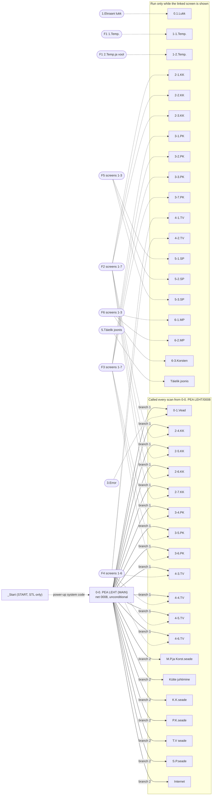

# 1. Overview, hardware, I/O and program structure

> Sources: dump folder `kk/` (vlpdump of the VisiLogic project). Net references are written `<subroutine>/<net>` and mean `ladder/! Main Module/<subroutine>/<net>.txt`. Values in `[...]` are inferred rather than read directly from the dump.

---

## 1.1 Summary of the plant and the program

The PLC controls a house heating plant with these parts:

| Area | Estonian (orig.) | Main hardware involved |
|---|---|---|
| Heat pump (main heat source) | SP = "soojuspump" | Analog set point to the heat pump (MI60, 4–20 mA), mode outputs O96 heating, O97 ECO, O98 DHW and O111 Legionella, its own circulation pump O103 with speed control MI64, change-over valves (O105, feedback I81/I82), defrost input I83 with defrost auxiliary heater O106, water-flow monitoring (MI612 → MI611 L/min) with emergency stop O99. Defrost cycles suggest [an air-source heat pump]. |
| Radiator circuit | KK = "keskküte" | Flow sensor MI34, weather curve, PID-driven 3-way valve MI61 (2–10 V), pump O100, room unit (I90/I91/I92, MI63, O108) |
| Floor heating circuit | PK = "põrandaküte" | Flow sensor MI35, curve, PID-driven 3-way valve MI62, pump O101, electric floor heating O109 |
| Domestic hot water | TV = "tarbevesi" | Sensor MI37 (4–20 mA), circulation pump O102, immersion heater O110 (feedback I87, manual mode I88), Legionella disinfection |
| Buffer tank(s) | MP = "mahupaak", large "suur MP", small "V.M.paak" [= "väike mahupaak"] | Thermocouple MI38, 4–20 mA sensor MI42, electric heater feedback I89 |
| Wood boiler | "katel", flue = "Korsten" | Flue thermocouple MI39, boiler pump O104, air damper O107 |
| Trunk line water | "Trassivesi" | Thermocouple MI40 (shown on screen only) |
| Electricity metering | "Voolumõõtja" | Pulse input I94 |

What the program does, in short (later chapters cover each function in detail):

- **Measurement.** It reads 12 analog channels, corrects them by fixed offsets and scales them (`0-0. PEA LEHT/0001`–`0003`).
- **Weather compensation.** It computes heating-curve flow set points for KK and PK (`0-0. PEA LEHT/0004`).
- **Corrections and schedules.** It applies room-unit corrections, weekly clock programmes and timers for KK, PK and TV.
- **Mixing circuits.** It runs two PID loops (library FB "PID Auto-tune", 2 instances) that drive the KK and PK 3-way valves.
- **Heat pump and outputs.** It chooses which demand (KK, PK, TV or Legionella) is sent to the heat pump as a 4–20 mA temperature request. It also switches the heat-pump mode inputs, pumps, valves and electric heaters (`Kütte juhtimine`, `*.seade` subroutines).
- **Faults.** It detects clock-programme conflicts, PID errors and low heat-pump water flow. Faults are shown on an error screen and flashed as blink codes on the room unit's backlight (`0-1.Vead`).
- **Statistics and metering.** It keeps min/max values and calculates electrical energy and power from meter pulses (`0-0. PEA LEHT/0009`–`0026`).
- **Operator interface.** A 35-screen touch HMI with backlight dimming and a screen lock (`0-0. PEA LEHT/0005`–`0007`, `0.1.Lukk`).
- **Ethernet.** Communication is set up at power-up and some values are prepared for remote logging (`Internet`).

---

## 1.2 Project metadata

| Item | Value | Source |
|---|---|---|
| VisiLogic version at creation / last save | 9.3.1 / 9.9.0 | `project.txt` |
| CreationDate (raw) | `13_04_12_19_28_28` (format ambiguous: 13 Apr 2012 or 12 Apr 2013) | `project.txt` |
| Last download recorded | 2024-06-30, user "Ergo", PLC MAC 58102815513, CardInit, SetPassword | `data/tblDownloadHistory.txt` |
| Unit ID / comms | UnitID=1. RS232 38400 Bd. CANbus 500 kBd. The EthernetSettings field contains `192.168.1.71`, `Master`, `20909`. | `project.txt` |
| HMI size in project.txt | 128×64. This is stale: the controller is a V-570 and the screens use 320×240 coordinates. | `project.txt`, `hmi/**/display.txt` |
| Function blocks | "PID Auto-tune" (FatherID 120400, title `PID A.TUNE`), instances "PID Auto-tune_1" and "_2". Methods used: CONFIG, AUTO-TUNE, RUN, READ.CC. | `data/FB_Fathers`, `FB_Instance_Details.txt`, `FB_Methods.txt` |
| Alarms / trends / data tables | Practically none: `AlarmsData` holds only a header, `PLC_DB_Blocks` has 4 empty keys, no trends. | `data/` |
| String libraries | 32 libraries (`Strings_Storage_1..16` hold data). Not decoded. | `data/Storages_Table.txt` |

---

## 1.3 Hardware

From `data/HW_Elements/HW_Elements.txt`, `data/HW_Elements_Operands.txt` and the `hardware` lines in `index.txt`:

| ElementID | Type | Model | Rail / position | Description |
|---|---|---|---|---|
| 1 | 1 = controller/panel | **V-570** | – | Unitronics Vision570 OPLC with a colour touch screen (320×240). No snap-in or built-in I/O is configured. |
| 2 | 3 = expansion | **IO-PT4x** | rail 1 / pos 1 | 4 RTD temperature inputs → MI32–MI35. IOType 51 on ch 1–2, 52 on ch 3–4. |
| 9 | 3 = expansion | **IO-ATC8** | rail 1 / pos 2 | 8 analog/thermocouple inputs → MI36–MI43. IOType 12 = 0–10 V (ch 1), 14 = current (ch 2, 7, 8), 33 = thermocouple (ch 3–6). FilterType=3 on ch 2–8. |
| 10 | 3 = expansion | **IO-AO6X** | rail 1 / pos 3 | 6 analog outputs, 5 used → MI60–MI64. IOType 17 (ch 1), 42 (ch 2–4), 16 (ch 5). Channel 6 is unused. |
| 11 | 3 = expansion | **IO-DI16** | rail 1 / pos 4 | 16 digital inputs, `InputsPNPStatus="8X1,8X1"` → I80–I95. Also a frequency/counter channel (IOGeneralType 5, IOType 10, index 1) → MI612. |
| 15 | 3 = expansion | **IO-TO16** | rail 1 / pos 5 | 16 transistor outputs, `OutputsPNPstatus="8X2,8X2"` → O96–O111. |

Notes:
- Digital channels print as `io -1` in the index. The channel order I80→I95 and O96→O111 is [inferred from consecutive addresses].
- The IOType codes are not decoded by the dump. Signal types below come from operand descriptions and the scaling in the ladder.
- Raw ranges seen in the ladder are listed below. The [unit interpretations] are inferred from the LINEAR constants and are not stated in the dump.

  | Signal | Raw range | Meaning |
  |---|---|---|
  | RTD and thermocouple inputs | – | [0.1 °C per count] |
  | ATC8 0–10 V input | 0..16383 | 14-bit |
  | ATC8 4–20 mA inputs | 3277..16383 | [4–20 mA] |
  | AO6X outputs | 0..4095 | 12-bit |
  | AO6X set points and valve signals | 819 | [the 4 mA / 2 V "live zero"] |

---

## 1.4 Complete I/O map

"Used in" lists every ladder reference from `index.txt` (subroutine/net). **(display)** marks a subroutine that runs only while its HMI screen is shown, i.e. mimic or settings logic only (see 1.5).

### 1.4.1 IO-PT4x (rail 1, pos 1) – RTD inputs

| Ch | Operand | Original description | English | Signal / processing | Used in |
|---|---|---|---|---|---|
| 1 | MI32 | "Õue temp." | Outdoor temperature | RTD, [0.1 °C]. +0.1 °C → MI196 "Õue temp. peale korrektsiooni" (outdoor temp after correction) | `0-0. PEA LEHT/0001`. MI196 → `0-0. PEA LEHT/0004`, `/0009`, `S.P.seade/0008`, HMI 1.Temp |
| 2 | MI33 | "Toa temp." | Room temperature | RTD. **−12.0 °C** → MI197 | `0-0. PEA LEHT/0001`. MI197 → `0-0. PEA LEHT/0010`, `1-1.Temp/0001`, `K.K.seade/0007, 0013, 0014, 0018, 0019` |
| 3 | MI34 | "K.Kütte temp." | Radiator (KK) flow temperature | RTD. −0.2 °C → MI198 | `0-0. PEA LEHT/0001`. MI198 → `/0011`, KK PID input `K.K.seade/0023` |
| 4 | MI35 | "P.Kütte temp." | Floor (PK) flow temperature | RTD. −0.3 °C → MI199 | `0-0. PEA LEHT/0001`. MI199 → `/0012`, PK PID input `P.K.seade/0009` |

### 1.4.2 IO-ATC8 (rail 1, pos 2) – analog / thermocouple inputs

| Ch | Operand | Original description | English | Signal / processing | Used in |
|---|---|---|---|---|---|
| 1 | MI36 | "Toa Seade (0-10V)" | Room set point (room unit) | 0–10 V, 0..16383 → MI200 "Toa Seade 11,0-30,0°C" = **10.0–30.0 °C** | `0-0. PEA LEHT/0002`. **MI200 is never read.** |
| 2 | MI37 | "T.V.Küte (4-20mA)" | DHW temperature | 4–20 mA, 3277..16383 → MI201 0–100.0 °C | `0-0. PEA LEHT/0002`. MI201 → `/0013`, `T.V seade/0001` |
| 3 | MI38 | "M.Paak (T/C type K)" | Buffer tank temperature | Thermocouple K. −4.4 °C → MI202 | `0-0. PEA LEHT/0002`. MI202 → `/0014`, `M.P.ja Korst.seade/0001` |
| 4 | MI39 | "Korsten (T/C type K)" | Chimney (boiler flue) temperature | TC K. −2.0 °C → MI203 | `0-0. PEA LEHT/0002`. MI203 → `/0015`, `M.P.ja Korst.seade/0006` |
| 5 | MI40 | "Trassivesi (T/C tipe K)" | Trunk-line water temperature | TC K. −4.0 °C → MI204 | `0-0. PEA LEHT/0002`. MI204 → `/0016`, HMI only |
| 6 | MI41 | "S. Pump  (T/C type K)" | Heat-pump temperature | TC K. −3.8 °C → MI205 | `0-0. PEA LEHT/0002`. MI205 → `/0017`, HMI only |
| 7 | MI42 | "V.M.paak(4-20mA)" | Small buffer tank temperature | 4–20 mA → MI206 0–100.0 °C | `0-0. PEA LEHT/0003`. MI206 → `/0018`, `5-1.SP/0024` (display) |
| 8 | MI43 | "Vaba (4-20mA)" | Spare | 4–20 mA → MI207 "vaba 0-100,0°C" | `0-0. PEA LEHT/0003`. MI207 → HMI 2.Temp.ja vool only |

### 1.4.3 IO-AO6X (rail 1, pos 3) – analog outputs

| Ch | Operand | Original description | English | Signal / scaling | Used in |
|---|---|---|---|---|---|
| 1 | MI60 | "Soojuspumbale" | Temperature request to the heat pump | 10–60 °C (whole degrees) → 819..4095. The program comments call this "4-20 mA". | Written: `Kütte juhtimine/0003` (KK), `/0007` (PK), `/0010` (DHW start-assist), `/0011` (DHW). Read: `5-2.SP/0005` (display, back to 10–60 °C) |
| 2 | MI61 | "K.K. 3T Ventiil (väljund O1.1)" | KK 3-way mixing valve | PID output "2-10V" = 819..4095. Forced to 819 when closed. | Written: `Kütte juhtimine/0004`. Read (valve % for mimics): `2-1.KK/0001`, `3-1.PK/0005`, `4-1.TV/0001`, `5-1.SP/0003`, `6-1.MP/0001`, `Täielik joonis/0001` |
| 3 | MI62 | "P.K. 3T Ventiil (väljund O2.0)" | PK 3-way mixing valve | As ch 2 | Written: `Kütte juhtimine/0008`. Read: `3-1.PK/0001`, `4-1.TV/0002`, `5-1.SP/0005`, `6-1.MP/0002`, `Täielik joonis/0005` |
| 4 | MI63 | "Toa temp.ja seade temp. (väljund)" | Room temperature / set point to the room unit display | LINEAR 0..500 (0–50.0 °C) → 5..2054 [≈0–5 V on a 0–10 V range]. Can also carry clock-status codes 0 / 1.0 / 2.0. | Written: `K.K.seade/0007` |
| 5 | MI64 | "SP.tsirk.pumba võimsuse juhtimine (0-20mA)" | Heat-pump circulation pump speed | 0–100 % → 0..4095. 0 when pump O103 is off. | Written: `S.P.seade/0003` |
| 6 | – | – | unused | – | – |

### 1.4.4 IO-DI16 (rail 1, pos 4) – digital inputs (+ frequency channel)

| Ch [inferred] | Operand | Original description | English | Used in |
|---|---|---|---|---|
| 0 | I80 | "SP.tsirk.pumba käivitamise käsk" | Heat-pump circulation pump start command (from the heat pump) | `S.P.seade/0001` |
| 1 | I81 | "3T Ventii suure MP. asendis" | 3-way valve in "large buffer tank" position (limit switch) | `4-1.TV/0003`, `4-5.TV/0001-0002`, `5-1.SP/0007-0008`, `6-1.MP/0003`, `K.K.seade/0029`, `P.K.seade/0015`, `S.P.seade/0001-0002`, `Täielik joonis/0012-0016` |
| 2 | I82 | "SP.3Tventiil KK/PK suunas avatud" | Heat-pump 3-way valve open towards KK/PK (space heating) | `4-1.TV/0003-0005, 0014`, `4-6.TV/0004-0005`, `5-1.SP/0002, 0009-0012`, `6-1.MP/0003`, `Kütte juhtimine/0018`, `S.P.seade/0001, 0003`, `T.V seade/0002, 0004, 0006-0009, 0012`, `Täielik joonis/0010, 0015, 0016` |
| 3 | I83 | "SP.Sulatus" | Heat pump defrosting | `5-2.SP/0006-0008, 0010`, `S.P.seade/0008-0010` |
| 4 | I84 | "Kliimaseadmest" | From the air-conditioning unit | `K.K.seade/0020`. Read inverted, starts T3 (KK block during cooling). |
| 5 | I85 | "1.Lisaküte (booster) sees" | Booster heater 1 on (feedback) | `5-1.SP/0023` (display), `Internet/0003` (logging). **Not used in control.** |
| 6 | I86 | "2.Lisaküte (booster) sees" | Booster heater 2 on | `5-1.SP/0025` (display), `Internet/0004` |
| 7 | I87 | "TV.Lisaküte sees (Immersion heater)" | DHW immersion heater on (feedback) | `4-1.TV/0010, 0012` (display), `Internet/0002` |
| 8 | I88 | "TV.Lisakütte käsirežiim" | DHW auxiliary heater manual mode | `4-1.TV/0010-0013`, `4-6.TV/0003, 0005`, `Kütte juhtimine/0012`, `T.V seade/0002, 0004-0009, 0012` |
| 9 | I89 | "MP.Elektriküte sees" | Buffer-tank electric heater on | `6-1.MP/0005-0006` (display only) |
| 10 | I90 | "Toa temp.korrektori+" | Room unit: correction + | `K.K.seade/0002, 0006` |
| 11 | I91 | "Toa temp.korrektori-" | Room unit: correction − | `K.K.seade/0002, 0006` |
| 12 | I92 | "Toa seade aktiveerimine ja veateadete nullimine" | Room unit: activate set-point adjustment and reset fault messages | `0-1.Vead/0020`, `K.K.seade/0002-0003` |
| 13 | I93 | (none) | – | **unused** |
| 14 | I94 | "Voolumõõtja" | Electricity meter pulse | `0-0. PEA LEHT/0020, 0022, 0026` |
| 15 | I95 | "SP.vee tsirkulatsiooni kontroll (sisendi sagedus Hz)" | Heat-pump water-circulation check (frequency input) | **no ladder reference**. [Its frequency arrives as MI612.] |
| freq 1 | MI612 | "Sisendi sagedus Hz (vee voolu)" | Input frequency, Hz (water flow) | `S.P.seade/0011` (FORMULA → MI611 "Veemõõtja näit L/Min"), HMI 2.SP.Seaded |

### 1.4.5 IO-TO16 (rail 1, pos 5) – transistor outputs

| Ch [inferred] | Operand | Original description | English | Written in | Also read in |
|---|---|---|---|---|---|
| 0 | O96 | "SP.kütte sisendile" | Heat pump: space-heating input | `Kütte juhtimine/0019` (T22 or T23, ECO switch off) | – |
| 1 | O97 | "küte ECO" | Heat pump: heating ECO input | `Kütte juhtimine/0019` (T22 or T23, ECO switch MB1124 on) | – |
| 2 | O98 | "SP.tarbevee kütte sisendile" | Heat pump: DHW heating input | `Kütte juhtimine/0019` (T23) | – |
| 3 | O99 | "SP. sees/väljas (vee tsirk. viga)" | Heat pump on/off (water circulation fault). On = emergency stop latched (MB617). | `S.P.seade/0015` | `5-1.SP/0026` |
| 4 | O100 | "KK.Tsirk.pump" | KK circulation pump | `K.K.seade/0029` | – |
| 5 | O101 | "PK.Tsirk.pump" | PK circulation pump | `P.K.seade/0015` | – |
| 6 | O102 | "TV.Tsirk.pump" | DHW circulation (charging) pump | `T.V seade/0009` | `T.V seade/0006, 0012` |
| 7 | O103 | "SP.Tsirk.pump" | Heat-pump circulation pump | `S.P.seade/0001` | `S.P.seade/0003, 0012` |
| 8 | O104 | "Katla pump sees/väljas" | Boiler pump on/off | `M.P.ja Korst.seade/0006` (SET/RESET) | HMI 3.Korstna Temp. Seade |
| 9 | O105 | "SP. Ventiil (sulgeb SP.ja avaneb S.MP.suunas)" | Heat-pump valve (closes the heat pump, opens towards the large buffer tank) | `S.P.seade/0007` | – |
| 10 | O106 | "Sulatuse lisaküte" | Defrost auxiliary heater | `S.P.seade/0008-0009` (SET), `/0010` (RESET) | `5-2.SP/0006-0011` |
| 11 | O107 | "Katla õhusiiber" | Boiler air damper | `M.P.ja Korst.seade/0006, 0009` (SET), `/0007, 0010` (RESET) | `M.P.ja Korst.seade/0008-0009`, HMI 4.Seadmete valikud, 1.MP.jaKatla joonis |
| 12 | O108 | "Lisaekraani valgustus" | Additional (room-unit) display backlight | `0-1.Vead/0033` | – |
| 13 | O109 | "EL.Põrandaküte" | Electric floor heating | `P.K.seade/0004` | – |
| 14 | O110 | "TV.lisaküte" | DHW auxiliary (immersion) heater | `T.V seade/0012` | – |
| 15 | O111 | "Legionella bakteri hävitus" | Legionella disinfection (to heat pump) | `Kütte juhtimine/0019` (MB522) | – |

---

## 1.5 Program structure

### 1.5.1 Main routine `0-0. PEA LEHT` ("main page"), 30 nets

`subroutine.txt`: `SUBROUTINE "0-0. PEA LEHT" MAIN`. None of the nets has a condition in front of its main action, so every net runs on every scan.

| Net | Comment (original → English) | What it does |
|---|---|---|
| 0001 | "Termoanturite via korrektsioon" → thermo-sensor error correction ("via" is a typo for "vea") | MI196 = MI32 + 1. MI197 = MI33 − 120. MI198 = MI34 − 2. MI199 = MI35 − 3 (0.1 °C). |
| 0002 | – | MI200 = LINEAR(0→100, 16383→300, MI36) (room set point 10.0–30.0 °C). MI201 = LINEAR(3277→0, 16383→1000, MI37). MI202 = MI38 − 44. MI203 = MI39 − 20. MI204 = MI40 − 40. MI205 = MI41 − 38. |
| 0003 | – | MI206 and MI207: 4–20 mA (3277..16383) → 0–100.0 °C |
| 0004 | "KK.jaPK.temperatuuri graafikud" → KK and PK temperature curves | MI190 = LINEAR(−20.0 °C→55.0, +15.0 °C→25.0, MI196). MI191 = LINEAR(−20.0→45.0, +15.0→35.0, MI196). No clamping in this net. |
| 0005 | "Ekraani valgustuse aktiveerija" → screen backlight activator | Touch rising edge SB16 → buzzer SB310 (1 scan) and T1. Or MB1 "Ekraani luku välja lülitamine" (screen lock disabled) → T1 held on. |
| 0006 | "Ekraani valgustuse valikud" → backlight options | T1 running → SI9 (backlight) := 100. T1 elapsed and SI9 > 0 → every 100 ms (rising edge of SB7) SI9 −= 2 and pulse MB1103 "tagasi luku aknasse" (back to lock window). |
| 0007 | – | Rising edge of MB1103 and SI9 = 0 → `JUMP_TO_HMI_PAGE "1.Ekraani lukk"` (screen lock) |
| 0008 | "Pidevalt töötavad lisalehed" → continuously running sub-pages | Calls the 19 cyclic subroutines (see 1.5.2) |
| 0009–0018 | "MIN/MAX Temperatuuride salvestamine" → min/max temperature recording | Min/max trackers for 10 temperatures (see 1.7.2) |
| 0019 | "MIN/MAX Kw/h salvestamine" → min/max of hourly energy | Min/max of MI21 |
| 0020 | "Voolumõõtja Kw/h" → electricity meter | Counts I94 pulses into MI20. Hourly: MI21 := MI20 × 2, MI20 := 0. |
| 0021 | – | MB3 "Täistunni impulss." (full-hour pulse) := (SI36 minute = 0) |
| 0022 | "Hetke tarbimine" → instantaneous consumption | On an I94 pulse: DW20 := SDW43 (10 ms tick counter). MI24 := MI23. |
| 0023 | – | DW21 := SDW43 − DW20. MI22 := DW21 (truncated to 16 bits). |
| 0024 | – | If MI22 > 0: MI23 := 720000 / MI22 (W) |
| 0025 | – | Display value MI25 (see 1.7.1) |
| 0026 | – | MB1176 "Voolumõõtja impulss" := I94 (blinking pulse symbol on the HMI) |
| 0027 | "Alati sees MB 0. Kasutusel mitte vajaminevate nuppude jaoks" → always-on MB0, for buttons that are not needed | SET MB0 "Alati sisse lülitatud." (no readers) |
| 0028 | "Informatsiooni reziimi salasõna" → Info-mode password | `SET_INFO_PASS(MI27) => MB7` (blob) |
| 0029 | "Hetke aeg DW" → current time DW | `RTC_TO_UTC(SI30) => DW0` "Hetke aeg sajandi algusest sekundites" (current time in seconds since the start of the century) |
| 0030 | – | `FUNCTION_RETURN` |

### 1.5.2 Call graph

A search of all net files finds `CALL_FUNCTION` in only one place, `0-0. PEA LEHT/0008`. That net has two unconditional parallel branches of calls in series. The graph is therefore flat: no subroutine calls another one. The other subroutines run because an HMI screen links them (`LADDER "..."` in `display.txt`).

Execution order inside net 0008 (series order, branch 1 then branch 2): 0-1.Vead → 2-4.KK → 2-5.KK → 2-6.KK → 2-7.KK → 3-4.PK → 3-5.PK → 3-6.PK → 4-3.TV → 4-4.TV → 4-5.TV → 4-6.TV → M.P.ja Korst.seade → Kütte juhtimine → K.K.seade → P.K.seade → T.V seade → S.P.seade → Internet. That the top branch runs before the lower one is [assumed VisiLogic behaviour].

Because 0-1.Vead runs first, the one-scan error pulses that later subroutines write (e.g. MB331 in `2-4.KK/0006`) are seen by `0-1.Vead` on the next scan. This works because a COIL keeps its value until its net runs again.

### 1.5.3 Subroutine inventory

The number in parentheses after a screen name is its display number (= display GUID = value of SI252). Net counts include the `FUNCTION_RETURN` net.

| Subroutine | Net files | Invocation | Linked screen | Purpose |
|---|---|---|---|---|
| `0-0. PEA LEHT` | 30 | MAIN | – | Scaling, curves, backlight/lock, calls, min/max, energy metering |
| `_Start` | 3 STL | START (system) | – | VisiLogic start-up code (labels `_Start`, `_PowerUp`). Opaque. |
| `0-1.Vead` ("faults") | 34 | Called (0008) **and** linked | 3.Error (100) | Fault-screen navigation, fault latches, blink codes on the room-unit backlight O108 |
| `0.1.Lukk` ("lock") | 6 | Linked only | 1.Ekraani lukk (775) | Screen-lock padlock: hold 1 s, release to unlock |
| `1-1.Temp.` | 6 | Linked only | F1 1.Temp. (73) | Temperature overview screen: room set-point status icon, clock-active indicators |
| `1-2.Temp.` | 2 | Linked only | F1 2.Temp.ja vool (72) | Flashing "buffer tank in use" indicator |
| `2-1.KK` | 10 | Linked only | 1.KK.Joonis (74) | KK mimic: valve % (MI5), arrows, tees, pump, AC text |
| `2-2.KK` | 5 | Linked only | 2.KK.PID (101) | KK PID screen: start auto-tune, hourglass, remembers the PID screen in MI10 |
| `2-3.KK` | 7 | Linked only | 3.KK.Temp.Seaded (75) | KK temperature 1 / 2 / manual set-point editing (±) |
| `2-4.KK` | 7 | Called and linked | 4.KK.Kella Seade (76) | KK temperature-1 weekly clocks 1–2. Fault codes 1–2. |
| `2-5.KK` | 7 | Called and linked | 5.KK.Kella Seade (77) | KK temperature-2 clocks 1–2. Codes 3–4. |
| `2-6.KK` | 7 | Called and linked | 6.KK.Kella Seaded (1026) | KK temperature-2 clocks 3–4. Codes 5–6. |
| `2-7.KK` | 7 | Called and linked | 7.KK.Kella Seaded (1316) | KK temperature-2 clocks 5–6. Codes 7–8. |
| `3-1.PK` | 13 | Linked only | 1.PK.Joonis (79) | PK mimic, incl. flashing texts for electric PK and clock switching |
| `3-2.PK` | 5 | Linked only | 2.PK.PID (102) | PK PID screen (auto-tune, hourglass, MI10) |
| `3-3.PK` | 11 | Linked only | 3.PK.Temp.Seaded (80) | PK temperature 1 / 2 / correction editing. MI192 = curve in whole degrees. |
| `3-4.PK` | 10 | Called and linked | 4.PK.Kella Seade (81) | PK temperature-1 clocks 1–2 and timer T76. Codes 10–12. |
| `3-5.PK` | 10 | Called and linked | 5.PK.Kella Seade (78) | PK temperature-2 clocks 1–2 and timer T77. Codes 13–15. |
| `3-6.PK` | 3 | Called and linked | 6.PK.Lülitamine kellaga (32) | PK on/off by weekly clock (MB84) |
| `3-7.PK` | 1 | Linked only | 7.PK.Lisafunk. (333) | **Empty** (only `FUNCTION_RETURN`) |
| `4-1.TV` | 15 | Linked only | 1.TV.Joonis (82) | DHW mimic |
| `4-2.TV` | 10 | Linked only | 2.TV.Temp.Seaded (83) | DHW temperature 1 / 2 / untimed ("ajatu") set-point editing |
| `4-3.TV` | 10 | Called and linked | 3.TV.Kella Seade (84) | DHW temperature-1 clocks and timer T86. Codes 16–18. |
| `4-4.TV` | 10 | Called and linked | 4.TV.Kella Seade (85) | DHW temperature-2 clocks and timer T87. Codes 19–21. |
| `4-5.TV` | 3 | Called and linked | 5.TV.Lisafunk. (923) | Limits how long DHW heating may use the heat pump before it returns to KK/PK |
| `4-6.TV` | 12 | Called and linked | 6.TV.Legionella (952) | Legionella disinfection start and post-Legionella pause (T25/T26) |
| `5-1.SP` | 28 | Linked only | 1.SP.Joonis (89) | Heat-pump mimic: valves, manual valves, flow-meter animation, boosters |
| `5-2.SP` | 13 | Linked only | 2.SP.Seaded (88) | Heat-pump settings/info: mode, defrost heater timers, analog input display, minimum flow |
| `5-3.SP` | 7 | Linked only | 3.SP.Pumba seaded (350) | Heat-pump circulation pump speeds (KK/PK and DHW position), "SP.lisakraadid" (extra degrees) |
| `6-1.MP` | 10 | Linked only | 1.MP.jaKatla joonis (86) | Buffer tank and boiler mimic |
| `6-2.MP` | 2 | Linked only | 2.MP.Temp.Seaded (87) | Copies MP on/off settings MI164/MI165 → ML40/ML41 for display |
| `6-3.Korsten` | 2 | Linked only | 3.Korstna Temp. Seade (98) | Copies boiler-pump on/off temperatures MI167/MI168 → ML45/ML46 for display |
| `Täielik joonis` ("complete diagram") | 24 | Linked only | 5.Täielik joonis (1036) | Whole-plant mimic |
| `M.P.ja Korst.seade` | 12 | Called | – | Buffer-tank enable logic, boiler pump O104 from flue temperature, air damper O107, last pump run time |
| `Kütte juhtimine` ("heating control") | 20 | Called | – | Heat-pump temperature request MI60 (KK/PK/DHW), valve outputs MI61/MI62, heat-pump mode outputs O96/O97/O98/O111, Legionella |
| `K.K.seade` ("KK device") | 33 | Called | – | Radiator circuit: curve correction, room unit, limits, standby, AC block, PID 1, pump O100 with periodic run, PID error |
| `P.K.seade` | 19 | Called | – | Floor circuit: corrections, 50 °C limit, electric floor heating O109, PID 2, pump O101, PID error |
| `T.V seade` | 15 | Called | – | DHW: differentials, heating time limit, pump O102, immersion heater O110, start-assist temperature |
| `S.P.seade` | 18 | Called | – | Heat-pump hydraulics: pump O103 and speed MI64, valve O105, defrost heater O106, flow MI611, low-flow emergency stop O99 |
| `Internet` | 5 | Called | – | Ethernet initialisation at power-up, logging values |

Screens without a linked subroutine: `2.Avaleht` (2, home), `4.Seadmete valikud` (156, equipment options), `Vea koodid 1.` (103) and `Vea koodid 2.` (105) (fault-code legend pages).

No subroutine is completely dead: each one is either called or linked. `3-7.PK` contains no logic, though.

---

## 1.6 System subroutines

### 1.6.1 `0-1.Vead` – faults, error routing, room-unit signalling (34 nets)

Error data written by the feature subroutines:
- **MI11 "Errori tekstid"** (error texts) selects the headline text on 3.Error.
- **MI12 "Täpsustav error"** (specifying error) is the detailed code shown on 3.Error and used for "back to faulty window".

Each source pulses a "… vea teade lisaekraani jaoks" bit (fault message for the additional display) for one scan and jumps to `3.Error`.

#### Fault codes (MI12)

| MI12 | MI11 | Meaning | Raised in (condition) | Group latch | "Back to faulty window" target |
|---|---|---|---|---|---|
| 0 | 3 (PID) | KK PID error: MI324 "PID: PID Status" < 0 → MB324 | `K.K.seade/0027-0028` → MB330 | MB338 KK | `2.KK.PID` (`0-1.Vead/0002`). Latch **not** reset. |
| 1, 2 | 1 (clock) | KK temperature-1 clock 1 / 2 tried to switch on while a temperature-2 clock (MB91) is on. The switch-on is refused. | `2-4.KK/0001, 0003, 0006` → MB331 / MB332 | MB338 | `4.KK.Kella Seade` via MB65 (`/0004`, `/0006`) |
| 3, 4 | 1 | KK temperature-2 clock 1 / 2 while a temperature-1 clock (MB90) is on | `2-5.KK/0006` → MB334 / MB335 | MB338 | `5.KK.Kella Seade` via MB66 |
| 5, 6 | 1 | KK temperature-2 clock 3 / 4 while MB90 | `2-6.KK/0006` → MB2286 / MB2287 | MB338 | `6.KK.Kella Seaded` via MB2290 (`/0005`) |
| 7, 8 | 1 | KK temperature-2 clock 5 / 6 while MB90 | `2-7.KK/0006` → MB2288 / MB2289 | MB338 | `7.KK.Kella Seaded` via MB2291 |
| 9 | 3 | PK PID error (MB424) | `P.K.seade/0013-0014` → MB430 | MB438 PK | `2.PK.PID` (`/0003`). Latch **not** reset. |
| 10, 11 | 1 | PK temperature-1 clock 1 / 2 while a PK temperature-2 clock (MB94) is on and the temperature-2 timer (MB183) is off | `3-4.PK/0008` → MB431 / MB432 | MB438 | `4.PK.Kella Seade` via MB67 (`/0007`, `/0009`) |
| 12 | 1 | PK temperature-1 timer started while the temperature-2 timer (MB183) runs | `3-4.PK/0009` → MB433 | MB438 | as above |
| 13, 14 | 1 | PK temperature-2 clock 1 / 2 while MB93 is on and MB181 is off | `3-5.PK/0008` → MB434 / MB435 | MB438 | `5.PK.Kella Seade` via MB68 (`/0008`) |
| 15 | 1 | PK temperature-2 timer while the temperature-1 timer (MB181) runs | `3-5.PK/0009` → MB436 | MB438 | as above |
| 16, 17 | 1 | DHW temperature-1 clock 1 / 2 while MB97 is on and MB187 is off | `4-3.TV/0008` → MB531 / MB532 | MB538 TV | `3.TV.Kella Seade` via MB69 (`/0010`, `/0012`) |
| 18 | 1 | DHW temperature-1 timer while the temperature-2 timer runs | `4-3.TV/0009` → MB533 | MB538 | as above |
| 19, 20 | 1 | DHW temperature-2 clock 1 / 2 while MB96 is on and MB185 is off | `4-4.TV/0008` → MB534 / MB535 | MB538 | `4.TV.Kella Seade` via MB70 (`/0011`) |
| 21 | 1 | DHW temperature-2 timer while the temperature-1 timer runs | `4-4.TV/0009` → MB536 | MB538 | as above |
| 22 | 2 (heat pump) | Heat-pump compressor emergency stop: water flow ≤ minimum for T55 (180 s) → MB617 (latched) → O99 | `S.P.seade/0012-0013, 0016` → MB630 | MB638 SP | `1.SP.Joonis` via MB71 (`/0013-0014`) |

MI11 = 0 is written when the heat-pump stop is reset (`S.P.seade/0016`). The "Veemõõtja vea nullimine" (flow-meter fault reset) button MB1140 on 3.Error is visible only while MI11 = 2 (hide flag MB1141, `S.P.seade/0017`).

#### Net-by-net

| Net(s) | Function |
|---|---|
| 0001 | "Liikumine infoaknast PID KK. või PK. aknasse" (move from the info window to the KK or PK PID window). On "Tagasi" (MB1132, back) while SI252 = 103 or 105 (`Vea koodid 1/2`): SI252 := MI10. MI10 holds the PID screen that was left, stored by `2-2.KK/0004` / `3-2.PK/0004`. |
| 0002–0003 | On 3.Error (SI252 = 100), rising edge of MB1142 "Nupp errori aknast tagasi vigasesse aknasse" (back to the faulty window): MI12 = 0 → `2.KK.PID`. MI12 = 9 → `2.PK.PID`. |
| 0004–0005 | Same button with MI12 = 1–2 / 3–4 / 5–6 / 7–8 → one-scan bits MB65 / MB66 / MB2290 / MB2291, and RESET MB338 |
| 0006 | MB65 / MB66 / MB2290 / MB2291 → jump to KK clock screens 4–7 |
| 0007–0009 | MI12 = 10–12 → MB67, MI12 = 13–15 → MB68, each RESET MB438. Then jump to PK clock screens 4 / 5. |
| 0010–0012 | MI12 = 16–18 → MB69, MI12 = 19–21 → MB70, each RESET MB538. Then jump to DHW clock screens 3 / 4. |
| 0013–0014 | MI12 = 22 → MB71, RESET MB638, then jump to `1.SP.Joonis` |
| 0015–0016 | "Erinevate errorite eristamine lisaekraani jaoks" (distinguish errors for the additional display): any KK pulse (MB330–MB335, MB2286–MB2289) → reset the PK/TV/SP latches, SET MB338 "KK.errorid" |
| 0017 | Any PK pulse (MB430–MB436) → SET MB438, reset the others |
| 0018 | Any DHW pulse (MB531–MB536) → SET MB538, reset the others |
| 0019 | MB630 → SET MB638 "SP.veemõõtja error" (heat-pump flow-meter error), reset the others |
| 0020 | Rising edge of I92 (room-unit button) → reset all four latches |
| 0021–0023 | "erinevate errorite kodeerimine lisaekraani jaoks" (coding the errors for the additional display), KK group. MB340 = MB338 ∧ ¬SB3. On each rising edge MI375 "KK.errori kodeerija" (KK error coder) +1. MB339 = MB338 ∧ MI375 < 2. MB341 = MB339 ∧ SB3. MI375 is reset to 0 when ¬MB339 ∧ MI375 ≥ 4. |
| 0024–0026 | PK group: MI475, flashes while < 3, reset at ≥ 5 → MB441 |
| 0027–0029 | DHW group: MI575, flashes while < 4, reset at ≥ 6 → MB541 |
| 0030–0032 | SP group: MI675, flashes while < 5, reset at ≥ 7 → MB641 |
| 0033 | "Lisaekraani valgustuse aktiveerimine" (activate the additional display backlight): O108 = MB327 "TE15 aja pikendaja" (T15 time extender: room corrector active, 10 s) ∨ MB341 ∨ MB441 ∨ MB541 ∨ MB641 |
| 0034 | `FUNCTION_RETURN` |

#### Room-unit blink codes on O108

One counter step happens per SB3 period ([nominally 1 s], 50 % duty), and the lamp is on during the high half of SB3.

| Group | Latch | Flashes per cycle | Dark periods | Cycle length |
|---|---|---|---|---|
| KK (radiators) | MB338 | 2 | 2 | 4 periods |
| PK (floor) | MB438 | 3 | 2 | 5 |
| TV (DHW) | MB538 | 4 | 2 | 6 |
| SP (heat pump low flow) | MB638 | 5 | 2 | 7 |

Only one group is latched at a time; the newest fault wins. If two groups pulse in the same scan, the later net wins: SP > TV > PK > KK. The latches are cleared by:
- I92 on the room unit (`/0020`);
- "back to faulty window" for the clock faults and the SP fault (`/0004`–`/0013`);
- for SP only, also `S.P.seade/0014` (the SP switch MB1123 turned off, or the reset button MB1140).

While the occupant uses the room unit (T15 running), O108 is lit continuously.

### 1.6.2 `0.1.Lukk` – screen lock (linked to `1.Ekraani lukk`)

| Net | Logic |
|---|---|
| 0001 | "Ekraani lukk" (screen lock). Touching the padlock image (MB1101 "taba vajutus" = padlock press) runs T0 (1 s). |
| 0002 | T0 elapsed → SET MB1100 "taba asend" (padlock position = open; shown as an image) |
| 0003 | MB1100 ∧ SI40 (touch X coordinate) = −1, i.e. finger lifted → MB1102 "Tagasi eelmisse aknasse" (back to previous window) |
| 0004 | Rising edge of MB1102 → RESET MB1100, `LOAD_LAST_HMI_PAGE` |
| 0005 | Rising edge of MB1100 → `REFRESH_HMI_VARS` |
| 0017 | `FUNCTION_RETURN` |

Behaviour: hold the padlock for at least 1 s, release, and the panel returns to the screen shown before the lock.

### 1.6.3 `Internet` (called every scan)

| Net | Logic |
|---|---|
| 0001 | "Seadistab programmi esimese jooksu ajal interneti kaardi ja avab vajaliku pesa" (configures the Ethernet card on the first scan and opens the needed socket). On SB2 (power-up) it runs `ETH_COM_INIT` [blob], `SET_PLC_NETWORK_ID(0)`, `SET_PLC_NAME` [blob], `ETH_SOCKET_INIT` ×2 [blobs], and `SET_ETH_PASS(MI4087) => MI4086` "Interneti salasõna staatus" (internet password status). |
| 0002 | "Digitaalsete andmete teisendamine logimiseks" (converting digital data for logging): MI587 = 10 if I87 (DHW immersion heater) is on, else 0 |
| 0003 | MI585 = 11 if I85 (booster 1) is on, else 1 |
| 0004 | MI586 = 12 if I86 (booster 2) is on, else 2 |
| 0018 | `FUNCTION_RETURN` |

MI585–MI587 are not read anywhere in the ladder. The distinct offsets suggest [they are trended or logged by an external system over Ethernet] with separate levels. DW0 (net 0029 of main) is likewise [presumably for remote reading].

### 1.6.4 `1-1.Temp.` (linked to F1 `1.Temp.`)

| Net | Logic |
|---|---|
| 0001 | "Toa seade muutuuse näitamine joonisel" (show the room set-point state in the diagram). Room temperature MI197 above MI306 (set point + 0.5 °C) → MB131 "KK.korrektori -joonisel" and MI75 := 0. Below MI307 (set point − 0.5 °C) → MB130 and MI75 := 2. Otherwise (previous-scan MB130/MB131 both 0) MI75 := 1. MI75 selects an icon on 1.Temp. |
| 0002 | "Keskkütte kella märgi lüliti" (KK clock symbol switch): MB92 = (any KK clock MB75–MB78, MB2270–MB2273 on) ∧ (SB3 ∨ ¬MB390). It is steady normally and flashes while MB390 (clocks restricted, outdoor < −15 °C, `K.K.seade/0008`) is set. |
| 0003 | PK: MB95 = any PK clock/timer (MB80–MB83, MB181, MB183) ∧ (SB3 ∨ ¬MB401). Flashes while the PK curve-correction limit (max 50.0 °C) is active. |
| 0004 | DHW: MB98 = any DHW clock/timer (MB85–MB88, MB185, MB187), steady |
| 0005 | "Ekraani uuendaja" (screen refresher): falling edge of MB92/MB95/MB98 → `REFRESH_HMI_VARS` |
| 0020 | `FUNCTION_RETURN` |

### 1.6.5 `1-2.Temp.` (linked to F1 `2.Temp.ja vool`)

| Net | Logic |
|---|---|
| 0001 | "M.Paagi kasutamise teavitamine" (buffer-tank use notification): MB202 "M.Paak tähelepanu vilkumine" (buffer tank attention flashing) = (MB122 ∨ MB123 ∨ MB124 ∨ MB125 "MP manuaal blokeering") ∧ SB3. It is attached as `op6` to the MP temperature field (MI202). |
| 0017 | `FUNCTION_RETURN` |

### 1.6.6 `_Start`

`SUBROUTINE "_Start" START` with three STL strips: `stl_0001` (60 bytes), `stl_0003` (label `_Start`, 88 bytes) and `stl_0005` (label `_PowerUp`, 1516 bytes). This is VisiLogic system code and is not decodable from the dump. Power-up values that it applies (from `operands.txt`, `OprndEnablePowerUp=-1`):
- PID parameters. KK: MI315 = 200 (P band 20.0 %), MI316 = 240 s, MI317 = 10 s. PK: MI415 = 600, MI416 = 340 s, MI417 = 10 s.
- PID input range 100–700 (10.0–70.0 °C) and output range 819–4095, for both loops.
- MI27 (Info-mode password) and MI4087–MI4094 (Ethernet password).
- MI300, MB1035 = 1, SB168 = 2, SI285.

---

## 1.7 Main-routine services

### 1.7.1 Electricity metering (`0-0. PEA LEHT/0019`–`0026`)

- **Hourly energy.** I94 pulses are counted in MI20 "Voolumõõtja loendur" (meter counter) (`/0020`). MB3 "Täistunni impulss." is on for the whole minute :00 (`/0021`). On its rising edge, MI21 "Hetke näit Kw/h" (current reading kWh) := MI20 × 2 and MI20 := 0 (`/0020`).
- **Instantaneous power.** On each pulse, the 10 ms tick counter SDW43 is stored in DW20 (`/0022`). Every scan DW21 = SDW43 − DW20, and MI22 "Aeg viimasest impulsist" (time since last pulse, 10 ms units) := DW21 (`/0023`). Then MI23 "Vatid viimasest impulsist" (watts since last pulse) = 720000 / MI22 (`/0024`).
- **Pulse weight.** 720000 / (Δt in 10 ms) = 7200 / Δt[s] W corresponds to **2 Wh per pulse** [= 500 imp/kWh]. On that basis MI21 = Wh used in the past hour, i.e. the average power in W over that hour.
- **Display smoothing.** At each pulse MI24 "Eelmised vatid" (previous watts) := MI23, which at that moment is the power over the completed interval (`/0022`). While the running estimate MI23 is still above MI24 (just after a pulse), the display value MI25 "Vatid ekraanile" (watts for screen) shows MI24. Once MI23 has decayed below MI24 (no pulse for longer than the last interval), MI25 follows MI23 once a second (rising edge of SB13) (`/0025`). The display therefore decays smoothly when consumption falls.
- **HMI.** MB1176 mirrors I94 for a pulse indicator (`/0026`). MI25, MI21 and MB1176 are shown on F1 `2.Temp.ja vool`.

### 1.7.2 Min/max statistics (`0-0. PEA LEHT/0009`–`0019`)

Pattern for each value X: if X < min, min := X; if X > max, max := X. Touching the min or max field (a VAR with `touch` on the same field) sets it to the current value, i.e. resets it.

| Net | Value | Min (reset button) | Max (reset button) | Screen |
|---|---|---|---|---|
| 0009 | MI196 outdoor | MI1150 (MB1150) | MI1151 (MB1151) | 1.Temp. |
| 0010 | MI197 room | MI1152 "Tao temp min" (MB1152) | MI1153 (MB1153) | 1.Temp. |
| 0011 | MI198 KK flow | MI1156 (MB1156) | MI1157 (MB1157) | 1.Temp. |
| 0012 | MI199 PK flow | MI1158 (MB1158) | MI1159 (MB1159) | 1.Temp. |
| 0013 | MI201 DHW | MI1160 (MB1160) | MI1161 (MB1161) | 1.Temp. |
| 0014 | MI202 buffer tank | MI1162 (MB1162) | MI1163 (MB1163) | 2.Temp.ja vool |
| 0015 | MI203 chimney | MI1164 (MB1164) | MI1165 (MB1165) | 2.Temp.ja vool |
| 0016 | MI204 trunk line | MI1166 (MB1166) | MI1167 (MB1167) | 2.Temp.ja vool |
| 0017 | MI205 heat pump | MI1168 (MB1168) | MI1169 (MB1169) | 1.Temp. |
| 0018 | MI206 small buffer tank | MI1170 (MB1170) | MI1171 (MB1171) | 2.Temp.ja vool |
| 0019 | MI21 hourly energy | MI1174 (MB1174) | MI1175 (MB1175) | 2.Temp.ja vool |

There is no min/max for MI200 (room set point) or MI207 (spare).

### 1.7.3 Backlight and screen lock (`0-0. PEA LEHT/0005`–`0007` + `0.1.Lukk`)

1. Any touch (rising edge of SB16) gives a one-scan buzzer click (SB310) and triggers T1 "Heledus taimer" (brightness timer, TE, 120 s).
2. While T1 is on, SI9 (LCD backlight) = 100 %.
3. After 120 s without a touch, SI9 drops by 2 every 100 ms (SB7 edge), from 100 % to 0 in about 5 s.
4. When SI9 reaches 0 (the MB1103 pulse with SI9 = 0), the panel jumps to `1.Ekraani lukk`. Unlocking works as in 1.6.2.
5. MB1 "Ekraani luku välja lülitamine" (disable screen lock), set on `4.Seadmete valikud`, keeps T1 permanently on. The backlight then stays at 100 % and the lock never engages.

### 1.7.4 Timer register (all timers in the project)

Preset = `OprndPowerUp`/100 s. TD = on-delay, TE = extended pulse. PU-reset = `ResetTimerOnPowerUp`.

| Timer | Original description | English | Type | Preset | Used in |
|---|---|---|---|---|---|
| T0 | "Ekraani luku viide" | Screen-lock delay | TD | 1 s | `0.1.Lukk/0001-0002` |
| T1 | "Heledus taimer" | Brightness timer | TE | 120 s | `0-0. PEA LEHT/0005-0006` |
| T3 | "KK.kütte plokeeringu viide (kliima)" | KK heating block delay (AC) | TD | 60 s | `K.K.seade/0001, 0020-0021`, `2-1.KK/0009` |
| T10 | "Oote aeg" | Waiting time | TD | 900 s (15 min) | `K.K.seade/0013, 0015-0016` |
| T11 | "Imppulsi aeg" | Pulse time | TD | 1 s | `K.K.seade/0015-0016` |
| T12 | "Oote aeg" | Waiting time | TD | 1800 s (30 min) | `K.K.seade/0013, 0015-0016` |
| T13 | "Imppulsi aeg" | Pulse time | TD | 1 s | `K.K.seade/0015-0016` |
| T15 | "Toa temp. korrektor töötab" | Room-temperature corrector active | TE | 10 s | `K.K.seade/0002, 0004` |
| T16 | "Näitab toa seade muutmist kellaga" | Shows the room set-point change by clock | TE | 6 s | `K.K.seade/0002, 0007` |
| T20 | "KK.võiPK. temp.lülitamise viide" | KK/PK temperature switching delay | TD, PU-reset | 1 s | `Kütte juhtimine/0012-0015` |
| T21 | " TV.kütte alustamise temp.lülitamise viide" | DHW start temperature switching delay | TD, PU-reset | 1 s | `Kütte juhtimine/0012, 0014-0015` |
| T22 | "SP.lülitamise viide KK.või PK.järgi (kütmine)" | Heat-pump switching delay for KK/PK (heating) | TD, PU-reset | 1 s | `Kütte juhtimine/0013, 0019` |
| T23 | "SP.tarbevee kütte sisse lülitamise viide" | Heat-pump DHW heating switch-on delay | TD, PU-reset | 1 s | `Kütte juhtimine/0015, 0019` |
| T24 | "TV.Legionella tõrje imp.lõpetamine" | Legionella pulse end | TD, PU-reset | 0.4 s | `Kütte juhtimine/0017-0018` |
| T25 | "Leg.reziimi järgus pausi alustamise viide.(2min.)" | Delay before post-Legionella pause | TD | 120 s | `4-6.TV/0007-0011`, `5-1.SP/0027`, `5-2.SP/0001-0004`, `Kütte juhtimine/0012` |
| T26 | "Leg.reziimi järgus pausi aeg.(20min.)" | Post-Legionella pause time | TD | 1200 s | `4-6.TV/0008-0009` |
| T30 / T33 / T36 / T39 | "KK./PK./TV./SP.Tsirk.pumba aegrelee" | Circulation-pump time relay, idle period | TD (PU-reset, except T36) | 86400 s (24 h) | `K.K.seade/0030-0031`, `P.K.seade/0016-0017`, `T.V seade/0010-0011`, `S.P.seade/0004-0005` |
| T31 / T34 / T37 / T40 | same | Time relay, short step | TD | 0.5 s | same nets |
| T32 / T35 / T38 / T41 | "...(pumba intervall 1kuu)" / "(pump töötab)" | Pump run, label "interval 1 month" | TE | 10 s | `K.K.seade/0029-0030`, `P.K.seade/0015-0016`, `T.V seade/0009-0010`, `S.P.seade/0001, 0004` |
| T42 | "MP. sees/väljas viide" | Buffer tank on/off delay | TD | 60 s | `S.P.seade/0006-0007` |
| T43 | "Õhusiibri käsitsi avamine" | Air damper manual opening | TE, PU-reset | 3600 s (1 h) | `M.P.ja Korst.seade/0007-0010` |
| T46 | "TV.küttmise RESi viide (1min) MP.-le" | DHW heating reset delay to MP | TD | 60 s | `T.V seade/0004-0006`, `4-6.TV/0005` |
| T47 | "TV.Legionella alustamise lua viide (1min)" | Legionella start permission delay | TD, PU-reset | 60 s | `4-6.TV/0003-0004` |
| T50 | "SP.Tsirk.pumba stopi viide" | Heat-pump pump stop delay (run-on) | TE, PU-reset | 180 s | `S.P.seade/0001-0002` |
| T55 | "vee voolu min.kiiruse viide" | Minimum water-flow delay | TD | 180 s | `S.P.seade/0012-0014`, displays `4-1.TV`, `5-1.SP`, `Täielik joonis` |
| T58 / T59 | "Veemõõtja sümboli keerutaja (RES)" | Flow-meter symbol spinner | TD | 0.3 s / 0.1 s | `5-1.SP/0019-0021`, `Täielik joonis/0017-0019` |
| T70–T75 | "PK. … plussi/miinuse nupp" | PK ± button repeat | TD | 1 s | `3-3.PK/0001-0009` |
| T76 / T77 | "F3-4 1.Temp.taimer" / "F3-5 2.Temp.taimer" | PK temperature-1/2 timer | TE | set at runtime (`STORE_TIMER_PRESET`) | `3-4.PK/0005-0006`, `3-5.PK/0005-0006` |
| T80–T85 | "TV. … plussi/miinuse nupp" | DHW ± button repeat | TD | 1 s | `4-2.TV/0001-0009` |
| T86 / T87 | "F4-3 1.Temp.taimer" / "F4-4 2.Temp.taimer" | DHW temperature-1/2 timer | TE | runtime | `4-3.TV/0005-0006`, `4-4.TV/0005-0006` |
| T90 | "TV.kütte temp.lülitamise viide" | DHW heating temperature switching delay | TD, PU-reset | 240 s | `Kütte juhtimine/0014-0015` |

---

## 1.8 Glossary (Estonian terms in operand names)

| Term / abbreviation | English |
|---|---|
| KK, K.K., keskküte | Radiator (central) heating circuit |
| PK, P.K., põrandaküte | Floor heating circuit. EL.PK / elektriline PK = electric floor heating. |
| TV, T.V., tarbevesi | Domestic hot water (DHW) |
| SP, S.P., soojuspump | Heat pump |
| MP, M.P., mahupaak | Buffer tank. Suur MP / S.MP = large buffer tank. V.M.paak [= väike mahupaak] = small buffer tank. |
| katel, katla | Boiler, boiler's |
| korsten, korstna | Chimney (boiler flue) |
| trass, trassivesi | Trunk line, trunk-line water |
| õue / toa | Outdoor / room |
| seade, seaded | Set point, settings (also "device") |
| kell, kella seade | Clock, clock (time-programme) setting |
| nädal / tunnid sisse / välja / nullimine | Weekday / hours on / off / reset (end of one-minute window) |
| temp. valik, 1./2.Temp. | Temperature selection, temperature level 1 / 2 |
| ajatu | Untimed (without clock programme) |
| taimer | Timer (operator-set duration) |
| graafik | Heating curve |
| korrektsioon, korrektor | Correction, corrector |
| lisakraadid | Added degrees (offset) |
| täis kraadid, teisendamine | Whole degrees, conversion |
| pealevool / tagasivool | Supply (flow) / return |
| tsirk.pump, tsirkulatsioonipump | Circulation pump |
| 3T kraan / 3T ventiil, 2T | 3-way valve, 2-way valve |
| kraan, käsikraan, mootorkraan | Valve, manual valve, motorised valve |
| kolmik | Tee piece (in mimics) |
| õhusiiber | Air damper |
| lisaküte, booster | Auxiliary / booster heater |
| sulatus | Defrost |
| hädaseis | Emergency stop |
| veemõõtja, vee vool, voolukiirus | Water (flow) meter, water flow, flow speed |
| voolumõõtja | Electricity meter (literally "current meter") |
| vatid, Kw/h | Watts, kWh |
| kliimaseade | Air-conditioning unit |
| ooterežiim | Standby mode |
| Legionella tõrje, des. (desinfitseerimine), hävitus | Legionella control, disinfection, destruction |
| diferents | Differential (hysteresis) |
| aegrelee | Time relay |
| viide | Delay |
| impulss, loendur, kodeerija | Pulse, counter, encoder / coder |
| viga, vead, error, vea teade | Fault, faults, error, fault message |
| vigane aken | Faulty window (screen where the fault arose) |
| lisaekraan | Additional display (the room unit) |
| valgustus, heledus | Illumination / backlight, brightness |
| ekraani lukk, taba | Screen lock, padlock |
| aken, avaleht, joonis, täielik joonis | Window/screen, home page, diagram/mimic, complete diagram |
| nupp, lüliti, peitmine | Button, switch, hiding (of a button) |
| sees / väljas, SISSE / VÄLJA | On / off, switch on / switch off |
| nool, nurk, vilkumine, liivakell, hüüumärk | Arrow, corner, flashing, hourglass, exclamation mark (mimic graphics) |
| piiraja, piiramine, blokeering / plokeering | Limiter, limiting, interlock / block |
| käsirežiim, manuaal | Manual mode |
| salasõna | Password |
| informatsiooni režiim | Vision "Info mode" (system menu) |
| tähelepanu | Attention |
| hetke, eelmine | Current / instantaneous, previous |
| vaba | Free / spare |
| F1…F6, e.g. "F2-4" | HMI screen group (F1 temperatures, F2 KK, F3 PK, F4 TV, F5 SP, F6 MP/boiler) – screen number |
| T/C type K | Type-K thermocouple |
| TE15 | Timer T15 (extended-pulse type) |

---

## 1.9 Open questions and inconsistencies

**Labels that disagree with the logic**

1. **MI200 is a dead value.** The room set point from the room unit's 0–10 V signal (MI36 → MI200) is computed (`0-0. PEA LEHT/0002`) but never read. Its label "11,0-30,0°C" also disagrees with the scaling, which gives 10.0–30.0 °C. The room set point actually used is MI362, adjusted with I90/I91 in `K.K.seade`.
2. **KK curve label is wrong.** The label of MI190 says "55,0-28,0°C", but `0-0. PEA LEHT/0004` gives 25.0 °C at +15 °C outdoors. The PK curve label (45–35 °C) matches. LINEAR is not clamped in this net, so values outside −20…+15 °C are extrapolated unless later limiters catch them.
3. **"Kw/h" is really average watts.** MI21 "Hetke näit Kw/h" holds pulses × 2 per hour, i.e. Wh per hour (average W) at the 2 Wh/pulse implied by `/0024`. MI1174 and MI1175 inherit the same unit question. The HMI number format is in a blob and not readable.
4. **Pump time-relay labels.** T32/T35/T41 say "pumba intervall 1kuu" (1-month interval), but the companion idle timers T30/T33/T36/T39 are 24 h. Check against the pump chapters whether the anti-seize run is daily or monthly.
5. **Valve terminal names.** MI61/MI62 carry the labels "(väljund O1.1)" / "(väljund O2.0)", but they are AO6X channels 2 and 3. These look like old terminal names.
6. **Typos in descriptions.** MI1152 "Tao temp min" for "Toa". MB105/MB106 and MB107/MB108 have identical descriptions. T41 starts with ".Tsirk". The net comment "Termoanturite via korrektsioon" has "via" for "vea".

**Measurement**

7. **Large room-sensor correction.** MI197 = MI33 − 12.0 °C (`0-0. PEA LEHT/0001`), while the other RTD channels are corrected by 0.1–0.3 °C. This may be compensation for a different sensor type or wiring; verify on site.
8. **Power calculation overflow.** MI22 is a 16-bit copy of the 32-bit DW21 (`/0023`). After 327.67 s without a pulse it wraps, so the estimate in `/0024`–`/0025` becomes invalid below about 22 W.

**Unused or display-only signals**

9. **Inputs unused in control.**
   - I93 has no description and no reference.
   - I95 is described, but only MI612 (the frequency channel) is used. Which physical input feeds MI612 cannot be determined from the dump.
   - I85, I86, I87 (boosters, immersion heater feedback) and I89 (MP electric heater) are used only in mimic subroutines and in `Internet` logging, not in control.
10. **Measurements shown on screen only.** MI204 (trunk line), MI205 (heat pump), MI207 (spare) and MI206 (apart from the `5-1.SP` mimic) take no part in control.
11. **Write-only operands.**
    - MB0 "Alati sisse lülitatud." is set every scan (`/0027`) but never read.
    - MB7 (Info-mode status, `/0028`) is never read.
    - DW0 (`/0029`) is never read in the ladder; [presumably it is read remotely].
    - MI585–MI587 are written only (`Internet/0002-0004`).
12. **Hide flag never driven.** MB1143 "Nupu peitmine" (hide flag of the "Tagasi vigasesse aknasse" button on 3.Error) is never written by the ladder.

**Fault handling**

13. **PID faults keep the room unit flashing.** For PID faults (MI12 = 0 and 9), "back to faulty window" jumps to the PID screen but does **not** reset MB338/MB438 (`0-1.Vead/0002-0003`). The room unit keeps flashing until I92 is pressed or another group's fault replaces it. All other fault types reset their latch.
14. **SI252 may not work on this panel.** Fault navigation relies on SI252, whose system description reads "(Standard Vision only)". The controller is a V-570, and the program also uses Enhanced-Vision bits (SB92/SB94). Check that SI252 reads and writes the display number on this panel. The screen numbers 100/103/105 are hard-coded GUIDs, which is fragile if screens are recreated.
15. **Blink cycle can start dark.** MI375/MI475/MI575/MI675 are not cleared when a latch is reset. A new fault can therefore start its blink cycle in the dark phase.

**Execution**

16. **Double execution.** 0-1.Vead, 2-4…2-7.KK, 3-4…3-6.PK and 4-3…4-6.TV are both called from `0-0. PEA LEHT/0008` and linked to their screens, so they run twice per scan while that screen is shown. This is probably harmless because edges are per element, but it does re-evaluate coils and timers within the same scan.
17. **Empty linked subroutine.** `3-7.PK` (linked to `7.PK.Lisafunk.`) contains no logic.

**Opaque parts and configuration**

18. **Not decodable from the dump:**
    - the `[bin]` blobs of `SET_INFO_PASS` (`0-0. PEA LEHT/0028`), `ETH_COM_INIT`, `SET_PLC_NAME`, both `ETH_SOCKET_INIT` and `SET_ETH_PASS` (`Internet/0001`);
    - the `FORMULA` in `S.P.seade/0011` (Hz → L/min);
    - the `_Start` STL strips and the PID Auto-tune FB hex code;
    - the HMI list texts (MI11 / MI12 texts on 3.Error) and the string libraries.
19. **Unit ID mismatch.** `SET_PLC_NETWORK_ID(D#0)` in `Internet/0001` differs from UnitID=1 in `project.txt`. The `project.txt` display size (128×64) is stale for a V-570.
20. **Odd power-up values.**
    - MB1035 is the is-displayed flag of `5.PK.Kella Seade`, yet it has power-up value 1. It is read in `3-5.PK/0005`.
    - SB168 ("set to 1") has power-up value 2.
21. **Passwords stored in plain text.** The Info-mode password (MI27) and the Ethernet password (MI4087–MI4090, ASCII) are plain power-up values in `operands.txt`. Treat the project file and this dump as sensitive.
22. **Min/max start values.** The min/max registers are not initialised at power-up. They track correctly only after the operator touches the field once to reset it, or if retained memory already holds sensible values.

---
Not checked here: the internals of `K.K.seade`, `P.K.seade`, `T.V seade`, `S.P.seade`, `Kütte juhtimine` and `M.P.ja Korst.seade` (only their I/O touch points and fault outputs), and HMI navigation beyond the error and lock screens. The digital channel order, the IOType meanings, the 2 Wh/pulse figure and the execution order of parallel branches are inferred, as marked.