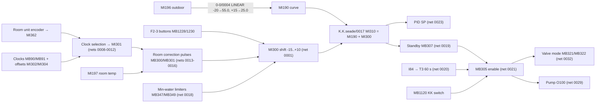
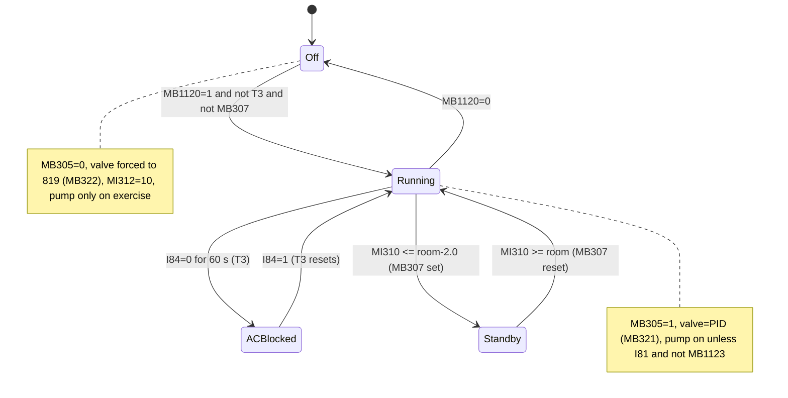
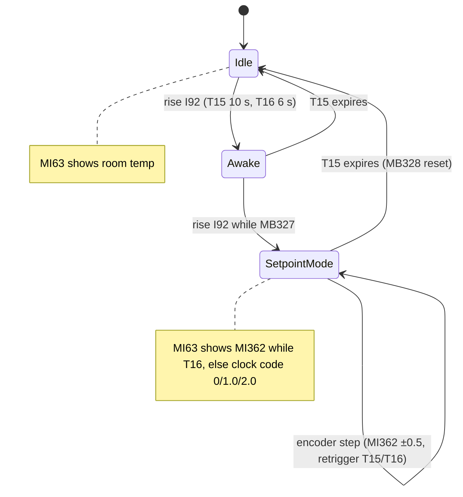
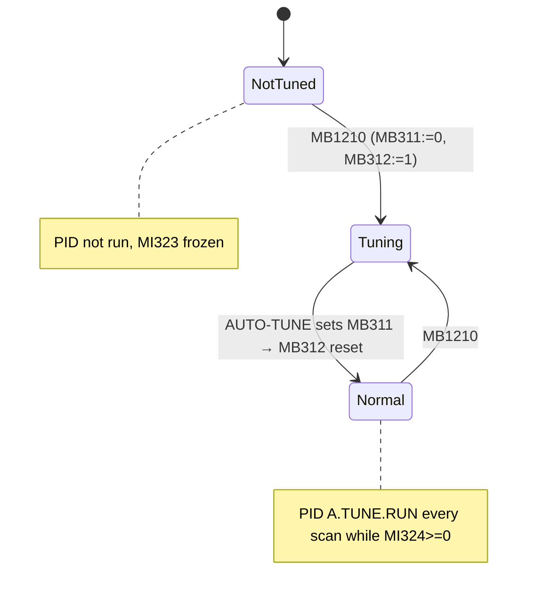
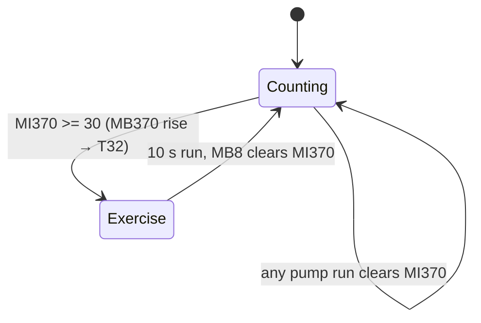

# 2. Radiator heating circuit (KK)

## 2.1 Purpose

KK (*keskküte*) is the radiator heating circuit. The PLC runs it as a weather-compensated mixing circuit with room-temperature feedback:

- **Flow set point.** An outdoor-temperature heating curve gives the base flow set point `MI190`. Two corrections are added to it: the operator's manual shift and an automatic room-temperature correction. The result is the corrected flow set point `MI310`.
- **Room set point.** The operator sets the room set point `MI362` on a wall-mounted room unit, which has a rotary encoder, a push-button and an analog display output. Two groups of weekly clock programs can shift the room set point by up to ±3.0 °C.
- **Valve control.** A PID loop with auto-tune drives the 3-way mixing valve (analog output `MI61`, 2–10 V) so that the measured flow temperature `MI198` follows `MI310`.
- **Circulation pump.** Output `O100` runs the pump. If the pump has stood still for 30 days, it is exercised for 10 s.
- **Blocking.** The circuit is blocked by the operator switch `MB1120`, by the air-conditioner signal `I84` (60 s delay) and by an automatic standby. Standby starts when the required flow temperature falls 2 °C below the room temperature.
- **Faults.** A PID failure and conflicts between the clock programs raise a KK error page and a latched error flag.

All temperatures are integers in 0.1 °C (for example 550 = 55.0 °C), unless a name says "täis kraadides" ("in whole degrees").

## 2.2 Subroutines

| Subroutine | How invoked | Purpose |
|---|---|---|
| `K.K.seade` ("KK set point / device") | `CALL_FUNCTION` from MAIN `0-0. PEA LEHT/0008`, second parallel branch, unconditional, every scan. It runs after `M.P.ja Korst.seade` and `Kütte juhtimine` and before `P.K.seade`. | All KK control: set-point chain, room unit, room correction, standby and blocking, PID, pump, valve mode. |
| `2-1.KK` | Display-linked only: `LADDER "2-1.KK"` of display `F2/1.KK.Joonis` | Animation of the KK schematic: valve position in %, valve, tee, arrow and pump images, "climate" text. |
| `2-2.KK` | Display-linked only: `F2/2.KK.PID` | Starts auto-tune, runs the hourglass animation, stores the return address for the info page. |
| `2-3.KK` | Display-linked only: `F2/3.KK.Temp.Seaded` | Plus/minus buttons for the two clock offsets `MI302` and `MI304`, button hiding at the limits, bar-graph mirrors. |
| `2-4.KK` | `CALL_FUNCTION` from `0-0. PEA LEHT/0008` (first branch, every scan) **and** display-linked (`F2/4.KK.Kella Seade`) | Clock programs 1 and 2 of temperature group 1. Output `MB90`. |
| `2-5.KK` | MAIN `0008` **and** `F2/5.KK.Kella Seade` | Clock programs 1 and 2 of temperature group 2. Writes `MB91`. |
| `2-6.KK` | MAIN `0008` **and** `F2/6.KK.Kella Seaded` | Clock programs 3 and 4 of temperature group 2. Writes `MB91`. |
| `2-7.KK` | MAIN `0008` **and** `F2/7.KK.Kella Seaded` | Clock programs 5 and 6 of temperature group 2. Writes `MB91`. |

MAIN call order in `0-0. PEA LEHT/0008`: `0-1.Vead` → `2-4.KK` → `2-5.KK` → `2-6.KK` → `2-7.KK` → (PK and TV clocks) …, then `M.P.ja Korst.seade` → `Kütte juhtimine` → `K.K.seade` → …. The clock subroutines therefore run before `K.K.seade` in every scan.

F2 display navigation: Enter (`MB1133`) steps 1.KK.Joonis → 2.KK.PID → 3.KK.Temp.Seaded → 4.KK.Kella Seade → 5 → 6 → 7 → back to 1. Back (`MB1132`) goes to `2.Avaleht` on every page. On 2.KK.PID, the "Vea koodid" button (`MB1211`) jumps to `Vea koodid 1.`.

## 2.3 Signals

### Inputs: measurements and hardware

| Operand | Original description | Meaning | Written by |
|---|---|---|---|
| `MI198` | "K.kütte temp. peale korrektsiooni" | KK flow temperature after offset correction (PID process value) | `0-0. PEA LEHT/0001` (`MI34` − 0.2 °C; `MI34` is IO-PT4x channel 3) |
| `MI197` | "Toa temp. peale korrektsiooni" | Room temperature after correction | `0-0. PEA LEHT/0001` (`MI33` − 12.0 °C; `MI33` is IO-PT4x channel 2) |
| `MI190` | "K.K.Seade (temp.graafik 55,0-28,0°C)" | Base flow set point from the heating curve | `0-0. PEA LEHT/0004`: `LINEAR(-200, 550, 150, 250, MI196)` |
| `MI196` | "Õue temp. peale korrektsiooni" | Outdoor temperature (corrected) | `0-0. PEA LEHT/0001` |
| `MI600` | "Õue temp.(täis kraadides)" | Outdoor temperature in whole °C | `S.P.seade/0008` (`MI196`/10) |
| `I84` | "Kliimaseadmest" | Signal from the air-conditioner. 0 means AC is cooling, so KK is blocked after 60 s. | hardware IO-DI16 |
| `I81` | "3T Ventii suure MP. asendis" | 3-way valve is in the "large buffer tank" position | hardware IO-DI16 |
| `I90` / `I91` | "Toa temp.korrektori+" / "-" | Room-unit encoder channels A and B | hardware IO-DI16 |
| `I92` | "Toa seade aktiveerimine ja veateadete nullimine" | Room-unit button: activate set-point entry and reset fault messages | hardware IO-DI16 |
| `MI313` | "KK.korrigeeritud temp.teisendamine täis kraadideks" | `MI310` in whole °C | `Kütte juhtimine/0001` (`MI310`/10) |

### Inputs: operator commands and enables

| Operand | Original description | Meaning | Written by |
|---|---|---|---|
| `MB1120` | "KK lüliti" | KK on/off switch | HMI `! Start-Up Module/4.Seadmete valikud` (binary image VAR; no ladder writer) |
| `MB1123` | "SP.Lüliti" | Heat-pump switch, used in the pump condition | HMI `4.Seadmete valikud`, `5.Täielik joonis` |
| `MB1228` / `MB1230` | "F2-3 (käsi valik temp.seade miinuse/plussi nupp)" | Manual flow-shift −/+ buttons | HMI `F2/3.KK.Temp.Seaded` touch |
| `MB1220` / `MB1222` | "F2-3 (1.kellaga temp.seade miinuse/plussi nupp)" | Group-1 clock offset −/+ | HMI F2-3 touch |
| `MB1224` / `MB1226` | "F2-3 (2.kellaga temp.seade …)" | Group-2 clock offset −/+ | HMI F2-3 touch |
| `MB1234`, `MB1235` | "1.Temp.valiku 1./2.kella SET/RES nupp" | Manual toggle of group-1 clocks 1 and 2 | HMI F2-4 touch |
| `MB1240`–`MB1245` | "2.Temp.valiku 1.–6.kella SET/RES nupp" | Manual toggle of group-2 clocks 1–6 | HMI F2-5/F2-6/F2-7 touch |
| `MB1210` | "Alustab AUTO TUNEt" | Start auto-tune | HMI F2-2 CBUTTON "Start AUTO-TUNE" |
| `MB1211` | "Nupp PID KK.aknast esimesse infoaknasse" | Go to the error-code info page | HMI F2-2 CBUTTON "Vea koodid" |

### Outputs

| Operand | Original description | Meaning | Written by | Used by |
|---|---|---|---|---|
| `O100` | "KK.Tsirk.pump" | KK circulation pump | `K.K.seade/0029` | hardware IO-TO16 |
| `MI61` | "K.K. 3T Ventiil (väljund O1.1)" | Mixing-valve analog output, 819..4095 = 2..10 V | `Kütte juhtimine/0004` (from `MI323` when `MB321` is on, 819 when `MB322` is on) | hardware IO-AO6X channel 2 |
| `MI63` | "Toa temp.ja seade temp. (väljund)" | Analog output to the room-unit display | `K.K.seade/0007` | hardware IO-AO6X channel 4 |
| `MB321` | "KK.PIDi väljundi juhtimine" | Valve follows the PID output | `K.K.seade/0032` | `Kütte juhtimine/0004` |
| `MB322` | "KK.3T ventiil suletud" | Force the valve closed | `K.K.seade/0032` | `Kütte juhtimine/0004` |
| `MB305` | "KK lüliti peale kliima seadet ja ooterežiimi." | KK effectively enabled, after the AC block and standby | `K.K.seade/0021` | `Kütte juhtimine/0012`, `P.K.seade/0007`, `M.P.ja Korst.seade/0002`, `4-5.TV/0001`/`0002`, F2-1 |
| `MI312` | "KK.korrigeeritud temp.lüliti" | KK demand temperature in whole °C, or 10 when KK is off | `K.K.seade/0022` | `Kütte juhtimine/0009` (KK-vs-PK selector), `P.K.seade/0006` |
| `MB8` | "KK.pumba lülitamine joonisel" | Pump-running flag for the schematics | `K.K.seade/0029` | `2-1.KK`, other schematics, `K.K.seade/0030`/`0031` |
| `MB307` | "Küte ooterežiimil" | KK standby | `K.K.seade/0019` | `K.K.seade/0021`, F2-1 text |
| `MB324` / `MB330` | "KK.PIDi error" / "…vea teade lisaekraani jaoks" | PID error / pulse for the error collector | `K.K.seade/0027` / `0028` | `0-1.Vead/0015` sets `MB338` "KK.errorid" |
| `MB331`, `MB332`, `MB334`, `MB335`, `MB2286`–`MB2289` | "KK.xtemp.ykell vea teade lisaekraani jaoks" | Clock-conflict error pulses | `2-4.KK`…`2-7.KK/0006` | `0-1.Vead/0015`/`0016` |
| `MI11` / `MI12` | "Errori tekstid" / "Täpsustav error" | Error text number / error detail code | `K.K.seade/0028`, `2-4.KK`…`2-7.KK/0006` | `3.Error` page, `0-1.Vead/0002`–`0005` |

### Key internal operands

| Operand | Original description | Meaning | Writer |
|---|---|---|---|
| `MI300` | "K.K.S.+/-" | Flow set-point shift (manual plus automatic), −15.0..+10.0 °C | `K.K.seade/0001` |
| `MI310` | "KK.korrigeeritud temp.(10,0-65,0°C)" | Corrected flow set point (PID SP) = `MI190` + `MI300` | `K.K.seade/0017` |
| `MI362` | "Toa Seade 15,0-30,0°C" | Room set point | `K.K.seade/0005` (encoder only) |
| `MI302` / `MI304` | "1./2.Temp.muutmine +/-3,0°C" | Clock offsets for group 1 / group 2 | `2-3.KK/0001`–`0004` |
| `MI303` / `MI305` | "1./2.Temp.valik" | `MI362` + offset | `K.K.seade/0010` |
| `MI301` | "Toa seade korrektsioon kellaga" | Effective room target after the clocks | `K.K.seade/0011`, `0012` |
| `MI306` / `MI307` | "Toa seade korrektsioon +0,5°C / -0,5°C" | `MI301` ± 0.5 | `K.K.seade/0013` |
| `MI308` / `MI309` | "…+2°C / -2°C" (actually ±1.0 °C) | `MI301` ± 1.0 | `K.K.seade/0014` |
| `MB300` / `MB301` | "KK.korrektori+ / -" | Room-correction step request, up / down | `K.K.seade/0013` |
| `MB302` | "KK.korrektori+(pidev)" | Room is continuously below target − 0.5 | `K.K.seade/0013` |
| `MB304` | "Temp.korrektsioon +/-1°C" | Room deviates from target by more than 1 °C (fast correction) | `K.K.seade/0014` |
| `MI381`–`MI383` | "Toa temp.miinus 1,0/2,0/3,0°C" | Room temperature − 1 / 2 / 3 °C | `K.K.seade/0018` |
| `MB347` / `MB348` / `MB349` | "Vee miinimum temp.piiraja (17/18/19°C)" | `MI310` < room−3 / ≤ room−2 / = room−1 | `K.K.seade/0018` |
| `MB390` | "KK.kellade kasutamise piiramine,sõltuvalt õue temperatuurist.(-15C°)" | Outdoor below −15 °C: limit the clocks | `K.K.seade/0008` |
| `MB391` / `MB392` | "1./2.Temp.muutja +poole piiramine." | Offset of group 1 / group 2 is positive | `K.K.seade/0009` |
| `MB90` | "F2-4 kell sees/väljas" | Group-1 clock active | `2-4.KK/0005` |
| `MB91` | "F2-5,F2-6,F2-7 kell sees/väljas" | Group-2 clock active | `2-5.KK/0005`, `2-6.KK/0005`, `2-7.KK/0005` (three coils, see 2.8) |
| `MB75`, `MB76` | "F2-4 1temp. 1./2.kell sees,väljas" | Group-1 clock states | `2-4.KK/0001`, `0003` |
| `MB77`, `MB78`, `MB2270`–`MB2273` | "F2-5/6/7 2.temp. n.kell sees,väljas" | Group-2 clock states 1–6 | `2-5`/`2-6`/`2-7.KK/0001`, `0003` |
| `MB327` | "TE15 aja pikendaja" | Room unit is active (follows `T15`) | `K.K.seade/0004` |
| `MB328` | "Toa temp. näidik" | Room unit in set-point mode | `K.K.seade/0003` |
| `MB342` / `MB343` | "Toa temp. korrek. + / -" | Decoded encoder direction | `K.K.seade/0006` |
| `MI363` | "Toa Seade 15,0-30,0°C peale valijat" | Value selected for the room-unit display | `K.K.seade/0007` |
| `MI323` / `MI324` | "PID: väljund väärtus 2-10V" / "PID: PID Status" | PID output / status | `K.K.seade/0023` |
| `MB311` / `MB312` | "AUTO TUNE tehtud" / "AUTO TUNE töötab" | Auto-tune done / running | `K.K.seade/0025`, `2-2.KK/0001` / `2-2.KK/0001`, `K.K.seade/0026` |
| `MI370` / `MB370` | "KK.Tsirkulatsioonipumba aegrelee" | Days the pump has stood still / exercise request | `K.K.seade/0031` |

## 2.4 Logic

### Overview of the set-point chain



### `K.K.seade`

**`K.K.seade/0001`: flow-curve shift `MI300` ("KK.temp.graafiku korrektor +10,0°C/-15,0°C").** Steps of 1.0 °C, clamped to −15.0..+10.0:

```
up   := ((rise MB1230 or rise MB300) and not T3) or rise MB347
down := ((rise MB1228 or rise MB301) and not MB348) or (rise MB349 and not MB302)
if up   and MI300 <  100: MI300 += 10
if down and MI300 > -150: MI300 -= 10
```

- **Raising.** The operator plus button or an automatic "room too cold" pulse raises the shift, but not while the AC block `T3` is active. A drop of `MI310` below room − 3 °C (`MB347`) also raises it.
- **Lowering.** The minus button or an automatic "room too warm" pulse lowers the shift, unless `MI310` is already ≤ room − 2 °C (`MB348`).
- **Extra step into standby.** When `MI310` reaches exactly room − 1 °C (`MB349`), one more step down is taken, unless the room is cold (`MB302`). That step takes `MI310` to room − 2 °C, which triggers standby (net 0019).
- **Power-up.** `MI300` is reset to 0 at every power-up (`OprndEnablePowerUp=-1` with no `OprndPowerUp` value).

**`K.K.seade/0002`–`0007`: room unit ("Toa seade korrektsioon").**

- **`0002`.** A press of `I92`, or an encoder edge (`I90`/`I91`) while the unit is already active (`MB327`), (re)triggers `T15` (TE, 10 s, "room correction running") and `T16` (TE, 6 s, "shows set point change").
- **`0003`.** A second press of `I92` while the unit is active sets `MB328` (set-point mode). `MB328` is reset when `MB327` drops. The first press does not set `MB328`, because `MB327` is only updated in the later net 0004.
- **`0004`.** `MB327` := `T15`. `MB327` also lights the room-unit backlight `O108` (`0-1.Vead/0033`). The same `I92` edge resets all fault flags (`0-1.Vead/0020`).
- **`0005`.** In set-point mode, each rising edge of `MB342` adds 0.5 °C to `MI362` (if `MI362` < 30.0). Each rising edge of `MB343` subtracts 0.5 °C (if `MI362` > 15.0).
- **`0006`.** Quadrature decoder ("Enkooderi dekodeerija"). With `I90`=1 and `I91`=0, `MB343` is reset and a rising `I90` sets `MB342`. With `I91`=1 and `I90`=0, `MB342` is reset and a rising `I91` sets `MB343`. The result is one `MB342` or `MB343` edge per detent, depending on direction.
- **`0007`.** Selects what the room unit shows ("Toa kraadide ja seade … näidu esitamine"):

```
if not MB328:                 MI363 := MI197            // room temperature
elif T16:                     MI363 := MI362            // set point while adjusting
elif not MB90 and not MB91:   MI363 := 0                // code: no clock active
elif MB90 and not MB91:       MI363 := 10               // code "1.0": group-1 clock
elif MB91 and not MB90:       MI363 := 20               // code "2.0": group-2 clock
MI63 := LINEAR(0→5, 500→2054, MI363)                    // always: ~0.1 V per °C on AO ch4 (inferred)
```

**`K.K.seade/0008`–`0012`: clock selection of the room target.**

- **`0008`.** `MB390` is set when `MI600` < −15 °C and reset when `MI600` > −15 °C ("Kellade kasutamise piiramine…").
- **`0009`.** `MB391` := `MI302` > 0 and `MB392` := `MI304` > 0, built as set/reset pairs ("Kellade temp.valiku pluss poole piiramine" = limiting the plus side of the clock selection).
- **`0010`.** `MI303` := `MI362` + `MI302` and `MI305` := `MI362` + `MI304`.
- **`0011`–`0012`.**

```
if not MB90 and not MB91: MI301 := MI362
if MB90 and not MB91:     MI301 := (MB390 and MB391) ? MI362 : MI303
if MB91 and not MB90:     MI301 := (MB390 and MB392) ? MI362 : MI305
// both active: MI301 keeps its previous value
```

Below −15 °C outdoors, a *positive* clock offset is ignored. A negative (set-back) offset still applies.

**`K.K.seade/0013`–`0016`: room set-point follower and correction clock ("Toa seade jälgija +/-0,5°C").**

```
MI306 := MI301 + 5;  MI307 := MI301 - 5                  // 0013
MB302 := MI197 < MI307                                   // 0013, continuous
W     := T10.done or T12.done                            // ≈1 s window
MB301 := W and MI197 > MI306                             // too warm  → lower MI300 (net 0001)
MB300 := W and MI197 < MI307                             // too cold  → raise MI300
MI308 := MI301 + 10;  MI309 := MI301 - 10                // 0014 "kiirendaja" (accelerator)
MB304 := MI197 > MI308  /  MB304 := MI197 < MI309         // two coils, see 2.8
// 0015/0016: pulse generator
if MB304:  T10 (15 min) runs until T11 (1 s) elapses, then restarts
else:      T12 (30 min) runs until T13 (1 s) elapses, then restarts
```

The room correction therefore moves the flow curve by 1.0 °C every 30 min while the room is more than 0.5 °C off target. With a deviation above 1.0 °C it moves every 15 min.

**`K.K.seade/0017`.** `MI310` := `MI300` + `MI190` ("KK.temp.graafiku korrigeeritud väljund").

**`K.K.seade/0018`: minimum water temperature limiters.** `MI383` = room − 3.0, `MI382` = room − 2.0, `MI381` = room − 1.0.

- `MB347` := `MI310` < `MI383`
- `MB348` := `MI310` ≤ `MI382`
- `MB349` := `MI310` = `MI381` (exact equality)

The "(17/18/19 °C)" in the descriptions assume a 20 °C room.

**`K.K.seade/0019`: standby ("KK.lülitamine ootereziimile").** `MB307` is set when `MI310` ≤ room − 2.0 and reset when `MI310` ≥ room temperature (hysteresis 2 °C).

**`K.K.seade/0020`–`0021`: blocking.**

- `T3` (TD 60 s) runs while `I84` = 0. The comment reads "blocking … when the AIR CONDITIONER works in cooling mode or when the required heating water temperature is below room temperature".
- `MB305` := `MB1120` AND NOT `T3` AND NOT `MB307`.

**`K.K.seade/0022`.** `MI312` := `MB305` ? `MI313` : 10 ("output to the selector that chooses heating temperature by KK or PK"). When KK is off, it reports 10 °C, so PK wins the comparison in `Kütte juhtimine/0009`.

**`K.K.seade/0023`: PID configuration (first scan only, `SB2`).** `PID A.TUNE.CONFIG` [loop 1]:

- SP `MI310`, PV `MI198`
- P band `MI315`, Ti `MI316`, Td `MI317`, sample time `MI318`, action `MB310`
- Input range `MI319`..`MI320` (10.0..70.0 °C), output range `MI321`..`MI322` (819..4095 = 2..10 V)
- Outputs: output → `MI323`, status → `MI324`, auto-tune block → `MI325`…(32 MIs)

**`K.K.seade/0024`.** If `MB311` (auto-tune done) and `MI324` ≥ 0: `PID A.TUNE.RUN`, then `READ.CC` copies the P, I and D shares to `MI358`, `MI359`, `MI364` (resolution `MI357`).

**`K.K.seade/0025`.** If `MB312` (auto-tune running) and `MI324` ≥ 0: `PID A.TUNE.AUTO-TUNE(D#3)`. Its output `MB311` signals that auto-tune is done. The meaning of the parameter 3 is not decoded.

**`K.K.seade/0026`.** A rising `MB311` resets `MB312`.

**`K.K.seade/0027`–`0028`: PID error.**

- `MB324` := `MI324` < 0.
- On its rising edge: `MI11` := 3, `MI12` := 0, jump to page `3.Error`, and a one-scan pulse on `MB330`.
- `0-1.Vead/0015` turns that pulse into the latched `MB338` "KK.errorid". The error page's return button goes back to `2.KK.PID` (`0-1.Vead/0002`).

**`K.K.seade/0029`: circulation pump.**

```
O100 := MB8 := (MB305 and (not I81 or MB1123)) or T32
```

- The pump runs while KK is enabled, provided the large-buffer-tank 3-way valve is not in its "large tank" position, or the heat pump is switched on.
- `T32` forces the exercise run.

**`K.K.seade/0030`–`0031`: pump exercise ("intervall 1kuu", interval 1 month).**

- While the pump is off, `T30` (24 h) and `T31` (0.5 s) form a free-running daily pulse.
- Each `T30` edge with the pump off increments `MI370`. Any pump run (`MB8`) clears it.
- `MB370` := `MI370` ≥ 30. Its rising edge triggers `T32` (TE 10 s), which runs the pump for 10 s (net 0029). Running the pump then clears the counter.

**`K.K.seade/0032`: valve mode.** `MB321` := `MB305` (valve follows the PID). `MB322` := NOT `MB305` (valve closed). `Kütte juhtimine/0004` copies `MI323` or 819 into `MI61`.

**`K.K.seade/0033`.** `FUNCTION_RETURN`.

### `2-1.KK`: schematic animation (runs only while F2-1 is shown)

- **`0001`.** `MI5` := `LINEAR(819→0, 4095→100, MI61)`, the valve position in %.
- **`0002`.** Valve state:
  - `MI5` < 5: `MB316` (closed); `MI368` = 0 with the pump off, 1 with the pump on.
  - `MI5` 5..95: `MB317` (partly open); `MI368` = 2.
  - `MI5` > 95: `MB315` (open); `MI368` = 3 with the pump on, 4 with the pump off.
- **`0003`–`0004`.** Flow arrows, all only while the pump runs:
  - `MB12` (bypass "corner"): valve closed or partly open.
  - `MB13` (supply/return): valve open or partly open.
  - `MB14` ("arrows on"): pump running.
  - `MB28` (collector arrows): valve open or partly open.
- **`0005`–`0006`.** Tee images `MI365` and `MI366`:
  - 0 without collector flow.
  - 1 when the valve is open or partly open and the pump runs.
  - With `MB27` "Kollektori ringvoolu ahel" (written by `4-1.TV/0003`) and `MB28`: 2 if the valve is closed, 3 if it is open or partly open.
- **`0007`.** Small-loop tee `MI367`: 0 when the pump is off, 1 when closed, 2 when open, 3 when partly open (`MB12` and `MB13`).
- **`0008`.** Pump image `MI369` cycles 0..3 every 100 ms (`SB7`) while the pump runs. It shows 4 when the pump is stopped.
- **`0009`.** `MB306` flashes the "climate" text (`SB3`) while `MB1120` and `T3` are on.
- **`0017`.** Return.

The F2-1 page also shows `MI198` (flow temperature), `MI5`, `MB307` (standby text) and `MB305` (KK state text).

### `2-2.KK`: PID page (runs only while F2-2 is shown)

- **`0001`.** A rising `MB1210` resets `MB311` and sets `MB312`. While auto-tune runs, `K.K.seade/0024` does not run the PID.
- **`0002`.** While `MB312` is on, the hourglass `MI360` advances every second through 0..13.
- **`0003`.** When `MB311` is on, `MI360` := 14 (graph image).
- **`0004`.** A rising `MB1211` stores `SI252` (the current display number) into `MI10` ("PID akna aadres"). The display `JUMP` then opens `Vea koodid 1.`, and `0-1.Vead/0001` returns to `MI10` on Back.
- **`0017`.** Return.

The page shows `MI324` (status), `MI310` (SP) and `MI198` (PV).

### `2-3.KK`: temperature settings page (runs only while F2-3 is shown)

- **`0001`/`0002`.** `MI302` changes by ±0.5 °C per button edge (`MB1222`/`MB1220`) within −3.0..+3.0. At a limit the value is clamped and the hide bit `MB1223`/`MB1221` is set (each button's `VisibleOpAddr` points to its hide bit). `ML0` := `MI302` for a bar graph.
- **`0003`/`0004`.** The same for `MI304` (`MB1226`/`MB1224`, hide bits `MB1227`/`MB1225`, `ML1`).
- **`0005`/`0006`.** Hide bits for the manual shift buttons: `MB1231` when `MI300` ≥ +10.0, `MB1229` when `MI300` ≤ −15.0. `ML2` := `MI300`. The `MI300` arithmetic itself is in `K.K.seade/0001`, which always runs.
- **`0017`.** Return.

The page shows `MI313` ("Vee temp.", the corrected flow set point in °C) and the group indicators `MB90` and `MB91`.

### `2-4.KK` … `2-7.KK`: weekly clock programs

All four subroutines have the same structure. Each defines two clocks (k = 1, 2). Each clock has an ON day mask, ON time, OFF day mask and OFF time, all keypad-entered with VarType 6 time-function widgets.

```
// net 0001 / 0003
on_trig  := (rise SET/RES button and clock==0) or (DayOfWeek in ON_days and Time in [ON_time, ON_time+1))
ERRk     := on_trig                                    // "errori impulss"
if on_trig and not OTHER_GROUP: clock := 1
off_trig := (rise SET/RES button and clock==1) or (DayOfWeek in OFF_days and Time in [OFF_time, OFF_time+1))
if off_trig: clock := 0
// net 0002 / 0004: end-of-window operands = time + 1 ("tunnid nullimine"), i.e. a one-minute window (inferred, HHMM hex)
// net 0005: group flag := clock1 or clock2
// net 0006: rise ERRk while OTHER_GROUP active → MI11:=1, MI12:=code, JUMP "3.Error", pulse error bit
```

| Sub | Clocks (state bit, button, day/time operands) | Group flag | OTHER_GROUP | Error codes `MI12` / pulse bits |
|---|---|---|---|---|
| `2-4.KK` | `MB75` (`MB1234`; `MI77`, `MI78`/`MI79`, `MI80`, `MI81`/`MI82`), `MB76` (`MB1235`; `MI83`–`MI88`) | `MB90` (`0005`) | `MB91` | 1, 2 / `MB331`, `MB332` |
| `2-5.KK` | `MB77` (`MB1240`; `MI89`–`MI94`), `MB78` (`MB1241`; `MI95`–`MI100`) | `MB91` (`0005`) | `MB90` | 3, 4 / `MB334`, `MB335` |
| `2-6.KK` | `MB2270` (`MB1242`; `MI2270`–`MI2275`), `MB2271` (`MB1243`; `MI2276`–`MI2281`) | `MB91` (`0005`) | `MB90` | 5, 6 / `MB2286`, `MB2287` |
| `2-7.KK` | `MB2272` (`MB1244`; `MI2282`–`MI2287`), `MB2273` (`MB1245`; `MI2288`–`MI2293`) | `MB91` (`0005`) | `MB90` | 7, 8 / `MB2288`, `MB2289` |

- The final nets are returns: `2-4.KK/0019`, `2-5.KK/0019`, `2-6.KK/0017`, `2-7.KK/0017`.
- Group 1 and group 2 are mutually exclusive. Trying to switch on a clock of one group, by time or by button, while the other group is active raises the error page.
- From the error page, `0-1.Vead/0004`–`0006` jump back to the offending F2-4..F2-7 page and reset `MB338`.
- `1-1.Temp/0002` shows a clock symbol (`MB92`) that is steady normally and blinks when `MB390` (deep cold) is on.

## 2.5 Timers

| Timer | Type | Preset | Purpose | Net |
|---|---|---|---|---|
| `T3` "KK.kütte plokeeringu viide (kliima)" | TD | 60 s | AC-cooling block delay | `K.K.seade/0020` (used in `0001`, `0021`, `2-1.KK/0009`) |
| `T10` "Oote aeg" | TD | 900 s (15 min) | Fast room-correction period (`MB304`) | `K.K.seade/0015` |
| `T11` "Imppulsi aeg" | TD | 1 s | Correction pulse width / `T10` restart | `K.K.seade/0016` |
| `T12` "Oote aeg" | TD | 1800 s (30 min) | Normal room-correction period | `K.K.seade/0015` |
| `T13` "Imppulsi aeg" | TD | 1 s | Pulse width / `T12` restart | `K.K.seade/0016` |
| `T15` "Toa temp. korrektor töötab" | TE | 10 s | Room unit active (`MB327`) | `K.K.seade/0002` |
| `T16` "Näitab toa seade muutmist kellaga" | TE | 6 s | Show set point on the room unit after the last action | `K.K.seade/0002` |
| `T30` "KK.Tsirk.pumba aegrelee" | TD (reset at power-up) | 86 400 s (24 h) | Day counter for pump exercise | `K.K.seade/0030` |
| `T31` "KK.Tsirk.pumba aegrelee" | TD (reset at power-up) | 0.5 s | Restarts `T30` | `K.K.seade/0031` |
| `T32` "…(pumba intervall 1kuu)" | TE (reset at power-up) | 10 s | Pump exercise run | `K.K.seade/0030` |

## 2.6 State diagrams

**KK operating state** (`K.K.seade/0019`–`0021`, `0029`, `0032`):



The Off, ACBlocked and Standby states all give `MB305` = 0. Standby can be entered and left while the switch is off, because `MB307` is evaluated independently.

**Room unit** (`K.K.seade/0002`–`0007`):



**Auto-tune** (`2-2.KK/0001`, `K.K.seade/0024`–`0026`):



**Pump exercise** (`K.K.seade/0029`–`0031`):



## 2.7 Operator parameters

| Operand | Meaning | Where set | Range / step | Power-up value |
|---|---|---|---|---|
| `MB1120` "KK lüliti" | KK on/off | `4.Seadmete valikud` (binary image) | 0/1 | none (retained) |
| `MI300` "K.K.S.+/-" | Flow curve shift | F2-3 MIINUS/PLUSS (`MB1228`/`MB1230`) plus the automatic room correction | −15.0..+10.0 °C, 1.0 °C steps | **0** (reset at every start) |
| `MI302` "1.Temp.muutmine +/-3,0°C" | Group-1 clock offset | F2-3 | −3.0..+3.0 °C, 0.5 °C steps | none |
| `MI304` "2.Temp.muutmine +/-3°C" | Group-2 clock offset | F2-3 | −3.0..+3.0 °C, 0.5 °C steps | none |
| `MI362` "Toa Seade 15,0-30,0°C" | Room set point | Room-unit encoder only (shown read-only on F1-1) | 15.0..30.0 °C, 0.5 °C steps | none |
| `MI77`, `MI78`, `MI80`, `MI81`, `MI83`, `MI84`, `MI86`, `MI87` | Group-1 clocks: ON days, ON time, OFF days, OFF time | F2-4 keypad (VarType 6) | day mask / time | none |
| `MI89`, `MI90`, `MI92`, `MI93`, `MI95`, `MI96`, `MI98`, `MI99` | Group-2 clocks 1–2 | F2-5 keypad | | none |
| `MI2270`, `MI2271`, `MI2273`, `MI2274`, `MI2276`, `MI2277`, `MI2279`, `MI2280` | Group-2 clocks 3–4 | F2-6 keypad | | none |
| `MI2282`, `MI2283`, `MI2285`, `MI2286`, `MI2288`, `MI2289`, `MI2291`, `MI2292` | Group-2 clocks 5–6 | F2-7 keypad | | none |
| Clock buttons `MB1234`, `MB1235`, `MB1240`–`MB1245` | Manual on/off of each clock | F2-4..F2-7 (touch on the state image) | toggle | none |
| `MB1210` | Start auto-tune | F2-2 | — | — |
| `MI315` | PID P band (0.1 %) | not on HMI | — | 200 (20.0 %) |
| `MI316` | PID integral time (s) | not on HMI | — | 240 |
| `MI317` | PID derivative time (s) | not on HMI | — | 10 |
| `MI318` | PID sample time (10 ms) | not on HMI | — | **none** |
| `MI319` / `MI320` | PID input range | not on HMI | — | 100 / 700 (10.0 / 70.0 °C) |
| `MI321` / `MI322` | PID output range | not on HMI | — | 819 / 4095 (2 / 10 V) |
| `MB310` | PID action | not written | — | none (0 = reverse/heating) |

## 2.8 Open questions and inconsistencies

1. **`MB91` has three coil writers**: `2-5.KK/0005`, `2-6.KK/0005` and `2-7.KK/0005`, all called in that order from `0-0. PEA LEHT/0008` before `K.K.seade`. With normal last-write-wins scan semantics, `K.K.seade/0007`/`0011`/`0012` and `2-4.KK` only ever see `MB2272 | MB2273` (the F2-7 clocks). If so, group-2 clocks 1–4 (F2-5 and F2-6) never change the room target and are not checked by the group-1 interlock. This looks like a bug; an OR of all six bits was probably intended. While one of F2-5..F2-7 is shown, its display-linked call adds a fourth write in the scan.
2. **`MB304` has two `COIL`s in parallel branches** of `K.K.seade/0014`. If the second write wins, only the "too cold by > 1 °C" case speeds up the correction. "Too warm" would stay on the 30-min period.
3. `2-4.KK`..`2-7.KK` run **twice per scan** while their display is shown (MAIN call plus display link). This is harmless for the coils. It is not verified for the `RISE_CONTACT`s and the `JUMP_TO_HMI_PAGE`.
4. **Heating curve.** `MI190` is `LINEAR(-20.0→55.0, +15.0→25.0)` (`0-0. PEA LEHT/0004`), but its description says "55,0-28,0°C". Whether `LINEAR` clamps outside −20..+15 °C is not visible. The 10.0–65.0 °C range named for `MI310` matches 25/55 ± the shift limits.
5. **Wrong descriptions.** `MI308`/`MI309` are named "+2°C/-2°C" but are ±1.0 °C. `2-6.KK/0001` has the comment "2.Temp.valiku 1.kella seade" but handles clock 3. ON-day and OFF-day operands share a description (for example `MI77` and `MI80`, both "F2-4 nädal 1.").
6. **`MB349` uses exact equality** (`MI310` = room − 1.0) at 0.1 °C resolution. It can be skipped when `MI310` or the room temperature jumps past the value, so the deliberate step into standby is not guaranteed. The `MB348` minus-block and `MB347` still bound the behaviour.
7. **PID runs when KK is off.** `K.K.seade/0024` is not gated by `MB305`, so the PID keeps integrating while `MI61` is forced to 819. Whether the PID block's anti-windup covers this is not visible.
8. **PID only runs after an auto-tune.** It runs only when `MB311` (auto-tune done) is set, and `MB311` has no power-up value. If it is lost, or an auto-tune is aborted (`MI324` < 0), `MI323` freezes and the valve holds its last position while KK is enabled.
9. **PID configuration details.** `PID A.TUNE.CONFIG` runs only on `SB2`, so range changes need a restart. `MI318` (sample time) and `MI357` (resolution factor) are never written and have no power-up value. The `AUTO-TUNE(D#3)` parameter and `[bin]` blobs are not decoded.
10. **Room temperature offset.** `MI197` = `MI33` − 12.0 °C (`0-0. PEA LEHT/0001`), an unusually large offset. Please confirm the sensor type or units.
11. **Unused analog set point.** `MI200` "Toa Seade 11,0-30,0°C" (an analog 0–10 V room set point from IO-ATC8 channel 1) is scaled but never used. The room set point comes only from the encoder (`MI362`).
12. **Pump condition.** In `K.K.seade/0029` the pump stops when `I81` (3-way valve in "large buffer tank" position) is on, unless `MB1123` (heat pump switch) is on. The hydraulic reason is not documented. The other uses of `I81` belong to the TV and SP chapters.
13. **Deep-cold clock limit.** `MB390` suppresses *positive* clock offsets below −15 °C outdoors (`K.K.seade/0012`), while negative set-backs still apply. This matches the label "+poole piiramine" but is unusual; it should be confirmed as intended.
14. **One-scan lag.** `MI313` is computed in `Kütte juhtimine/0001` (before `K.K.seade`) and `MI61` in `Kütte juhtimine/0004`, so both use the previous scan's `MI310`, `MB321` and `MB322`. `MI600` (from `S.P.seade/0008`) also lags one scan. All of this is negligible.
15. **Shared display flags.** `MB315`/`MB316`/`MB317`, `MI5` and `MB28` are also written by other schematic subroutines (`5-1.SP`, `3-1.PK`, `4-1.TV`, `6-1.MP`, `Täielik joonis`), and `MB27` comes from `4-1.TV/0003`. The F2-1 animation can therefore use stale values. Display only, no control effect.
16. **Weekly clock elements.** `IN_DIR_TIME` and `IN_DIR_DAY_OF_THE_WEEK` were read as "time within [start, start + 1 minute)" and "day in mask". This is inferred from the "+1" nets and the operand formats, not decoded.

Not verified: the `[bin]` blobs, the HMI list texts and the error-page texts behind `MI11`/`MI12`. Items 1 and 2 rest on the usual last-write-wins coil semantics and should be checked on the real PLC before anyone relies on them.
