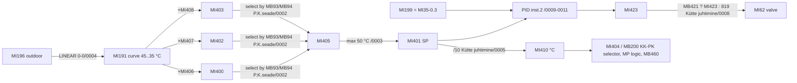
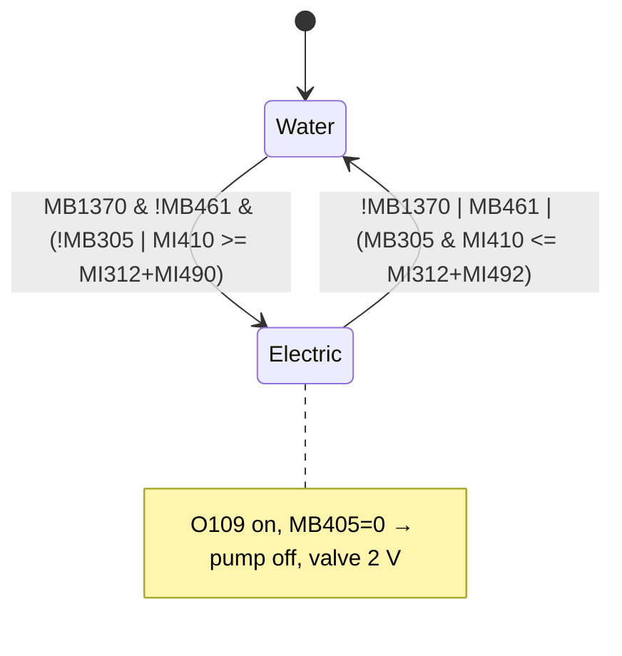
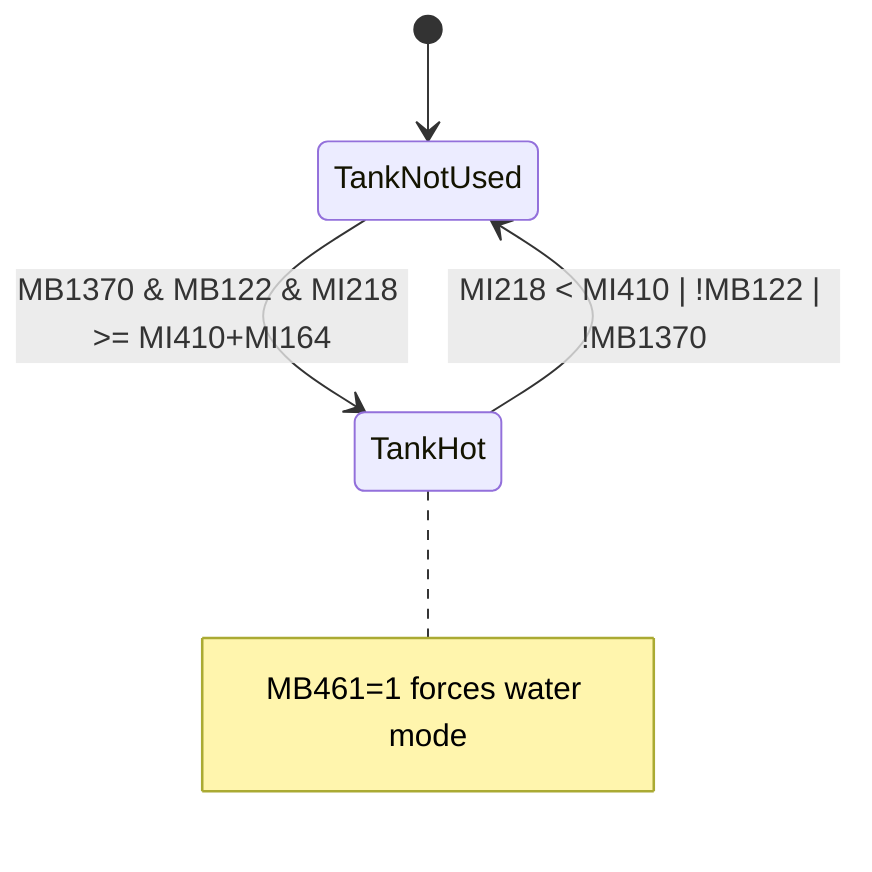
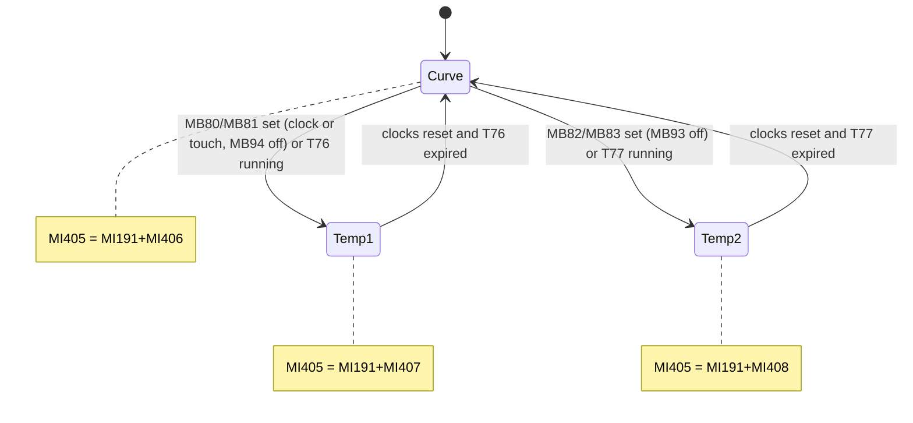
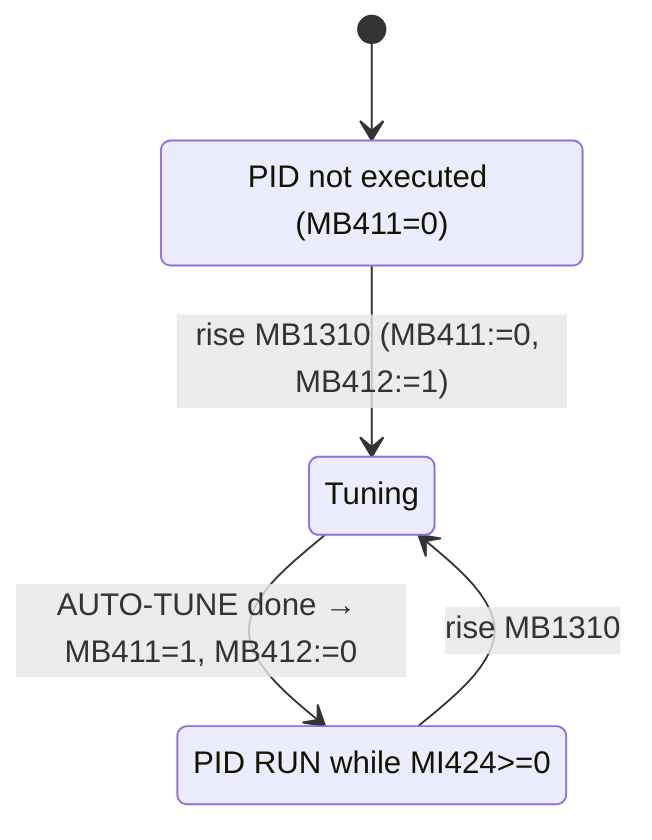

# 3. Floor heating circuit (PK)

All net references are relative to `ladder/! Main Module/` (e.g. `P.K.seade/0004` = `ladder/! Main Module/P.K.seade/0004.txt`). Displays are in `hmi/F3/`. Temperatures are in 0.1 °C unless the text says "whole °C".

## 3.1 Purpose

The PK circuit ("põrandaküte", floor heating) is a weather-compensated water floor-heating loop. It has its own circulation pump (`O101 "PK.Tsirk.pump"`) and a 0–10 V motorised 3-way mixing valve (`MI62 "P.K. 3T Ventiil (väljund O2.0)"`, analog output on IO-AO6X). A PID loop drives the valve from the floor-heating flow sensor (`MI35 "P.Kütte temp."`, PT100 on IO-PT4x channel 4).

- **Flow set point.** It comes from the outdoor-temperature heating curve `MI191`, plus either a manual correction or one of two clock-scheduled alternative set points (with optional one-shot timers). It is limited to 50 °C to protect the floor.
- **Electric option.** If the operator selects "VESI/ELEKTER" (water/electric, `MB1370`), the floor can be heated by an electric heater (`O109 "EL.Põrandaküte"`) instead of water:
  - Electric heating is used whenever the radiator circuit (KK) is not running.
  - When KK is running, electric heating is used if the PK set point is clearly higher than the KK set point (adjustable hysteresis).
  - Electric heating is blocked when the buffer tank (MP) is hot enough to supply the floor with water.
- **Enable chain.** The whole circuit is enabled by the PK switch `MB1121` and can also be switched on and off by a weekly clock (`MB1360`/`MB84`).
- **Effect on the rest of the plant.** The resulting enable and set point feed the heat-pump demand, the KK/PK "higher set point" selector and the buffer-tank logic.

## 3.2 Subroutines

| Subroutine | How invoked | Purpose |
|---|---|---|
| `P.K.seade` (19 nets) | `CALL_FUNCTION` every scan from MAIN `0-0. PEA LEHT/0008` (second branch, after `M.P.ja Korst.seade`, `Kütte juhtimine`, `K.K.seade`) | Set point calculation and limiting, enable/blocking, water vs electric selection, PID config/run/auto-tune, PID error, pump with anti-seize exercise, valve mode |
| `3-1.PK` | Display-linked only: `DISPLAY "1.PK.Joonis" LADDER "3-1.PK"` | Animation of the PK schematic (valve %, arrows, tees, pump, blinking texts) |
| `3-2.PK` | Display-linked only: `"2.PK.PID"` | Starts PID auto-tune, hourglass animation, return address for the error-code screen |
| `3-3.PK` | Display-linked only: `"3.PK.Temp.Seaded"` | +/- buttons for clock set point 1, clock set point 2 and manual correction (with auto-repeat) |
| `3-4.PK` | MAIN `0-0. PEA LEHT/0008` (every scan) **and** display-linked `"4.PK.Kella Seade"` | Clocks 1 and 2 for "temperature 1", one-shot timer T76, conflict errors |
| `3-5.PK` | MAIN `0-0. PEA LEHT/0008` **and** display-linked `"5.PK.Kella Seade"` | Same as 3-4.PK for "temperature 2" (timer T77) |
| `3-6.PK` | MAIN `0-0. PEA LEHT/0008` **and** display-linked `"6.PK.Lülitamine kellaga"` | Weekly on/off clock for the whole PK circuit (`MB84`) |
| `3-7.PK` | Display-linked only: `"7.PK.Lisafunk."` | Empty (only `FUNCTION_RETURN`, `3-7.PK/0017`) |

**F3 screen navigation.** Each screen's Enter button (`MB1133`) leads to the next: `1.PK.Joonis` → `2.PK.PID` → `3.PK.Temp.Seaded` → `4.PK.Kella Seade` → `5.PK.Kella Seade` → `6.PK.Lülitamine kellaga` → `7.PK.Lisafunk.` → back to `1.PK.Joonis`. Back (`MB1132`) goes to `2.Avaleht` on every screen. The PID screen also has a "Vea koodid" (error codes) button (`MB1311`) that jumps to `Vea koodid 1.`.

## 3.3 Signals

### Inputs

| Operand | Original description | Meaning | Written by |
|---|---|---|---|
| `MI35` | "P.Kütte temp." | Floor-heating flow temperature, raw | hardware IO-PT4x rail 1 pos 1 io 4 |
| `MI199` | "P.Kütte temp. peale korrektsiooni" | Flow temperature after offset (MI35 − 0.3 °C); PID process value | `0-0. PEA LEHT/0001` (SUB) |
| `MI32` → `MI196` | "Õue temp." / "Õue temp. peale korrektsiooni" | Outdoor temperature (+0.1 °C offset) | hardware IO-PT4x io 1; `0-0. PEA LEHT/0001` |
| `MI191` | "PK.Seade (temp.graafik 45,0-35,0°C)" | PK heating-curve set point | `0-0. PEA LEHT/0004` (LINEAR) |
| `I81` | "3T Ventii suure MP. asendis" | 3-way (diverting) valve is in the "large buffer tank" position | hardware IO-DI16 rail 1 pos 4 |
| `MB1123` | "SP.Lüliti" | Heat-pump enable switch | HMI `! Start-Up Module/4.Seadmete valikud` |
| `MB305` | "KK lüliti peale kliima seadet ja ooterežiimi." | KK (radiator) circuit active after climate interlock and standby | `K.K.seade/0021` |
| `MI312` | "KK.korrigeeritud temp.lüliti" | KK set point in whole °C, or 10 when KK is off | `K.K.seade/0022` |
| `MB122` | "F6-2 MP.sees/väljas (KK.,PK.)" | Buffer tank is used for KK/PK | `M.P.ja Korst.seade/0003` (set/reset), `/0005` (reset) |
| `MI218` | "M.Paagi temp.teisendus täis kraadideks" | Buffer-tank temperature, whole °C | `M.P.ja Korst.seade/0001` |
| `MI164` | "MP.SISSE lülitamise temp.seade" | Buffer-tank "switch in" margin (K) | HMI `F6/2.MP.Temp.Seaded` |
| `MI410` | "P.Kütte temp. teisendamine täis kraadideks" | Final PK set point in whole °C (MI401/10) | `Kütte juhtimine/0005` |
| `MB8`, `MI61` | "KK.pumba lülitamine joonisel", "K.K. 3T Ventiil (väljund O1.1)" | KK pump state and KK valve output (animation only) | `K.K.seade/0029`, `Kütte juhtimine/0004` |
| System | `SB2` power-up, `SB3` 1 s pulse, `SB7` 100 ms pulse, `SB92` keypad entry in progress, `SB94` keypad entry complete, `SI42` active keypad variable, `SI252` current display number | | firmware |

### Outputs

| Operand | Original description | Meaning | Written by |
|---|---|---|---|
| `O101` | "PK.Tsirk.pump" | PK circulation pump (IO-TO16 rail 1 pos 5) | `P.K.seade/0015` |
| `O109` | "EL.Põrandaküte" | Electric floor heating contactor (IO-TO16) | `P.K.seade/0004` |
| `MI62` | "P.K. 3T Ventiil (väljund O2.0)" | PK mixing valve, 819 = 2 V (closed) … 4095 = 10 V (open); IO-AO6X io 3 | `Kütte juhtimine/0008` (from MI423, or 819) |

### Key internal operands

| Operand | Original description | Meaning | Written by |
|---|---|---|---|
| `MI400` | "PK.graafiku korrektsioon+/-10,0°C" | Curve + manual correction | `P.K.seade/0001` |
| `MI402` / `MI403` | "1.Temp.valik" / "2.Temp.valik" | Curve + clock offset 1 / 2 | `P.K.seade/0002` |
| `MI405` | "PK. graafiku korrektsioon kellaga (25,0-55,0°C" | Selected set point before limiting | `P.K.seade/0002` |
| `MI412` | "PK. graafiku korrektsioon kellaga (25-55°C" | MI405 in whole °C | `P.K.seade/0002` |
| `MB401` | "PK. graafiku korrektsiooni piiraja (max 50,0°C)" | Max limiter active | `P.K.seade/0002` |
| `MI401` | "PK. graafiku korrektsioon kellaga (25,0-50,0°C)" | **Final PK set point** (PID SP) | `P.K.seade/0003` |
| `MB404` | "PK lüliti kella" | PK switch on and clock allows | `P.K.seade/0004` |
| `MB405` | "PK lüliti peale kõiki blokeeringuid" | **Water PK active** (after all blockings) | `P.K.seade/0004` |
| `MI404` | "PK.korrigeeritud temp.lüliti" | PK set point to the KK/PK selector (MI410, or 10 when off) | `P.K.seade/0005` |
| `MI491` / `MI493` | "KK.+lisatud kraadid elektri PKsisse/välja lülitamiseks" | KK set point + electric ON / OFF offset | `P.K.seade/0006` |
| `MB460` | "PK valik vesi või elektriküte" | 0 = water, 1 = electric | `P.K.seade/0007` (set/reset) |
| `MB461` | "PK.vesi või elektriküte valiku plokeerija." | Electric blocked (buffer tank hot) | `P.K.seade/0008` (set/reset) |
| `MI495` | "P Kütte temp.+MP sisse" | PK set point + MP margin | `P.K.seade/0008` |
| `MI423` | "PID: väljund väärtus 2-10V" | PID output (819..4095) | `P.K.seade/0009` (PID CONFIG out1) |
| `MI424` | "PID: PID Status" | PID status (negative = error) | `P.K.seade/0009` |
| `MB411` / `MB412` | "AUTO TUNE tehtud" / "AUTO TUNE töötab" | Auto-tune done / running | `P.K.seade/0011`, `3-2.PK/0001` / `3-2.PK/0001`, `P.K.seade/0012` |
| `MB421` / `MB422` | "PK.PIDi väljundi juhtimine" / "PK.3T ventiil suletud" | Valve under PID / valve forced closed | `P.K.seade/0018` |
| `MB424`, `MB430` | "PK.PIDi error", "PK.PIDi vea teade lisaekraani jaoks" | PID error / error flag for the error module | `P.K.seade/0013`, `/0014` |
| `MB15` | "PK.pumba lülitamine joonisel" | Mirror of the pump output | `P.K.seade/0015` |
| `MI470`, `MB470` | "PK.Tsirk.pumba aegrelee" | Idle-day counter / 30 days idle | `P.K.seade/0017` |
| `MB80`, `MB81` | "F3-4 1temp. 1./2.kell sees,väljas" | Temp-1 clock 1 / 2 latched | `3-4.PK/0001`, `/0003` |
| `MB82`, `MB83` | "F3-5 2 .temp. 1./2.kell sees,väljas" | Temp-2 clock 1 / 2 latched | `3-5.PK/0001`, `/0003` |
| `MB181`, `MB183` | "F3-4 1.temp.taimer", "F3-5 2.temp.taimer" | Temp-1 / temp-2 one-shot timer active | `3-4.PK/0006`, `3-5.PK/0006` |
| `MB93`, `MB94` | "F3-4 kell sees/väljas", "F3-5 kell sees/väljas" | **Temp-1 / temp-2 period active** | `3-4.PK/0007`, `3-5.PK/0007` |
| `MB84` | "F3-6 PK.kell sees,väljas" | PK on/off clock state | `3-6.PK/0001` |
| `MB105`–`MB108`, `MB180`, `MB182` | "F3-4/F3-5 errori impulss" | Clock/timer start attempts (for conflict errors) | `3-4.PK/0001,0003,0006`, `3-5.PK/0001,0003,0006` |
| `MB431`–`MB436` | "PK.…vea teade lisaekraani jaoks" | Clock/timer conflict error flags | `3-4.PK/0008,0009`, `3-5.PK/0008,0009` |
| `MI11`, `MI12` | "Errori tekstid", "Täpsustav error" | Error text group / detail code on `3.Error` | various, PK: `P.K.seade/0014`, `3-4.PK/0008,0009`, `3-5.PK/0008,0009` |

## 3.4 Logic

### Heating curve (outside the PK subroutines)

`0-0. PEA LEHT/0004`: `MI191 := LINEAR(-20.0 °C → 45.0 °C, +15.0 °C → 35.0 °C, MI196)`. That is 45 °C flow at −20 °C outdoor and 35 °C at +15 °C, a slope of about −0.29 K/K (0 °C outdoor gives about 39.3 °C). The dump does not show whether LINEAR clamps or extrapolates outside this range. `3-3.PK/0010` shows it in whole degrees (`MI192 := MI191/10`, "Graafiku temp." on F3-3).

### `P.K.seade` – set point

- **`P.K.seade/0001`** "PK.Temp.graafiku korrektsioon +/-15,0°C" (curve correction): `MI400 := MI191 + MI406` (manual correction, ±10.0 °C in 1 °C steps, see `3-3.PK` below).
- **`P.K.seade/0002`** "PK.graafiku korrektsioon kellaga" (curve correction by clock). It selects the set point by clock state and computes the alternatives and the limiter flag:
  ```
  MI402 := MI191 + MI407          // "temperature 1" = curve + clock offset 1
  MI403 := MI191 + MI408          // "temperature 2" = curve + clock offset 2
  if !MB93 && !MB94: MI405 := MI400     // no clock period: curve + manual correction
  if  MB93 && !MB94: MI405 := MI402
  if !MB93 &&  MB94: MI405 := MI403
  // (both on: MI405 unchanged)
  MI412 := MI405 / 10
  MB401 := MI412 > 50             // limiter
  ```
  The clock set points replace the manual correction; they are not added to it.
- **`P.K.seade/0003`** "korrigeeritud temperatuuri piiramine (max 50,0C°)" (corrected temperature limit): `MI401 := MB401 ? 500 : MI405`. This is the final set point, shown on F1 `1.Temp` and F3-2. There is no lower limit.
- **`Kütte juhtimine/0005`** (outside PK): `MI410 := MI401/10` (whole °C). `MI499 := MI410 + MI676` ("SP.lisakraadid", heat-pump extra degrees). `MB499 := MI499 < 56` (heat-pump input limiter, 60 °C).

### `P.K.seade` – enable, blocking, water vs electric

- **`P.K.seade/0004`** "PK.lüliti blokeerimine kellaga või elektrilise PK.valimisel" (PK switch blocked by clock or electric selection):
  ```
  en := MB1121 && (!MB1360 || MB84)     // PK switch; clock control off, or clock says ON
  MB404 := en
  MB405 := en && !MB460                 // water PK active
  O109  := en &&  MB460                 // electric floor heating
  ```
- **`P.K.seade/0005`**: `MI404 := MB405 ? MI410 : 10`. This is the PK value for the KK/PK "higher temperature" selector (`Kütte juhtimine/0009` sets `MB200` when MI312 > MI404 and resets it when MI312 < MI404).
- **`P.K.seade/0006`** "võrdlemine KK.temperatuuriga, elektrilise PK.lülitamiseks" (comparison with KK temperature, for switching electric PK): `MI491 := MI312 + MI490` (EL ON offset), `MI493 := MI312 + MI492` (EL OFF offset).
- **`P.K.seade/0007`**: water/electric selection `MB460`:
  ```
  if MB1370 && MB305 && !MB461:          // water/electric mode, KK running
      if MI410 >= MI491: MB460 := 1      // PK needs ≥ KK + ON offset → electric
      if MI410 <= MI493: MB460 := 0      // PK ≤ KK + OFF offset → water
  if MB1370 && !MB305 && !MB461: MB460 := 1   // KK not running → electric
  if !MB1370: MB460 := 0                      // water-only mode
  if MB461:   MB460 := 0                      // buffer tank hot → water
  ```
  The F3-7 help texts say "Elektriküte lülitatakse SISSE kui PK.temperatuur on 3-6 kraadi kõrgem KK.temperatuurist" (electric ON when PK is 3–6 K above KK) and "… VÄLJA kui … 0-2 kraadi kõrgem" (OFF when 0–2 K above).
- **`P.K.seade/0008`** "kui MP.on temperatuur piisavalt kõrge plokeerib elektrikütte valiku" (if the buffer tank is hot enough, block the electric selection). Blocker `MB461`:
  ```
  if MB1370 && MB122:
      MI495 := MI410 + MI164
      if MI218 >= MI495: MB461 := 1      // tank ≥ PK set + margin
      if MI218 <  MI410: MB461 := 0      // tank below PK set
  if MB1370 && !MB122: MB461 := 0
  if !MB1370:          MB461 := 0
  ```
  This uses the same thresholds as `MB122` in `M.P.ja Korst.seade/0003`. In water/electric mode with KK off, `M.P.ja Korst.seade/0002` loads `MI220 := MI410` when `MB404` is on, so the buffer tank is switched in for the floor alone.

### `P.K.seade` – PID, valve, pump, errors

- **`P.K.seade/0009`** (first scan only, `SB2`): `PID A.TUNE.CONFIG` instance 2 [param=2]:
  - SP `MI401`, PV `MI199`.
  - P band `MI415`, I `MI416`, D `MI417`, sample time `MI418`.
  - Action `MB410` (0 = reverse/heating).
  - Input range `MI419..MI420` (10.0..70.0 °C), output range `MI421..MI422` (819..4095 = 2..10 V).
  - Outputs: `MI423` output, `MI424` status, `MI425…` 32-word auto-tune area.
- **`P.K.seade/0010`**: if `MB411` (auto-tune done) and `MI424 ≥ 0`: `PID A.TUNE.RUN`, then `READ.CC(MI457)` → P/I/D contributions `MI458`, `MI459`, `MI461`. These three are not used anywhere else. The PID runs only after an auto-tune has completed once, and it runs regardless of `MB405`.
- **`P.K.seade/0011`**: if `MB412` and status ≥ 0: `PID A.TUNE.AUTO-TUNE(3)` → `MB411` on completion. `P.K.seade/0012`: rising `MB411` → reset `MB412`.
- **`P.K.seade/0013`**: `MB424 := MI424 < 0`. **`P.K.seade/0014`**: on rising `MB424`: `MI11 := 3`, `MI12 := 9`, jump to `3.Error`, one-scan `MB430`. `0-1.Vead/0017` turns `MB430` (and `MB431`–`MB436`) into `SET MB438 "PK.errorid"` and resets the KK/TV/SP error group flags.
- **`P.K.seade/0015`** "PK.Tsirkulatsioonipump":
  ```
  O101 := (MB405 && (!I81 || MB1123)) || T35
  MB15 := O101
  ```
  With water PK active, the pump runs unless the 3-way valve is in the large-buffer-tank position while the heat pump is disabled. `T35` is the anti-seize run.
- **`P.K.seade/0016`–`0017`** pump exercise, "intervall 1kuu" (interval 1 month):
  - While the pump is off, `T33` (24 h) runs and is retriggered by `T34` (0.5 s).
  - Each `T33` expiry with the pump off increments `MI470`. Any pump run clears `MI470`.
  - `MB470 := MI470 ≥ 30`. Its rising edge starts `T35` (TE, 10 s), so the pump runs 10 s after 30 idle days.
- **`P.K.seade/0018`** "PK. 3Tventiili juhtimine" (PK 3-way valve control): `MB421 := MB405`, `MB422 := !MB405`. `Kütte juhtimine/0008` then sets `MI62 := MI423` if `MB421`, or `MI62 := 819` (closed) if `MB422`.
- **`P.K.seade/0019`**: `FUNCTION_RETURN`.

Other users of PK results:
- `MB405`: `Kütte juhtimine/0012` (heat-pump demand "KK or PK running and buffer tank not in use") and `4-5.TV/0001`–`0002` (DHW heat-pump time limit).
- `MB404`, `MI410`: `M.P.ja Korst.seade/0002`.
- `MI199`: min/max memory `0-0. PEA LEHT/0012`.
- `MB80`–`MB83`, `MB181`, `MB183`, `MB401`: clock symbol `MB95` on F1 (`1-1.Temp/0003`). It shows steady, or blinks when the 50 °C limiter is active.

### `3-3.PK` – set point offsets (screen F3-3)

The screen has three identical button pairs. In each pair, the counter (in °C, −10..+10) is shown, and the matching value in 0.1 °C is used by the logic:

| Nets | Counter | Value used | + button / hide | − button / hide | Repeat timers | Bar copy |
|---|---|---|---|---|---|---|
| `0001`–`0003` | `MI157` | `MI407` (clock offset 1) | `MB1322` / `MB1323` | `MB1320` / `MB1221` (sic) | `T70`, `T71` | `ML10` |
| `0004`–`0006` | `MI158` | `MI408` (clock offset 2) | `MB1326` / `MB1327` | `MB1324` / `MB1325` | `T72`, `T73` | `ML11` |
| `0007`–`0009` | `MI156` | `MI406` (manual correction) | `MB1330` / `MB1331` | `MB1328` / `MB1329` | `T74`, `T75` | `ML13` |

Pattern (net 0001, plus side):
```
step := rise(btn) && !T70  ||  rise(SB7) && T70     // first press, then 10 steps/s after holding 1 s
if step && MI157 < 10: MI157 += 1; MI407 += 10
MB1323 := MI157 >= 10;  if MB1323: MI157 := 10       // hide + button, clamp
```
- The minus side mirrors this with −10. Its net also copies the counter to the bar `ML10`/`ML11`/`ML13` every scan.
- Holding a button runs its TD timer (`0003`, `0006`, `0009`).
- `0010`: `MI192 := MI191/10` (display only).

### `3-4.PK` / `3-5.PK` – set point clocks and timers (MAIN plus F3-4/F3-5)

`3-4.PK` covers "temperature 1" (`MB93`). `3-5.PK` is the mirror for "temperature 2" (`MB94`), with operands in brackets.

- **`0001`/`0003` – clock 1 / clock 2:**
  - SET `MB80` (`MB81`; `MB82`/`MB83` in 3-5) when the SET/RES touch (`MB1340`, `MB1341`; `MB1350`, `MB1351`) rises and the clock is off, OR when the weekday is in `MI102` (`MI108`…) and the time is in [`MI103`, `MI104`) (the ON minute). This happens only if the other temperature is not active (`!MB94`; in 3-5 `!MB93`).
  - The attempt itself drives `MB105`/`MB106` (`MB107`/`MB108`).
  - RESET when the touch rises and the clock is on, OR at weekday `MI105`/time [`MI106`, `MI107`) (OFF).
- **`0002`/`0004`**: end of each time window := start + 1. The times use hex HHMM format (`FormatView=4`), so this gives a one-minute window. This is inferred.
- **`0005`**: while F3-4 is shown (`MB1034`) and the active keypad variable `SI42 = 10`, the "keypad entry complete" pulse `SB94` triggers TE timer `T76` (`T77`). In other words, typing a duration into the "1.Temp.taimer" field (`VAR link=T76`, keypad entry) starts a one-shot period. Treating `SI42 = 10` as that field is an inference.
- **`0006`**:
  - When `T76` is not running and no keypad entry is in progress, its preset is reset to 0, so the timer is single-use.
  - While `T76` runs: `MB180` (attempt flag), and `MB181 := !MB183` (`MB183 := !MB181` in 3-5).
- **`0007`**: `MB93 := ((MB80 || MB81) && !MB183) || MB181`. In 3-5: `MB94 := ((MB82 || MB83) && !MB181) || MB183`.
- **`0008`**: a clock start attempt (rising `MB105`/`MB106`) while the other temperature is active by clock (`MB94 && !MB183`) gives `MI11 := 1`, `MI12 := 10`/`11` (3-5: `13`/`14`), jump to `3.Error`, flag `MB431`/`MB432` (`MB434`/`MB435`).
- **`0009`**: a timer start (rising `MB180`) while the other timer is active (`MB183`) gives `MI12 := 12` (3-5: `15`) and `MB433` (`MB436`).
- **`0021`**: `FUNCTION_RETURN`.

### `3-6.PK` – PK on/off clock (MAIN plus F3-6)

- `3-6.PK/0001`: `MB84` is SET by the touch `MB1361` (when off) or at weekday `MI480`, time [`MI481`, `MI482`). It is RESET by the touch (when on) or at weekday `MI483`, time [`MI484`, `MI485`).
- `3-6.PK/0002`: `MI482 := MI481 + 1`, `MI485 := MI484 + 1`.
- `3-6.PK/0019`: return.
- `MB84` only takes effect when `MB1360` "Lüliti PK.kellaga juhtimiseks" (switch for PK clock control) is on (`P.K.seade/0004`).

### `3-2.PK` – PID screen (F3-2)

- `0001`: rising `MB1310` "Start AUTO-TUNE" → reset `MB411`, set `MB412`. This also stops the PID RUN for the duration of the tune.
- `0002`: while tuning, the hourglass `MI460` counts 0..13 once per second.
- `0003`: when done, `MI460 := 14`.
- `0004`: rising `MB1311` ("Vea koodid") stores `MI10 := SI252` (current display), so that `0-1.Vead/0001` can return from the info screen to the PID screen.
- `0017`: return.
- The screen also shows `MI424` status, `MI401` SP and `MI199` PV.

### `3-1.PK` – schematic animation (F3-1)

| Net | Function |
|---|---|
| `0001` | `MI7 := LINEAR(819→0 %, 4095→100 %, MI62)`. This is the commanded valve position; there is no feedback. |
| `0002` | `MB416` closed (< 5 %), `MB417` partly open (5..95 %), `MB415` open (> 95 %). Valve image `MI468`: 0 closed/pump off, 1 closed/pump on, 2 partial, 3 open/pump on, 4 open/pump off. |
| `0003` | Arrows: `MB19` corner (closed or partial, with pump), `MB20` in/out (open or partial, with pump), `MB21` all (pump). |
| `0004` | `MB16` floor "heated" := `MB21` OR electric active (same condition as `O109`). |
| `0005` | KK info: if `MB8`, `MI5 := KK valve %` and `MB317 := MI5 ≥ 5`. |
| `0006` | `MB26` collector + KK flow := `MB317`. `MB28` collector arrows := (PK open/partial with pump) OR `MB26`. |
| `0007`–`0008` | Tee images `MI465`/`MI466`: 0 no flow, 1 PK only, 2 KK only with PK closed, 3 both. |
| `0009` | Small-loop tee `MI467`: 0 pump off, 1 full recirculation, 2 straight through, 3 mixing. |
| `0010` | Pump rotation `MI469` 0..3 on the 100 ms pulse, 4 = stopped. |
| `0011` | Text "electric PK" `MB406`: only in water/electric mode; steady if `MB460`, otherwise blinking (`SB3`). |
| `0012` | Text "clock switching" `MB407`: only if `MB1360`; steady if `MB84`, otherwise blinking. |
| `0018` | Return. |

## 3.5 Timers

| Timer | Type | Preset (s) | Purpose | Net |
|---|---|---|---|---|
| `T33` "PK.Tsirk.pumba aegrelee" | TD | 86400 (24 h), reset on power-up | Day clock for pump idle counting | `P.K.seade/0016`, `/0017` |
| `T34` | TD | 0.5, reset on power-up | Retrigger of T33 | `P.K.seade/0017` |
| `T35` "… (pumba intervall 1kuu)" | TE | 10, reset on power-up | Anti-seize pump run | `P.K.seade/0016`, `/0015` |
| `T70`/`T71` | TD | 1 | Auto-repeat for clock offset 1 +/− | `3-3.PK/0001`–`0003` |
| `T72`/`T73` | TD | 1 | Auto-repeat for clock offset 2 +/− | `3-3.PK/0004`–`0006` |
| `T74`/`T75` | TD | 1 | Auto-repeat for manual correction +/− | `3-3.PK/0007`–`0009` |
| `T76` "F3-4 1.Temp.taimer" | TE | 0 at start; operator-entered; reset to 0 after use | One-shot "temperature 1" period | `3-4.PK/0005`, `/0006` |
| `T77` "F3-5 2.Temp.taimer" | TE | as T76 | One-shot "temperature 2" period | `3-5.PK/0005`, `/0006` |

## 3.6 Diagrams











Pump exercise: pump off → each 24 h `MI470++` → at 30, `MB470` rises → `T35` runs the pump 10 s → `MI470 := 0`.

## 3.7 Operator parameters

| Operand | Meaning | Where set | Power-up default |
|---|---|---|---|
| `MB1121` "PK.Lüliti" | PK main switch | `! Start-Up Module/4.Seadmete valikud` (also shown on F3-1) | none (retained) |
| `MB1360` "Lüliti PK.kellaga juhtimiseks" | Use on/off clock | F3-6 | none |
| `MB1361` → `MB84` | Manual SET/RES of the PK clock | F3-6 | none |
| `MI480`/`MI481`, `MI483`/`MI484` | PK clock ON weekday/time, OFF weekday/time | F3-6 (time-function VARs) | none |
| `MB1370` "Lüliti vesi PK.ja vesi/elekter PK." | "VESI" / "VESI/ELEKTER" mode | F3-7 | none |
| `MI490` "EL.põrandaküte SEES" | Electric ON offset above KK (K) | F3-7 keypad | none (screen suggests 3–6) |
| `MI492` "EL.põrandaküte VÄLJAS" | Electric OFF offset above KK (K) | F3-7 keypad | none (screen suggests 0–2) |
| `MI156`/`MI406` | Manual correction ±10 °C | F3-3 +/− | none |
| `MI157`/`MI407`, `MI158`/`MI408` | Clock set point 1/2 offset ±10 °C | F3-3 +/− | none |
| `MI102`–`MI107`, `MI108`–`MI113` | Temp-1 clocks 1/2: ON/OFF weekday and time | F3-4 | none |
| `MI114`–`MI125` | Temp-2 clocks 1/2 | F3-5 | none |
| `MB1340`/`MB1341`, `MB1350`/`MB1351` | Manual SET/RES of each clock | F3-4 / F3-5 | — |
| `T76` / `T77` preset | One-shot period length | F3-4 / F3-5 keypad | 0 |
| `MB1310` | Start PID auto-tune | F3-2 | — |
| `MI415`/`MI416`/`MI417` | P band 0.1 % / I s / D s | not on HMI | 600 / 340 / 10 (rewritten every power-up) |
| `MI418` | PID sample time (10 ms units) | not on HMI | **none** |
| `MI419`/`MI420`, `MI421`/`MI422` | PID input range, output range | not on HMI | 100/700, 819/4095 |
| `MB410` | PID direction | not on HMI | 0 (reverse = heating) |
| External: `MI164` (F6-2), `MI676` (F5-3), `MB1123` | Buffer-tank margin, heat-pump extra degrees, heat-pump switch | other chapters | none |

## 3.8 Open questions and inconsistencies

1. **Wrong operand.** `3-3.PK/0002` writes `COIL MB1221 "F2-3 (1.kellaga temp.seade miinuse nupu peitmine)"`, which belongs to the KK screen. The F3-3 minus button is hidden by `MB1321`, which nothing writes. As a result the PK clock-1 "MIINUS" button is never hidden, and `MB1221` is double-coiled with `2-3.KK/0002`.
2. **PID sample time.** `MI418` has no power-up value and no writer, so it is 0. The same applies to KK's `MI318`. How the PID block handles a sample time of 0 is not visible in the dump.
3. **PID never runs before an auto-tune.** The PID only runs after an auto-tune (`P.K.seade/0010` requires `MB411`). Until then `MI423` is never computed, and the valve gets `MI423` (probably 0, below the 819 = 2 V floor) whenever water PK is active.
4. **Gains reset at power-up.** `MI415`–`MI417` are reset at every power-up while `MB411` is retained. If auto-tune stores its result in these registers, a power cycle silently returns to the default gains. Where auto-tune writes its results is not visible in the dump.
5. **Integral wind-up.** The PID keeps running when PK is disabled or in electric mode while the valve is forced to 2 V (`P.K.seade/0010`, `/0018`). On re-enable the valve may jump to a wound-up output.
6. **Limiter threshold and range.** The limiter compares whole degrees (`MI405/10 > 50`, `P.K.seade/0002`), so values from 50.1 to 50.9 °C pass through unlimited. There is no lower limit, although the descriptions say "25,0-50,0°C".
7. **Correction range mismatch.** The `P.K.seade/0001` comment says ±15 °C, but the HMI text and the `3-3.PK` clamps use ±10 °C.
8. **Unclamped values.** Only the counters `MI156`–`MI158` are clamped, not `MI406`–`MI408`. If a pair gets out of step (no power-up init), the 0.1 °C value can drift.
9. **Corrections do not combine.** The clock set points (`MI402`/`MI403`) ignore the manual correction `MI406`. If `MB93` and `MB94` were both on, `MI405` would freeze (`P.K.seade/0002`).
10. **Double execution.** `3-4.PK`, `3-5.PK` and `3-6.PK` run twice per scan while their own screen is shown (MAIN plus the `LADDER` link). Edge contacts make this mostly harmless.
11. **Silent conflicts.** Clock conflicts are not reported when the conflict comes from the other temperature's timer (`!MB183` / `!MB181` in `3-4.PK/0008`, `3-5.PK/0008`); the start is simply ignored.
12. **Pump condition with `I81`.** The pump condition `!I81 || MB1123` (`P.K.seade/0015`, same in `K.K.seade/0029`) stops the pump when the diverting valve is at the large buffer tank and the heat pump is disabled. The hydraulic reason is not documented.
13. **Electric hysteresis.** `MI490` and `MI492` have no defaults. If MI490 ≤ MI492 the hysteresis collapses and the reset in `P.K.seade/0007` wins. With KK off, electric heating is used whenever the buffer tank is not hot, regardless of the PK set point. The PLC has no temperature control for `O109` (presumably the heater has its own thermostat; this is an inference).
14. **Unused or empty items.** `3-7.PK` is empty. `MI458`/`MI459`/`MI461` (P/I/D parts) and `MI457` are unused or uninitialised.
15. **No sensor fault handling.** Nothing handles a broken `MI35` sensor; the PID status error (`MB424`) is the only PK fault.

**Differences from the KK circuit (`K.K.seade`):**
- **Set point.** KK uses curve `MI190` (55→25 °C) with an automatic room-temperature corrector `MI300` (+10/−15 °C, `K.K.seade/0001`, `/0013`–`/0016`), a room-set-point encoder, standby (`/0019`) and a climate-unit interlock (`/0020`–`/0021`). PK has none of these: only the curve plus a manual offset, and it has the 50 °C maximum limiter, which KK lacks.
- **Clocks.** KK clocks shift the room set point by ±3 °C and are disabled below −15 °C outdoor (`MB390`, `/0008`–`/0012`). PK clocks replace the flow-offset outright, with no outdoor restriction.
- **PK-only functions.** PK has the on/off clock (`3-6.PK`) and the electric option (`/0004`, `/0006`–`/0008`).
- **Identical parts.** The PID, pump, exercise and valve-mode nets have the same structure (`K.K.seade/0023`–`/0032`), using PID instance 1. KK's defaults are P = 200 and I = 240, against PK's 600 and 340.

Not verified: the texts behind the `MI11`/`MI12` codes in `0-1.Vead`, and the bitmap images.
