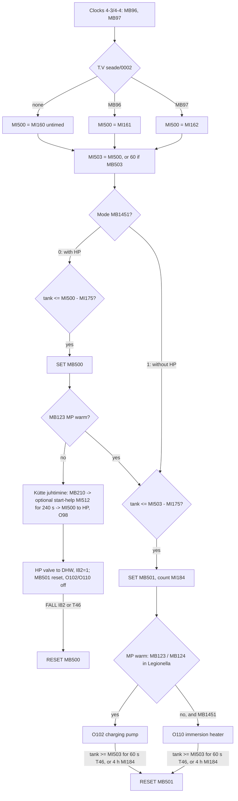
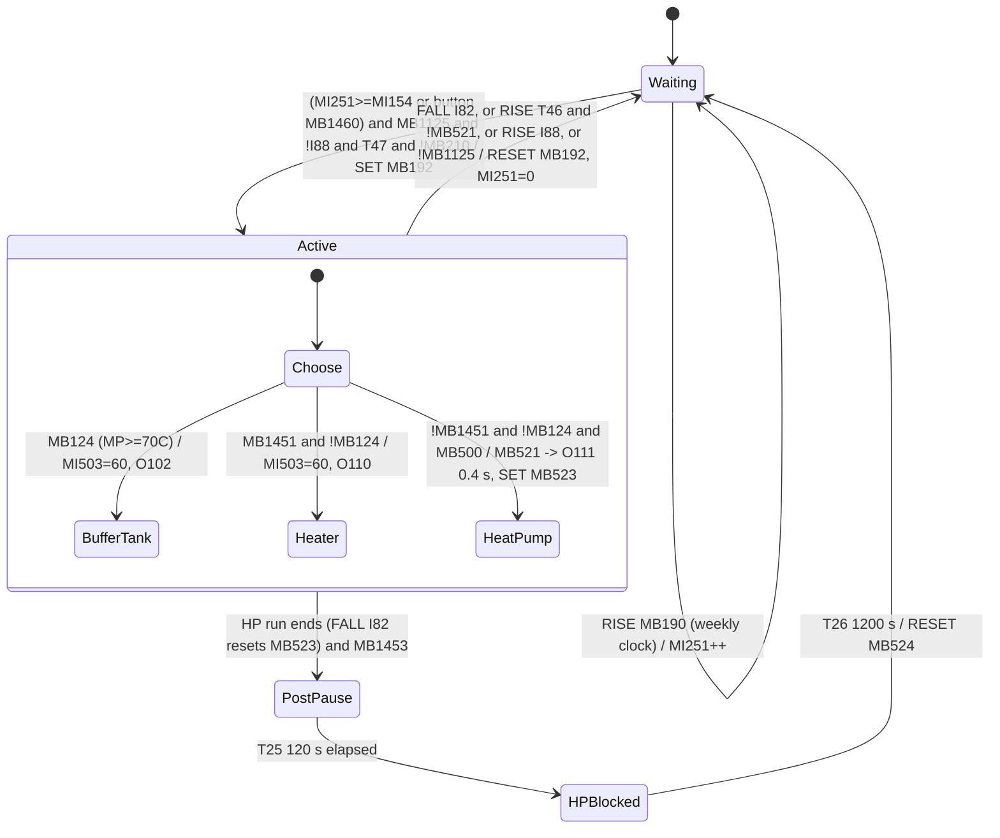
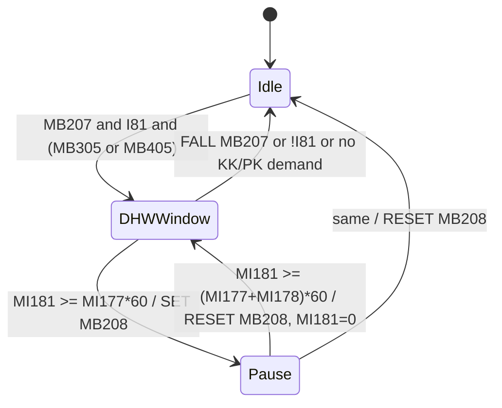

# 4. Domestic hot water (TV) and Legionella protection

Domestic hot water is "tarbevesi" (TV) in the program. All paths below are relative to `ladder/! Main Module/`, and net references are written `<subroutine>/<net>`. Timer presets are in seconds (`OprndPowerUp`/100).

## 4.1 Purpose

The DHW storage tank ("boiler") is measured by one 4–20 mA sensor. `MI37 "T.V.Küte (4-20mA)"` is wired to the IO-ATC8 module (rail 1, pos 2, io 2). `0-0. PEA LEHT/0002` scales it to `MI201 "T.V.Küte temp. 0-100,0°C"` in 0.1 °C. The tank can be heated from three sources:

| Source | How the PLC uses it | Evidence |
|---|---|---|
| Heat pump (SP) | The PLC raises a DHW demand (`MB500`) and sends the DHW set point to the heat pump. The HP switches its own 3-way valve to the DHW coil (input `I82`) and heats until it finishes its cycle. | `T.V seade/0004`; `Kütte juhtimine/0011,0012,0015,0019` |
| Buffer tank (MP, wood-boiler storage) | Pump `O102 "TV.Tsirk.pump"` (the DHW charging pump) circulates buffer-tank water through the DHW coil. It runs only when the buffer tank is hot enough (`MB123`, or `MB124` during disinfection). | `T.V seade/0009`; `M.P.ja Korst.seade/0003,0004` |
| Immersion heater | Output `O110 "TV.lisaküte"` (electric heater). It is used only in the mode "DHW heating without heat pump" (`MB1451`) and only when the buffer tank cannot supply. | `T.V seade/0012` |

**Legionella protection** ("Legionella tõrje") is a weekly disinfection cycle (`MB192`):

- It starts from a weekly clock, repeated every 1–4 weeks, or by a button.
- The tank is raised to 60 °C, either from the buffer tank or the immersion heater, or by commanding the heat pump's own Legionella program with a pulse on `O111`.
- After a heat-pump Legionella run, an optional pause blocks the heat pump for 20 minutes.

A hardware switch `I88 "TV.Lisakütte käsirežiim"` (immersion-heater manual mode) overrides everything: while it is on, the PLC does no automatic DHW heating.

## 4.2 Subroutines

`0-0. PEA LEHT/0008` ("Pidevalt töötavad lisalehed" = continuously running sub-pages) calls the subroutines unconditionally on every scan. The call order is:

1. Upper branch: `0-1.Vead`, `2-4..2-7.KK`, `3-4..3-6.PK`, `4-3.TV`, `4-4.TV`, `4-5.TV`, `4-6.TV`
2. Lower branch: `M.P.ja Korst.seade`, `Kütte juhtimine`, `K.K.seade`, `P.K.seade`, `T.V seade`, `S.P.seade`, `Internet`

| Subroutine | How it is invoked | Purpose |
|---|---|---|
| `T.V seade` ("DHW device/set-up") | CALL every scan (`0-0. PEA LEHT/0008`) | Core DHW logic: set-point selection, demand hysteresis for heat pump and for buffer tank/heater, 240-min limit, charging pump `O102`, immersion heater `O110`, pump anti-seize run, start-help temperature, last-run time stamp |
| `4-1.TV` | Display only: `hmi/F4/1.TV.Joonis` (`LADDER "4-1.TV"`) | Animation of the F4-1 DHW schematic (arrows, tees, boiler and pump images) |
| `4-2.TV` | Display only: `hmi/F4/2.TV.Temp.Seaded` | +/- buttons for the three DHW set points (range 40–60 °C) |
| `4-3.TV` | CALL every scan, and display `3.TV.Kella Seade` | Weekly clocks 1 and 2 plus a one-shot timer for set point 1; conflict errors |
| `4-4.TV` | CALL every scan, and display `4.TV.Kella Seade` | The same for set point 2 |
| `4-5.TV` | CALL every scan, and display `5.TV.Lisafunk.` | Time sharing of the heat pump between DHW and space heating (heat/pause cycle) |
| `4-6.TV` | CALL every scan, and display `6.TV.Legionella` | Legionella cycle start/end, weekly clock, post-Legionella pause |

`4-3`..`4-6` are both called from MAIN and linked to their displays, so they run twice per scan while their screen is shown (see 4.8).

## 4.3 Signals

### Physical I/O

| Operand | Original description | Meaning | Writer / hardware |
|---|---|---|---|
| `MI37` → `MI201` | "T.V.Küte (4-20mA)" → "T.V.Küte temp. 0-100,0°C" | DHW tank temperature, raw value → 0.1 °C | IO-ATC8 r1 p2 io2; `0-0. PEA LEHT/0002` LINEAR |
| `I81` | "3T Ventii suure MP. asendis" | 3-way valve in the "large buffer tank" position | IO-DI16 r1 p4 |
| `I82` | "SP.3Tventiil KK/PK suunas avatud" | HP 3-way valve "open towards radiator/floor heating". The logic treats 1 as "valve in DHW position" (see 4.8). | IO-DI16 r1 p4 |
| `I87` | "TV.Lisaküte sees (Immersion heater)" | Immersion heater running (feedback). Used only in the drawing (`4-1.TV/0010,0012`) and in `Internet/0002`. | IO-DI16 r1 p4 |
| `I88` | "TV.Lisakütte käsirežiim" | Immersion heater in manual mode (hardware switch); blocks automatic DHW | IO-DI16 r1 p4 |
| `O102` | "TV.Tsirk.pump" | DHW charging pump (buffer tank → DHW coil) | IO-TO16 r1 p5; COIL `T.V seade/0009` |
| `O110` | "TV.lisaküte" | Immersion heater contactor | IO-TO16 r1 p5; COIL `T.V seade/0012` |
| `O98` | "SP.tarbevee kütte sisendile" | HP "DHW heating" input (context) | COIL `Kütte juhtimine/0019` (from `T23`) |
| `O111` | "Legionella bakteri hävitus" | HP Legionella program start pulse (context) | COIL `Kütte juhtimine/0019` (from `MB522`) |

### Inputs from other chapters

| Operand | Original | Meaning | Writer |
|---|---|---|---|
| `MB123` | "F6-2MP.sees/väljas (TV.)" | Buffer tank hot enough for DHW. Set when MP ≥ `MI503`+`MI164`, reset when MP < `MI503`+`MI165`. | SET/RESET `M.P.ja Korst.seade/0003`, RESET `/0005` |
| `MB124` | "F6-2MP.sees/väljas (TV.Legionella 60C°)" | Buffer tank hot enough for disinfection: set at MP ≥ 70 °C, reset at MP < 65 °C | `M.P.ja Korst.seade/0004,0005` |
| `MB207` | "SP.kasutamise ajaline piiraja käivitus TV.küttel." | HP is requested for DHW (starts the time sharing) | COIL `Kütte juhtimine/0012` |
| `MB210` | " TV.kütte alustamise temp.lülitamine" | HP DHW heating request granted (not in the pause) | COIL `Kütte juhtimine/0012` |
| `MB521` | "Legionella tõrje käivitus käsk SP-le." | Legionella start command to the HP | COIL `Kütte juhtimine/0015` |
| `MB523` | "Legionella režiimis olek SET/RES" | HP is in Legionella mode | SET `Kütte juhtimine/0016`, RESET `/0018` |
| `MB305`, `MB405` | "KK lüliti peale kliima seadet ja ooterežiimi.", "PK lüliti peale kõiki blokeeringuid" | Radiator / floor heating demand after all blockings | `K.K.seade/0021`, `P.K.seade/0004` |
| `MI59` | "SP.-le saadetava temperatuuri näit.(aken F1-1)" | Temperature currently sent to the HP | `Kütte juhtimine/0003,0007,0010,0011` |
| `MB38`, `MB8`, `MB15`, `T55`, `MI61`, `MI62` | HP / KK / PK pump-on flags, flow delay, 3-way valve outputs | Drawing only (`4-1.TV`) | `S.P.seade/0001`, `K.K.seade/0029`, `P.K.seade/0015`, `S.P.seade/0012`, hardware AO |

### Key internal operands

| Operand | Original | Meaning | Written by |
|---|---|---|---|
| `MI195` | "TV. temp. teisendamine täis kraadideks" | Tank temperature in whole °C | `T.V seade/0001` |
| `MI500` | "TV.kütte temp. kellaga või ajatu" | Active DHW set point (clock or untimed). Used for HP demand and sent to the HP. | `T.V seade/0002` |
| `MI503` | "TV.kütte temp. kellaga, ajatu või des.temp." | Set point for buffer tank / heater (= `MI500`, or 60 during disinfection) | `T.V seade/0002,0003` |
| `MI501` | "TV.kütte temp. miinus 5-20°C (diferents)" | `MI500` − differential = HP switch-on temperature | `T.V seade/0004` |
| `MI505` | "… (diferents MP.-le)" | `MI503` − differential = MP/heater switch-on temperature | `T.V seade/0005` |
| `MB500` | "TV.kütte diferents (SP.-le)" | DHW demand to the heat pump (latched) | SET/RESET `T.V seade/0004` |
| `MB501` | "TV.kütte diferents (tsirk.pumbale ja EL.küttele)" | DHW demand to the charging pump / heater (latched) | SET `/0005`; RESET `/0006,0007` |
| `MB503` | "des.temp.saatmine diferentsiaalile" | Disinfection temperature (60 °C) applied to `MI503` | COIL `T.V seade/0002` |
| `MI184` | "TV.kütmise ajaline piiramine" | Seconds of MP/heater demand (limit 14400) | `T.V seade/0007,0008` |
| `MB22` | "TV.pumba lülitamine joonisel" | Copy of `O102` (pump running) | COIL `T.V seade/0009` |
| `MI570`, `MB570` | "TV.Tsirk.pumba aegrelee" | Idle-day counter / 30-day flag for pump anti-seize | `T.V seade/0011` |
| `DW1` | "TV. pumba viimase käivituse aeg." | UTC time stamp of last pump run | `T.V seade/0014` |
| `MB525`, `MI512`, `MI513` | "TV.kütmise abi temp.valik (kõrgem)", "TV. kütte alustamise abi temp.", "TV.kütmise alustamiseks valitud kõrgem temp." | Start-help decision, help temperature, temperature captured at request start | `T.V seade/0013` |
| `MB85`/`MB86` | "F4-3 1temp. 1./2.kell sees,väljas" | Set point 1, clock 1/2 on | `4-3.TV/0001,0003` |
| `MB87`/`MB88` | "F4-4 2.temp. 1./2.kell sees,väljas" | Set point 2, clock 1/2 on | `4-4.TV/0001,0003` |
| `MB185`/`MB187` | "F4-3 1.temp.taimer" / "F4-4 2.temp.taimer" | One-shot timer of set point 1/2 running | `4-3.TV/0006`, `4-4.TV/0006` |
| `MB96`/`MB97` | "F4-3 / F4-4 kell sees/väljas" | Set point 1 / set point 2 active | `4-3.TV/0007`, `4-4.TV/0007` |
| `MB110`,`MB111`,`MB184`,`MB112`,`MB113`,`MB186` | "… errori impulss" | Switching-event pulses used for conflict errors | `4-3.TV/0001,0003,0006`, `4-4.TV/0001,0003,0006` |
| `MB531`–`MB536` | "TV.… vea teade lisaekraani jaoks" | One-scan error flags for the auxiliary display | `4-3.TV/0008,0009`, `4-4.TV/0008,0009` |
| `MI179`,`MI180`,`MI182`,`MI181` | heating time, pause time, their sum (s), running counter | HP time sharing | `4-5.TV/0001,0002` |
| `MB208` | "SP.kasutamise ajaline piiramine TV.küttel." | HP DHW pause active (blocks `MB210`) | `4-5.TV/0001,0002` |
| `MB190`, `ML250` | "F4-6 des.aeg sees/väljas (nädal+kell)", "F4-6 kella nullimiseks" | Weekly Legionella clock hit (12-h window) and its seconds counter | `4-6.TV/0001` |
| `MI251` | "F4-6 des.aja nullimiseks" | Count of weekly clock hits since the last cycle | `4-6.TV/0003,0005` |
| `MB192` | "F4-6 des.aeg sees,väljas" | Legionella cycle active | SET `4-6.TV/0003`, RESET `/0005` |
| `MB524`, `MB527`, `MI260`, `MI56` | post-pause latch, blinking text, seconds counter, remaining minutes | Post-Legionella pause | `4-6.TV/0006–0011`, `5-2.SP/0002` |

## 4.4 Logic

### `T.V seade` (every scan)

**`/0001` Tank temperature.** `MI195 := MI201 / 10` ("convert DHW temp to whole degrees").

**`/0002` Set-point selection with clocks ("TV.kütte korrektsioon kellaga").** `MB96` = set point 1 active, `MB97` = set point 2 active (from `4-3`/`4-4`).

```
if !MB96 & !MB97: MI500 := MI160 "TV.Ajatu temp.seade" (untimed / manual)
if  MB96 & !MB97: MI500 := MI161 "TV.1.Temp.seade"
if !MB96 &  MB97: MI500 := MI162 "TV.2.Temp.seade"
   (each branch also: if !MB503 then MI503 := same value)
MB503 := MB1122 & !I88 & !I82 & !MB521 & (MB124 | MB1451) & MB192
```

- If both `MB96` and `MB97` were on, nothing would be written. The interlocks in `4-3`/`4-4` prevent that.
- `MB503` means disinfection is running (`MB192`) and the heat pump is not doing it (`!MB521`). The tank is then heated by the buffer tank (`MB124`, MP ≥ 70 °C) or the system is in "without-HP" mode (`MB1451`).

**`/0003` Disinfection temperature.** `if MB503: MI503 := 60`. So `MI503` is the clock/untimed set point normally and 60 °C during MP/electric disinfection. `MI500`, the HP set point, is never raised to 60.

**`/0004` HP demand hysteresis ("TV.kütte diferents SP.-le").**

```
if !I88: MI501 := MI500 - MI175;  if MI501 >= MI195: SET MB500      // tank <= set point - differential
RESET MB500 if !MB1122 | MB1451 | FALL I82 | I88 | RISE T46
```

The demand ends when:
- the HP leaves the DHW valve position (end of its DHW run, `FALL I82`), or
- the tank has been at or above `MI503` for 60 s (`T46`), or
- DHW is switched off, the without-HP mode is selected, or manual mode is on.

`Kütte juhtimine/0012` turns `MB500` into an HP request, but only when the buffer tank cannot supply. The condition there is `!MB123`, or `!MB124 & MB192` during disinfection.

**`/0005` Buffer-tank/heater demand hysteresis ("diferents MP.-le ja EL.küttele").**

```
if !I88: MI505 := MI503 - MI175;  if MI505 >= MI195: SET MB501
T46 runs while MI503 <= MI195        // tank reached target, 60 s on-delay
```

**`/0006` Reset `MB501`** on any of:
- `!MB1122`
- `RISE T46` (target held for 1 min)
- `I88`
- `I82` (heat pump is heating DHW)
- `FALL O102 & !MB1451`: the charging pump just stopped while in with-HP mode

**`/0007` Heating-time limit ("ajaline piiramine (240 min)").** While `MB1122 & !I88 & MB501 & !I82`, `MI184` counts seconds (rising edge of `SB3`). At `MI184 ≥ 14400` (4 h) it resets `MB501` and `MI184` (see 4.8: `/0005` may re-set `MB501` on the next scan).

**`/0008`** `MI184 := 0` when `!MB1122 | I88 | !MB501 | I82`.

**`/0009` Charging pump ("TV.Tsirkulatsioonipump").**

```
O102 = MB22 = ( MB1122 & !I88 & !I82 & !MB521 & MB501 &
               ( (!MB192 & MB123) | (MB192 & MB124) ) )   // MP warm enough for normal / Legionella
             | T38                                         // anti-seize pulse
```

**`/0010`–`/0011` Anti-seize run ("aegrelee, intervall 1kuu").**
- While the pump is idle (`!MB22`), `T36` (24 h) and `T37` (0.5 s) form a self-resetting daily pulse.
- Each rising edge of `T36` increments `MI570` (idle days). `MB22` clears `MI570`.
- At `MI570 ≥ 30`, `MB570` turns on. Its rising edge triggers `T38` (TE, 10 s), which runs `O102` for 10 s regardless of `MB1122`/`I88` (`/0009`).
- The pump running then clears `MI570`.

**`/0012` Immersion heater ("TV.kütmine elektriga").**

```
O110 = MB1122 & !I88 & MB1451 & !I82 & !MB521 & !O102 & MB501 &
       ( !MB123 | (!MB124 & MB192) )
```

The heater runs only in without-HP mode. It needs demand, a stopped charging pump, and a buffer tank too cold for the current purpose.

**`/0013` HP start-help temperature ("kütmise alustamise abi, temperatuuri valimine").** The rung is a junction net:

```
RISE MB210:              MI513 := MI59           // temp being sent to HP when DHW request starts
MB1450 & !MB210:         RESET MB525
MB1450 &  MB210:         MI512 := MI501 + 4;  if MI512 <= MI513: SET MB525
!MB1450:                 SET MB525               // help disabled
```

`MB525 = 1` means "the higher temperature is already being sent, no help needed".

If `MB525 = 0`, `Kütte juhtimine/0014,0015,0010` handle the start:
1. The HP is first sent `MI512` (set point − differential + 4 °C).
2. After `T90` (240 s) the PLC switches to the DHW set point `MI500`.

**`/0014` Last-run time stamp.** While `MB22`: `DW1 := RTC_TO_UTC(...)`. F4-1 shows it as "Viimati töötas" (last ran).

**`/0021`** `FUNCTION_RETURN`.

### `4-1.TV` (F4-1 schematic animation; runs only while F4-1 is shown)

| Net | Content |
|---|---|
| `/0001` | While `MB8` (KK pump): `MI5 := LINEAR(819..4095 → 0..100 %, MI61)`; `MB317 := MI5 ≥ 5` (KK valve partly open). |
| `/0002` | The same for PK: `MI7`, `MB417`. |
| `/0003` | `MB27` "Kollektori ringvoolu ahel" (collector loop) `= MB38 & I81 & !I82`. |
| `/0004` | `MB25` "TV.Nooled" (DHW arrows) `= (MB38 & I82) \| MB22`; `MB28` (collector arrows) `= MB317 \| MB417`; `MB29` (arrow out) `= MB28 \| MB22`. |
| `/0005` | `MB30`/`MB31` (return to MP / supply from MP) `= MB22`; `MB32`/`MB35` (supply from / return to HP) `= !T55 & MB38 & I82`. |
| `/0006`–`/0008` | Tee-piece image indexes `MI521` (0–2), `MI522` (0–3), `MI523` (0–2) from `MB25`/`MB28`/`MB30`/`MB31`/`MB32`. |
| `/0009` | `MB23 := MI195 ≥ 35` (boiler drawn "warm"). |
| `/0010`–`/0013` | Boiler image `MI525` (0–7): +4 if warm, +1 if arrows, +2 if `I87` heater on. In manual mode (`I88`) the heater symbol blinks with `SB3` (0↔2 or 4↔6). |
| `/0014` | Pump image `MI519`: cycles 0–3 every 100 ms while `MB22`; set to 4 (stopped) when `!MB22 & !I82`. |
| `/0022` | `FUNCTION_RETURN`. |

### `4-2.TV` (F4-2 set points, display-linked only)

| Nets | Set point | Buttons (− / +) | Hold timers |
|---|---|---|---|
| `/0001`–`/0003` | `MI161` (set point 1) | `MB1410` / `MB1412` | `T81` / `T80` |
| `/0004`–`/0006` | `MI162` (set point 2) | `MB1414` / `MB1416` | `T83` / `T82` |
| `/0007`–`/0009` | `MI160` (untimed) | `MB1418` / `MB1420` | `T85` / `T84` |

How each button works:
- A press (rising edge) changes the value by 1 °C.
- Holding the button for more than 1 s (`T80`–`T85`, 1 s) repeats the change on every 100 ms pulse (`RISE SB7`).
- The value is limited to 40…60 °C. At a limit it is clamped and a "hide button" bit is set (`MB1411`/`1413`/`1415`/`1417`/`1419`/`1421`, used as the CBUTTON's `op5` operand).
- The values are copied to `ML20`, `ML21`, `ML23` for the bar graphs.

`/0017` is `FUNCTION_RETURN`.

### `4-3.TV` / `4-4.TV` (clocks and timers for set points 1 and 2)

The two subroutines are identical. `4-3` handles set point 1 and is blocked by `MB97`; `4-4` handles set point 2 and is blocked by `MB96`.

- **`4-3/0001`, `/0003`; `4-4/0001`, `/0003`: clock latches.** Clock 1 of set point 1:
  ```
  ON event  = (RISE MB1430 & !MB85) | (day in MI127 & time in [MI128, MI129))
  MB110 := ON event;  if ON event & !MB97: SET MB85
  OFF event = (RISE MB1430 & MB85) | (day in MI130 & time in [MI131, MI132)) -> RESET MB85
  ```
  - Touching the lamp `MB85` (touch bit `MB1430`) toggles it manually.
  - Clock 2 uses `MB86`, `MI133–MI138`, `MB1431`, `MB111`.
  - In `4-4`: `MB87`/`MB88`, `MI139–MI150`, `MB1440`/`MB1441`, `MB112`/`MB113`.
- **`/0002`, `/0004`:** `end := start + 1`, which makes each switching time a one-minute window (time format is hex HHMM, `FormatView=4`).
- **`/0005` one-shot timer.** On display F4-3 (`MB1043`, is-displayed flag), when the active keypad variable is `SI42 = 10` (the `T86` VAR, `TabIndex=10`) and entry completes (`RISE SB94`), TE timer `T86` starts with the preset the operator just entered. `4-4` uses `MB1044` and `T87`.
- **`/0006`:**
  - When `T86` is not running and no keypad entry is in progress, its preset is reset to 0.
  - While `T86` runs: `MB184 := 1`, and if `!MB97` then `MB185 := 1` (set point 1 timer active).
  - `4-4`: `MB186`, `MB187`, gated by `!MB96`.
- **`/0007`:** `MB96 := ((MB85 | MB86) & !MB187) | MB185`. In `4-4`: `MB97 := ((MB87 | MB88) & !MB185) | MB187`.
- **`/0008`–`/0009` conflict errors.** When an on-event of one set point occurs while the other set point is active:
  - The PLC writes `MI11 := 1` ("Errori tekstid") and `MI12` ("Täpsustav error", detail code).
  - It jumps to display `3.Error` and pulses an auxiliary-display flag.
  - `0-1.Vead/0018` latches these as `MB538 "TV.errorid"`.

  | Code `MI12` | Event | Flag | Net |
  |---|---|---|---|
  | 16 | Set point 1, clock 1 while set point 2 is clock-active | `MB531` | `4-3/0008` |
  | 17 | Set point 1, clock 2, same conflict | `MB532` | `4-3/0008` |
  | 18 | Set point 1 timer started while set point 2 timer runs | `MB533` | `4-3/0009` |
  | 19 | Set point 2, clock 1 while set point 1 is clock-active | `MB534` | `4-4/0008` |
  | 20 | Set point 2, clock 2, same conflict | `MB535` | `4-4/0008` |
  | 21 | Set point 2 timer started while set point 1 timer runs | `MB536` | `4-4/0009` |

`/0021` is `FUNCTION_RETURN` in both.

### `4-5.TV` (heat-pump time sharing, "SP.ümberlülitamiseks KK.võiPK.kütmiseks")

**`/0001`:**

```
MI179 := MI177*60; MI180 := MI178*60; MI182 := MI179 + MI180
while MB207 & I81 & (MB305 | MB405):          // HP wanted for DHW AND space heating demand exists
    every 1 s: MI181++
    if MI181 >= MI179: SET MB208              // heating window used up -> pause
    if MI181 >= MI182: RESET MB208; MI181 := 0 // pause over -> new window
```

**`/0002`:** `RESET MB208` and `MI181 := 0` on `FALL MB207 | !I81 | (!MB305 & !MB405)`.

`MB208` blocks `MB206`/`MB210`/`T21` in `Kütte juhtimine/0012`. The heat pump therefore alternates between DHW for `MI177` minutes and space heating for `MI178` minutes for as long as both demands exist.

`/0017` is `FUNCTION_RETURN`.

### `4-6.TV` (Legionella)

**`/0001` Weekly clock.**
- At day `MI151` and time `MI152`, `MB190` is set.
- While `MB190` is on, `ML250` counts seconds. At 43200 (12 h) `MB190` and `ML250` are reset.
- The F4-6 text says: "the clock is reset automatically after 12 h if no Legionella disinfection has taken place".

**`/0002`** `MI153 := MI152 + 1` (one-minute window).

**`/0003` Start.**

```
on RISE MB190: MI251++                                       // weeks elapsed
if ((RISE MB1460 & !MB192) | MI251 >= MI154) & MB1125 & !I88 & T47 & !MB210:
    SET MB192
```

The cycle starts:
- either by the button (touch `MB1460` on the `MB192` lamp), or
- when the number of weekly clock hits reaches the interval `MI154` (1–4 weeks).

It also needs: Legionella mode enabled (`MB1125`), no manual heater mode, the HP valve out of the DHW position for 1 min (`T47`), and no HP DHW request running (`!MB210`).

**`/0004`** `T47` (60 s) runs while `!I82`.

**`/0005` End / abort.**

```
RESET MB192; MI251 := 0  if  !MB1125
                          | MB192 & (RISE I88 | FALL I82 | (RISE T46 & !MB521))
```

The cycle ends when:
- the heat pump finishes its run (valve leaves the DHW position), or
- the tank has held `MI503` (= 60 °C) for 1 min on MP/heater heating, or
- manual mode is switched on, or
- the Legionella mode is switched off.

How the tank is heated during the cycle (`MB192 = 1`):

| Situation | What heats the tank | Evidence |
|---|---|---|
| `MB124` (MP ≥ 70 °C) | `MB503` → `MI503 = 60`; pump `O102` charges from the buffer tank | `T.V seade/0002,0003,0009` |
| Without-HP mode, MP not hot enough | `O110` heats to 60 °C | `T.V seade/0012` |
| With-HP mode, `!MB124` | `MB500` + `MB192` → `MB210` → `MB521` (`Kütte juhtimine/0012,0015`) → `MB522` → `O111` pulse of 0.4 s (`T24`) starts the HP's own Legionella program; `MB523` is set | `Kütte juhtimine/0016,0017,0019` |

**`/0006`–`/0009` Post-Legionella pause ("SP. lülitatakse pausile (22 min)").**
1. If `MB1453` is on, the falling edge of `MB523` (end of the HP Legionella mode) sets `MB524` (`/0006`).
2. `MB524` runs `T25` (120 s) (`/0007`). `T25` then runs `T26` (1200 s) (`/0008`).
3. `RISE T26` or `!MB1453` resets `MB524` (`/0009`). `MB527 := MB524 & SB3` blinks the "pause" text on F4-6.

`Kütte juhtimine/0012` blocks all heat-pump control while `MB1453 & T25`. The heat pump therefore keeps running for 2 min after the Legionella mode ends and is then paused for 20 min. `5-2.SP/0001` shows mode 3 during this time.

**`/0010`–`/0011` Pause countdown display.**
- While `T25` is done, `MI260` counts seconds. `5-2.SP/0002` shows `MI56 = 20 − MI260/60` minutes remaining.
- `!T25` clears `MI260` and `MI56`.

`/0017` is `FUNCTION_RETURN`.

## 4.5 Timers

| Timer | Type | Preset | Purpose | Net |
|---|---|---|---|---|
| `T25` "Leg.reziimi järgus pausi alustamise viide (2min.)" | TD | 120 s | Delay before post-Legionella pause; done = HP blocked | `4-6.TV/0007` |
| `T26` "… pausi aeg (20min.)" | TD | 1200 s | Pause length | `4-6.TV/0008` |
| `T36` "TV.Tsirk.pumba aegrelee" | TD | 86400 s (24 h) | Idle-day pulse for anti-seize | `T.V seade/0010` |
| `T37` "TV.Tsirk.pumba aegrelee" | TD | 0.5 s | Self-reset of `T36` | `T.V seade/0011` |
| `T38` "… (pump töötab)" | TE (reset at power-up) | 10 s | Anti-seize pump run | `T.V seade/0010` |
| `T46` "TV.küttmise RESi viide (1min) MP.-le" | TD | 60 s | Tank ≥ `MI503` confirmation → end demand / disinfection | `T.V seade/0005` |
| `T47` "TV.Legionella alustamise lua viide (1min)" | TD (reset at power-up) | 60 s | HP valve out of DHW position before Legionella start | `4-6.TV/0004` |
| `T80`–`T85` "… plussi/miinuse nupp" | TD | 1 s each | +/- auto-repeat delay | `4-2.TV/0003,0006,0009` |
| `T86` "F4-3 1.Temp.taimer" | TE | 0 (operator-entered, cleared after use) | One-shot set point 1 period | `4-3.TV/0005,0006` |
| `T87` "F4-4 2.Temp.taimer" | TE | 0 (as above) | One-shot set point 2 period | `4-4.TV/0005,0006` |
| `T55` "vee voolu min.kiiruse viide" | TD | 180 s | Read only (drawing) | `4-1.TV/0005` |

Related timers in `Kütte juhtimine` (see chapter 5): `T21` 1 s, `T23` 1 s (HP DHW input delay), `T24` 0.4 s (`O111` pulse), `T90` 240 s (start-help duration).

## 4.6 Diagrams

### Hot-water heating sequence



### Legionella cycle



### Heat-pump time sharing (`4-5.TV`)



## 4.7 Operator parameters

None of these operands has `OprndEnablePowerUp` in `operands.txt`. They have no power-up default and keep their retained value.

| Operand | Meaning | Where / limits |
|---|---|---|
| `MB1122` "TV.Lüliti" | DHW on/off | `! Start-Up Module/4.Seadmete valikud` (binary VAR); state shown on F4-1 |
| `MB1125` "Legionellatõrje reziimi lüliti" | Legionella mode enable | `4.Seadmete valikud` |
| `MI160` / `MI161` / `MI162` | Untimed / set point 1 / set point 2 [°C] | F4-2 +/- buttons, 40–60 |
| `MI175` "TV. diferentsiaali muutmine (5-20°C)" | Switching differential | F4-2 keypad, 5–20 |
| `MI127`–`MI138` | Set point 1 clocks: on-day, on-time, off-day, off-time | F4-3 time-function VARs |
| `MI139`–`MI150` | Set point 2 clocks | F4-4 |
| `MB1430`/`MB1431`, `MB1440`/`MB1441` | Manual toggle of each clock | Touch on F4-3 / F4-4 lamps |
| `T86` / `T87` preset | One-shot set point 1/2 duration | F4-3 / F4-4 timer VAR (keypad) |
| `MB1450` "TV. Kütmise abi (Valiku lüliti)" | HP start-help on/off | F4-5 |
| `MB1451` "TV.küte (ilma SP.-ta ) lüliti" | DHW without heat pump (electric/buffer tank) | F4-5 |
| `MI177` / `MI178` | HP DHW heating window / pause [min] | F4-5 keypad, 30–120 each |
| `MI151`, `MI152` | Legionella day and time | F4-6 |
| `MI154` "F4-6 des.tsükli vahe" | Disinfection interval [weeks] | F4-6 keypad, 1–4 |
| `MB1460` | Manual Legionella start | Touch on `MB192` lamp, F4-6 |
| `MB1453` | Post-Legionella pause on/off | F4-6 |

The F4 screens are chained with the Enter key: F4-1 → F4-2 → F4-3 → F4-4 → F4-5 → F4-6 → F4-1. The Back key on every screen goes to "2.Avaleht".

- F4-1 also shows `MI201` (tank temperature), `MI204` (trunk/line water temperature) and `DW1` (last pump run).
- F4-2 shows `MI500` (active set point) and `MI501` (switching temperature), with the text "valitud temp.-dif.kraadid=lülitus temp." (selected temp − differential = switching temp).
- F4-6 shows `MI251` (weeks counted) and `MB190` (clock hit).

## 4.8 Open questions and inconsistencies

1. **`I82` label vs. logic.** The description says "valve open towards KK/PK". The logic treats `I82 = 1` as the HP valve in the DHW position: DHW arrows and HP supply in `4-1.TV/0004,0005`, and pump speed "TV asendis" in `S.P.seade/0003`. The label is probably inverted.
2. **`MB124` label.** It says "Legionella 60C°", but the thresholds are 70 °C on / 65 °C off (`M.P.ja Korst.seade/0004`).
3. **The 240-min limit is not a lockout.** `T.V seade/0007` resets `MB501` and `MI184`. On the next scan `/0005` sets `MB501` again if the tank is still below `MI503 − MI175`. The limit only stops heating when the tank is inside the hysteresis band; otherwise outputs drop for one scan and the count restarts.
4. **HP Legionella needs a normal demand (inferred).** `MB500` is computed from `MI500` (normal set point), not 60 °C. So the HP Legionella command `MB521` (`Kütte juhtimine/0012,0015`) only fires when the tank is below the normal set point minus the differential.
5. **Post-pause only after HP disinfection.** The pause is triggered by `FALL MB523`, which is only set by `MB521`. MP/electric disinfection never starts it.
6. **Start not limited to the 12-h window.** `MB190` only increments `MI251`. The start condition `MI251 ≥ MI154` persists until a cycle actually runs (`4-6.TV/0003,0005`). The F4-6 text implies a 12-h window. Also, if several weekdays are selected in `MI151`, `MI251` counts days, not weeks.
7. **No manual stop button.** Touching `MB1460` while `MB192` is on does nothing. Stopping needs `MB1125` off or manual mode.
8. **Double execution.** `4-3`..`4-6` run twice per scan while their display is shown (MAIN call plus `LADDER` link). With edge contacts and timers this appears harmless, but it is not certain.
9. **Asymmetric conflict handling.** Errors 16/17 are suppressed when the other set point is active only through its timer (`!MB187` / `!MB185` in `/0008`), yet the switch-on is still refused.
10. **Timer start depends on a tab index.** `T86`/`T87` start only when `SI42 = 10`, which ties the logic to the VAR's `TabIndex=10`. Their preset is cleared after each use, so the operator must re-enter it every time.
11. **Switch bits have no ladder writer.** `MB1122`, `MB1125`, `MB1450`, `MB1451` and `MB1453` are written by no net. They must be toggled by the binary-image VARs (touch setting is in an undecoded blob, so this is inferred). The set points `MI160`–`MI162` have no power-up value; after retained-memory loss they would be 0 and there would be no demand.
12. **Frozen pump image.** `4-1.TV/0014` leaves `MI519` on its last animation frame when `!MB22 & I82`.

The heat-pump request path is summarized from `Kütte juhtimine` nets 0010–0019; see chapter 5 for the full logic. The error texts for `MI12` 16–21 are in undecoded string blobs.
