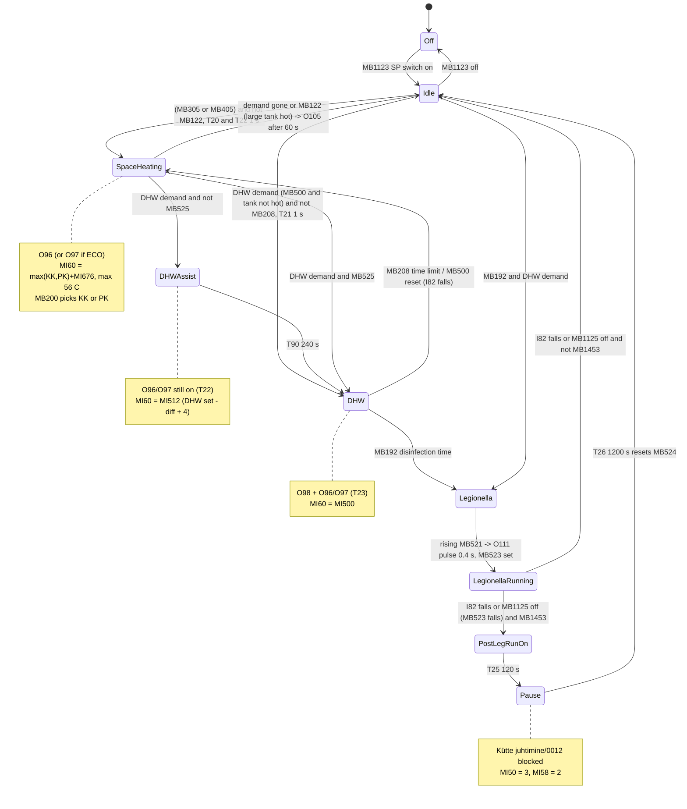
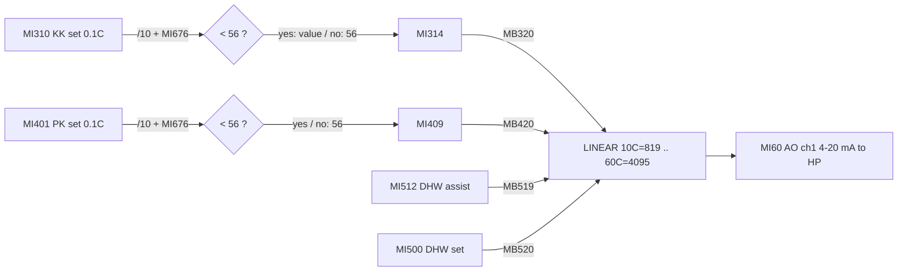
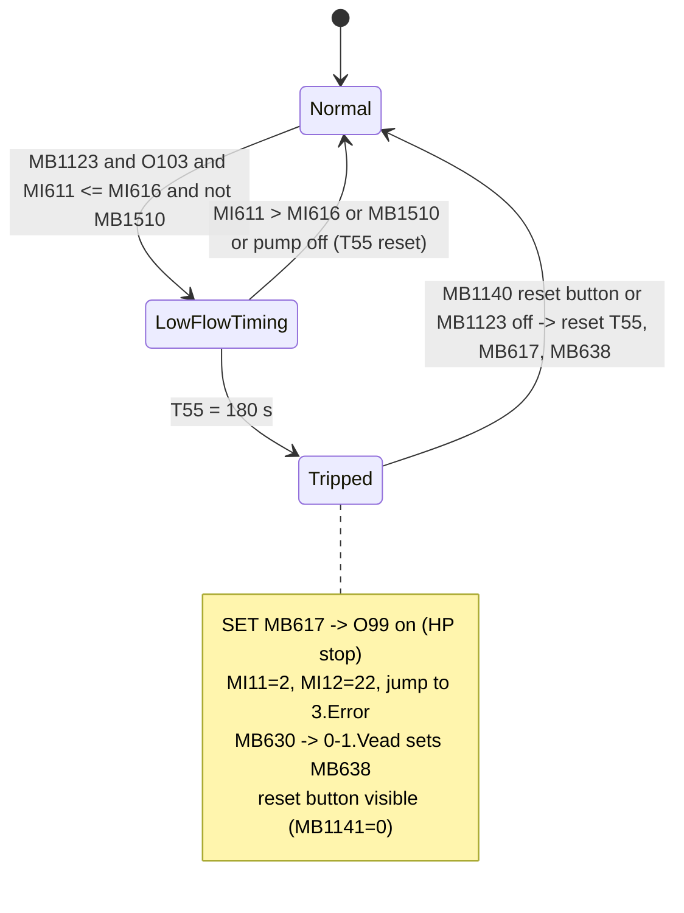
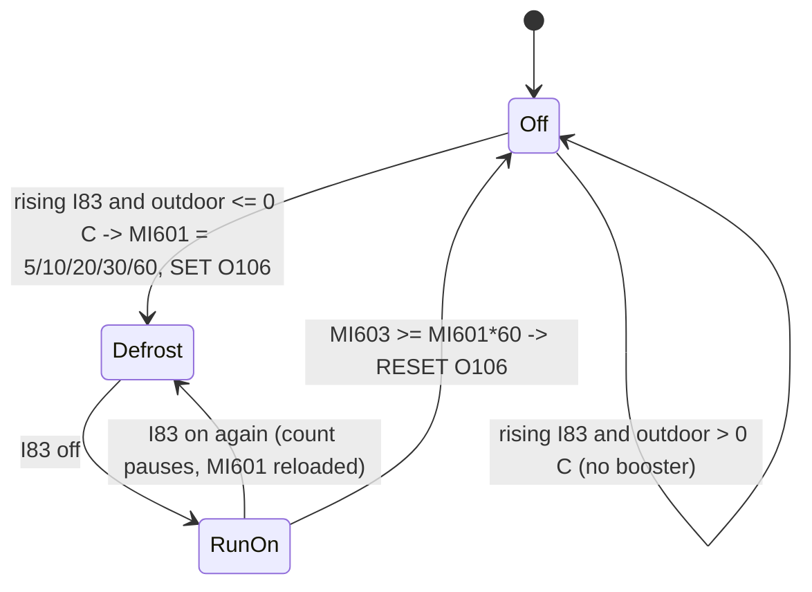

# 5. Heat pump control (SP) and heating coordination

> **Citations.** `Sub/00NN` means `ladder/! Main Module/<Sub>/00NN.txt` in the dump. Display references are `hmi/<module>/<display>`. Writers come from `index.txt`. Timer presets are `OprndPowerUp/100` seconds, taken from `operands.txt`.
> **Translations.** Estonian descriptions are quoted on first use and translated after them.

## 5.1 Purpose

This part of the program does three jobs:

1. **It decides what the heat pump ("SP" = soojuspump) is asked to do.** The options are:
   - radiator heating (KK) or floor heating (PK);
   - domestic hot water (TV), with an optional "start-assist" temperature first;
   - a Legionella (disinfection) cycle;
   - nothing: the SP is idle, blocked, or in the pause that follows a Legionella cycle.

   The heat pump gets this as digital "mode" inputs (heating / ECO heating / DHW / Legionella) plus one analogue set point.
2. **It works out that set point and scales it to the 4-20 mA output `MI60 "Soojuspumbale"` ("to the heat pump").** For KK/PK it uses the weather-compensated flow temperature of whichever circuit needs the higher temperature, plus an operator offset ("SP.lisakraadid", extra degrees), clamped to 56 °C. For TV it uses the DHW set point, or a lower start-assist temperature for the first 240 s.
3. **It runs the heat-pump hydraulics and safety:**
   - the SP circulation pump `O103` and its variable speed `MI64`, which depends on the diverter-valve position;
   - a monthly anti-seize run of that pump;
   - the "SP valve" `O105`, which switches to the wood-boiler buffer tank (MP) when that tank is hot enough;
   - an electric defrost booster `O106`, timed from the outdoor temperature;
   - flow measurement, with a low-flow emergency stop `O99` that latches and needs an operator reset;
   - the KK/PK 3-way mixing-valve analogue outputs `MI61`/`MI62`. These are wired here, but the PID loops themselves are in K.K.seade and P.K.seade.

Three HMI-linked subroutines (`5-1.SP` .. `5-3.SP`) drive the F5 screens: a P&ID animation, a status page and the pump/offset settings page. Only 5-3.SP changes parameters.

## 5.2 Subroutines

| Subroutine | How it is invoked | Purpose |
|---|---|---|
| `Kütte juhtimine` ("heating control"), 20 nets | Called **unconditionally every scan** from MAIN `0-0. PEA LEHT/0008`, second parallel branch: `M.P.ja Korst.seade → Kütte juhtimine → K.K.seade → P.K.seade → T.V seade → S.P.seade → Internet`. | Chooses the SP demand (KK/PK/TV/Legionella), the set point and the 4-20 mA scaling, sets the mode outputs O96/O97/O98/O111, and writes the KK/PK 3-way valve AO. |
| `S.P.seade` ("heat-pump device"), 18 nets | Same MAIN `0-0. PEA LEHT/0008` call chain, unconditionally every scan, after T.V seade. | SP circulation pump and its speed, monthly pump run, buffer-tank valve O105, defrost booster, flow calculation, low-flow trip and reset, error-screen hand-off. |
| `5-1.SP`, 28 nets | Display-linked only: `hmi/F5/1.SP.Joonis` header `LADDER "5-1.SP"`. Not called from MAIN. | Animation of the SP hydraulic drawing. Also derives the KK/PK valve opening % (display copy). |
| `5-2.SP`, 13 nets | Display-linked only: `hmi/F5/2.SP.Seaded` `LADDER "5-2.SP"`. | Status texts: SP mode, analogue set point in °C, defrost/booster state and remaining time, post-Legionella pause time, low-flow warning. |
| `5-3.SP`, 7 nets | Display-linked only: `hmi/F5/3.SP.Pumba seaded` `LADDER "5-3.SP"`. | +/- buttons for the SP pump speeds (10-100 %) and the SP extra degrees (0-5 K). |

Navigation in module F5:
- `1.SP.Joonis` → Enter (`MB1133`) → `2.SP.Seaded` → Enter → `3.SP.Pumba seaded` → Enter → `1.SP.Joonis`.
- Back (`MB1132`) on each screen → `2.Avaleht`.

**Call order matters.** In MAIN 0008, Kütte juhtimine runs **before** K.K.seade, P.K.seade and T.V seade. It therefore always uses the previous scan's values of MB305, MB405, MI310/MI312, MI401/MI404, MB321/322, MB421/422, MB500, MB525 and MI512. This is a one-scan lag and has no practical effect.

## 5.3 Signals

### Physical inputs

All are on the IO-DI16 module (rail 1, pos 4). `index.txt` shows `io -1`, so the channel numbers are not in the dump.

| Operand | Original description | Meaning | Used in |
|---|---|---|---|
| `I80` | "SP.tsirk.pumba käivitamise käsk" | Heat pump requests its circulation pump (signal from the HP) | S.P.seade/0001 |
| `I81` | "3T Ventii suure MP. asendis" | 3-way valve is in the "large buffer tank" (heating) position (limit contact) | S.P.seade/0001, 0002; 5-1.SP/0007, 0008; also K.K.seade/0029, P.K.seade/0015, 4-5.TV |
| `I82` | "SP.3Tventiil KK/PK suunas avatud" | Label: "SP 3-way valve open toward KK/PK". **The logic uses I82=1 as the DHW (TV) position** (see 5.8). | S.P.seade/0001, 0003; Kütte juhtimine/0018; 5-1.SP; many TV nets |
| `I83` | "SP.Sulatus" | Heat pump is defrosting | S.P.seade/0008-0010; 5-2.SP/0006-0010 |
| `I85` | "1.Lisaküte (booster) sees" | Booster heater 1 is on (feedback) | 5-1.SP/0023 (display), Internet/0003 |
| `I86` | "2.Lisaküte (booster) sees" | Booster heater 2 is on (feedback) | 5-1.SP/0025 (display), Internet/0004 |
| `I88` | "TV.Lisakütte käsirežiim" | DHW electric heater in manual mode; blocks SP DHW | Kütte juhtimine/0012 |
| `MI612` | "Sisendi sagedus Hz (vee voolu)" | Flow-meter pulse frequency (Hz). IO-DI16 frequency channel 1 (`HW_Elements_Operands`: IOGeneralType=5, Adrs=612). | S.P.seade/0011; shown on F5-2 |

### Inputs from other subroutines (demands and analogue values)

| Operand | Original description | Meaning | Writer |
|---|---|---|---|
| `MI196` | "Õue temp. peale korrektsiooni" | Outdoor temp after correction, 0.1 °C | 0-0. PEA LEHT/0001 |
| `MI206` | "V.M.Paagi temp. 0-100,0°C" | Small buffer tank temperature, 0.1 °C | 0-0. PEA LEHT/0003 |
| `MB305` | "KK lüliti peale kliima seadet ja ooterežiimi." | KK enabled after the climate and standby blocks | K.K.seade/0021 |
| `MB405` | "PK lüliti peale kõiki blokeeringuid" | PK enabled after all blocks | P.K.seade/0004 |
| `MI310` | "KK.korrigeeritud temp.(10,0-65,0°C)" | KK flow set point (curve + correction), 0.1 °C | K.K.seade/0017 |
| `MI312` | "KK.korrigeeritud temp.lüliti" | KK set point in whole °C, or 10 if KK is disabled | K.K.seade/0022 |
| `MI401` | "PK. graafiku korrektsioon kellaga (25,0-50,0°C)" | PK flow set point with clock correction, 0.1 °C | P.K.seade/0003 |
| `MI404` | "PK.korrigeeritud temp.lüliti" | PK set point in whole °C, or 10 if PK is disabled | P.K.seade/0005 |
| `MB321` / `MB322` | "KK.PIDi väljundi juhtimine" / "KK.3T ventiil suletud" | KK valve: follow PID / force closed | K.K.seade/0032 |
| `MI323` | "PID: väljund väärtus 2-10V" | KK PID output | K.K.seade/0023 |
| `MB421` / `MB422`, `MI423` | PK equivalents | PK valve: follow PID / closed; PK PID output | P.K.seade/0018, 0009 |
| `MB500` | "TV.kütte diferents (SP.-le)" | DHW demand for the SP (tank below set point minus differential) | T.V seade/0004 (set/reset) |
| `MI500` | "TV.kütte temp. kellaga või ajatu" | DHW set point (clock or fixed), whole °C | T.V seade/0002 |
| `MI512` | "TV. kütte alustamise abi temp." | DHW start-assist temperature = MI501 + 4 | T.V seade/0013 |
| `MB525` | "TV.kütmise abi temp.valik (kõrgem)" | Skip the assist: assist switch is off, or the current SP temperature is already ≥ the assist temperature | T.V seade/0013 |
| `MB122` | "F6-2 MP.sees/väljas (KK.,PK.)" | Large buffer tank (wood boiler) is hot enough for KK/PK | M.P.ja Korst.seade/0003, 0005 |
| `MB123` | "F6-2MP.sees/väljas (TV.)" | Large buffer tank is hot enough for DHW | M.P.ja Korst.seade/0003, 0005 |
| `MB124` | "F6-2MP.sees/väljas (TV.Legionella 60C°)" | Large buffer tank is hot enough for Legionella (≥70 °C on, <65 °C off) | M.P.ja Korst.seade/0004, 0005 |
| `MB192` | "F4-6 des.aeg sees,väljas" | Disinfection (Legionella) time is active | 4-6.TV/0003 (set), 0005 (reset) |
| `MB208` | "SP.kasutamise ajaline piiramine TV.küttel." | DHW heating time limit reached; SP is released back to KK/PK | 4-5.TV/0001, 0002 |
| `T25` | "Leg.reziimi järgus pausi alustamise viide.(2min.)" | 2 min after the end of a Legionella cycle; on = SP pause is active | 4-6.TV/0007 |

### Physical outputs

Digital outputs are on IO-TO16 (rail 1, pos 5; channel `io -1`). Analogue outputs are on IO-AO6X (rail 1, pos 3).

| Operand | Original description | Meaning | Writer |
|---|---|---|---|
| `O96` | "SP.kütte sisendile" | HP "heating" input | Kütte juhtimine/0019 |
| `O97` | "küte ECO" | HP "ECO heating" input (replaces O96 when ECO is on) | Kütte juhtimine/0019 |
| `O98` | "SP.tarbevee kütte sisendile" | HP "DHW heating" input | Kütte juhtimine/0019 |
| `O111` | "Legionella bakteri hävitus" | HP Legionella-program start (0.4 s pulse) | Kütte juhtimine/0019 |
| `O99` | "SP. sees/väljas (vee tsirk. viga)" | HP on/off, **energised = trip** (water-circulation fault) | S.P.seade/0015 |
| `O103` | "SP.Tsirk.pump" | SP circulation pump | S.P.seade/0001 |
| `O105` | "SP. Ventiil (sulgeb SP.ja avaneb S.MP.suunas)" | SP valve: closes the SP and opens toward the large buffer tank | S.P.seade/0007 |
| `O106` | "Sulatuse lisaküte" | Defrost booster heater | S.P.seade/0008, 0009 (set), 0010 (reset) |
| `MI60` | "Soojuspumbale" | HP set point, AO ch 1 (4-20 mA; 819 = 10 °C, 4095 = 60 °C) | Kütte juhtimine/0003, 0007, 0010, 0011 |
| `MI61` | "K.K. 3T Ventiil (väljund O1.1)" | KK 3-way valve, AO ch 2 (819 = 2 V = closed) | Kütte juhtimine/0004 |
| `MI62` | "P.K. 3T Ventiil (väljund O2.0)" | PK 3-way valve, AO ch 3 | Kütte juhtimine/0008 |
| `MI64` | "SP.tsirk.pumba võimsuse juhtimine (0-20mA)" | SP pump speed, AO ch 5 (0-4095 = 0-100 %) | S.P.seade/0003 |

### Key internal operands

| Operand | Original description | Meaning | Writer |
|---|---|---|---|
| `MB200` | "Kõrgema temp.valija KK.võiPK." | Higher-temp selector: 1 = KK, 0 = PK | Kütte juhtimine/0009 |
| `MI313` / `MI410` | "...teisendamine täis kraadideks" | KK / PK set point in whole °C | Kütte juhtimine/0001, 0005 |
| `MI399` / `MI499` | "KK/PK.temp.saatmine SP.sisendi piirajale.(60C°)" | Set point + extra degrees, before the limiter | Kütte juhtimine/0001, 0005 |
| `MB399` / `MB499` | "...SP.sisendi piiraja.(60C°)" | Value is < 56 (inside the limit) | Kütte juhtimine/0001, 0005 |
| `MI314` / `MI409` | "kk/PK.kütte temp.+lisakraadid SP.sisendi jaoks" | Limited KK / PK set point for the SP | Kütte juhtimine/0002, 0006 |
| `MI311`, `MI411`, `MI510`, `MI515` | "...teisendatud (4-20mA)" | KK / PK / TV / TV-assist set point as raw AO counts | Kütte juhtimine/0003, 0007, 0011, 0010 |
| `MI59` | "SP.-le saadetava temperatuuri näit.(aken F1-1)" | Set point sent to the SP, in °C (shown on F1-1) | Kütte juhtimine/0003, 0007, 0010, 0011 |
| `MB205` | "KK.või PK.töötab (5-2 SP info aknas)" | KK/PK demand on the SP | Kütte juhtimine/0012 |
| `MB206` | "TV.töötab (5-2SP jnfo aknas)" | DHW demand on the SP (not time-limited) | Kütte juhtimine/0012 |
| `MB207` | "SP.kasutamise ajaline piiraja käivitus TV.küttel." | Starts the DHW time limiter (read in 4-5.TV) | Kütte juhtimine/0012 |
| `MB210` | " TV.kütte alustamise temp.lülitamine" | DHW request is active | Kütte juhtimine/0012 |
| `MB320` / `MB420` | "KK/PK.valitud temp.SP-le" | KK / PK set point selected for the SP | Kütte juhtimine/0013 |
| `MB518` | "TV.kütmise alustamise abi temp." | DHW start-assist phase | Kütte juhtimine/0014 |
| `MB519` | "TV.kütmise alustamise abi temp.SP.-le" | Assist temperature selected for the SP | Kütte juhtimine/0013 |
| `MB520` | "TV.valitud temp.SP-le" | DHW set point selected for the SP | Kütte juhtimine/0015 |
| `MB521` | "Legionella tõrje käivitus käsk SP-le." | Legionella start command to the SP | Kütte juhtimine/0015 |
| `MB522` | "Legionella tõrje imp.sees/väljas" | Legionella pulse | Kütte juhtimine/0016 (set), 0018 (reset) |
| `MB523` | "Legionella režiimis olek SET/RES" | In Legionella mode (its fall starts the pause in 4-6.TV/0006) | Kütte juhtimine/0016, 0018 |
| `MB38` | "SP.pumba lülitamine joonisel" | SP pump running (mirror of O103) | S.P.seade/0001 |
| `MI673` / `MI674` | "SP.tsirk.pumba kiirus KK.,PK./TV.asendis (0-20mA)" | Pump speed in AO counts, heating / DHW position | S.P.seade/0003 |
| `MB118` / `MB119` | "F5-3 ... SEES/VÄLJAS" | Which speed set is active (lamps on F5-3) | S.P.seade/0003 |
| `MI670`, `MB670` | "SP.Tsirk.pumba aegrelee" | Days without a pump run; ≥30 days flag | S.P.seade/0005 |
| `MI600` | "Õue temp.(täis kraadides)" | Outdoor temperature in whole °C | S.P.seade/0008 |
| `MI601` | (no description) | Booster run-on time, minutes | S.P.seade/0008, 0009, 0010 |
| `MI602` | "Sulatuse lisakütte aeg (sekundites)" | Booster run-on time, seconds | S.P.seade/0010 |
| `MI603` | "Taimeri aja liitjast" | Booster run-on elapsed seconds | S.P.seade/0010 |
| `MI611` | "Veemõõtja näit L/Min" | Flow, L/min | S.P.seade/0011 (FORMULA) |
| `MB617` | "SP.kompressori hädaseis (SET/RES.)" | Compressor emergency stop (latched) | S.P.seade/0013 (set), 0014 (reset) |
| `MB630` | "Veemõõtja vea teade lisaekraani jaoks" | One-scan flag that makes 0-1.Vead/0019 set `MB638 "SP.veemõõtja error"` | S.P.seade/0016 |
| `MI11` / `MI12` | "Errori tekstid" / "Täpsustav error" | Error-screen text index / detail | S.P.seade/0016 (and others) |
| `MB1141` | "peidab nullimise nupu" | Hides the reset button on 3.Error | S.P.seade/0017 |

## 5.4 Logic

### `Kütte juhtimine`

**0001-0003: KK set point to the SP.**

```
MI313 := MI310 / 10                      // 0.1 °C -> whole °C
MI399 := MI313 + MI676                   // + operator extra degrees (0..5)
MB399 := MI399 < 56
MI314 := MB399 ? MI399 : 56              // limiter: max 56 °C (label says 60 °C)   (0002)
if MB320:                                // KK selected                              (0003)
    MI59 := MI314                        // display value (F1-1)
    MI311 := LINEAR(10->819, 60->4095, MI314)
    MI60  := MI311                       // analogue output to the heat pump
```

- Scaling: 10 °C = 819 = 4 mA and 60 °C = 4095 = 20 mA, assuming a 0-20 mA full scale of 4095. That is 65.5 counts per K.
- With the clamp, the highest KK/PK set point is 56 °C, about 3833 counts or 18.7 mA.

**0004: KK 3-way valve AO.**
- `MI61 := MI323` (PID output) while `MB321`.
- `MI61 := 819` (2 V, closed) while `MB322`.
- MB321/MB322 are simply MB305 and NOT MB305 (K.K.seade/0032). So the valve follows the PID while KK is enabled and is held closed otherwise.

**0005-0007: PK set point to the SP.** Same as 0001-0003, using `MI401` → `MI410` → `MI499` → `MB499` → `MI409`. While `MB420`, the result goes to `MI59`, `MI411` and `MI60`.

**0008: PK 3-way valve AO.** `MI62 := MI423` while `MB421`, or `819` while `MB422` (see P.K.seade/0018).

**0009: higher-temperature selector.**
```
if MI312 > MI404: SET MB200      // KK needs more -> KK set point to SP
if MI312 < MI404: RESET MB200    // PK needs more
(equal: MB200 keeps its value)
```
A disabled circuit reports 10 (K.K.seade/0022, P.K.seade/0005), so the enabled circuit always wins. The comparison is made on whole degrees without the extra degrees; the same offset is added to both, so this does not change the result.

**0010: DHW start-assist set point.**
- Always: `MI515 := LINEAR(10->819, 60->4095, MI512)`.
- While `MB519`: `MI59 := MI512` and `MI60 := MI515`.

**0011: DHW set point.**
- Always: `MI510 := LINEAR(.., MI500)`.
- While `MB520`: `MI59 := MI500` and `MI60 := MI510`.
- DHW values are **not** clamped (see 5.8).

If several selections are true in one scan, the last net wins (order 0003 → 0007 → 0010 → 0011). When none is true, `MI60` keeps its last value.

**0012: demand logic (core of the coordination).**
```
if MB1123 (SP switch) AND (NOT MB1453 OR NOT T25):          // not in post-Legionella pause
    // space heating demand
    if (MB305 OR MB405) AND NOT MB122:                      // KK or PK on, and large buffer tank NOT hot enough
        MB205 := 1 ; run T20 (1 s)
    // DHW demand
    if MB1122 (TV switch) AND NOT I88 AND NOT MB1451 (DHW-without-SP switch) AND
       ( ( (NOT MB123  OR  (NOT MB124 AND MB192)) AND MB500 )   // tank cannot supply DHW (or Legionella
         OR MB521 ):                                            // temperature during disinfection) and DHW is cold;
                                                                // or Legionella command holds it
        MB207 := 1                                          // start DHW time limiter (4-5.TV)
        if NOT MB208:                                       // time limit not reached
            MB206 := 1 ; MB210 := 1 ; run T21 (1 s)
```
- All of these are plain coils, so they drop as soon as the condition goes away.
- `MB208` (4-5.TV/0001) is set after `MI177` "TV.Lubatud kütmise aeg (SP-ga)" (allowed DHW heating time, minutes) of DHW heating, but only while `I81` is on and KK/PK demand is present.
- `MB208` is reset after a further `MI178` "TV.kütmise piirangu aeg (SP-ga)" (DHW blocking time, minutes).
- The effect is that DHW cannot hold the heat pump away from space heating for longer than MI177.

**0013: set point routing after the 1 s delay.**
```
if T20 AND NOT MB520:
    if NOT MB518:  MB320 := MB200 ; MB420 := NOT MB200    // KK or PK set point
    if MB518:      MB519 := 1                             // DHW start-assist set point
if T20: run T22 (1 s)                                     // SP heating start delay
```

**0014: start-assist phase.**
- `MB518 := T21 AND T20 AND NOT MB525`, and the same rung runs `T90` (240 s).
- This applies only when space heating and DHW are both requested and the assist is wanted. In that case the SP first gets `MI512` (DHW set point − differential + 4 K) for 240 s instead of the full DHW temperature.

**0015: switch to the DHW set point, or to Legionella.**
```
if MB210 AND ( (T21 AND (MB525 OR NOT T20)) OR T90 ):
    if NOT MB192:  run T23 (1 s) ; MB520 := 1             // DHW set point to SP
    if MB192:      MB521 := 1                             // Legionella start command
```
DHW goes straight to its own set point when there is no space demand or no assist is wanted. Otherwise it switches after the 240 s assist.

**0016-0018: Legionella pulse and state.**
- Rising `MB521` → SET `MB522` (pulse) and SET `MB523` (in Legionella mode).
- `MB522` runs `T24` (0.4 s), and `T24` resets `MB522`. This gives a 0.4 s pulse.
- `MB523` is reset when `MB1125` "Legionellatõrje reziimi lüliti" (Legionella mode switch) is off, or on the **falling edge of I82**, i.e. when the HP valve leaves the DHW position.
- The fall of MB523 sets the 2 + 20 min SP pause (4-6.TV/0006-0009), if `MB1453` "Legionellatõrrje reziimi järgse pausi lüliti" (post-Legionella pause switch) is on.

**0019: outputs to the heat pump.**
```
O96  := (T22 OR T23) AND NOT MB1124      // heating input
O97  := (T22 OR T23) AND MB1124          // ECO heating input ("ECO lüliti")
O98  := T23                              // DHW input
O111 := MB522                            // Legionella pulse
```
During DHW the heating input (O96, or O97 in ECO) is also on.

**0021:** `FUNCTION_RETURN`.

### `S.P.seade`

**0001-0002: SP circulation pump.**
```
O103 := ( ((MB1123 AND (I81 OR I82)) OR T50) AND I80 )  OR  T41
MB38 := O103
T50 (TE 180 s) is triggered while (NOT MB1123 OR NOT I81)       (0002)
```
- The pump runs only when the heat pump asks for it (`I80`) and the diverter valve is in a known position (I81 heating or I82 DHW), with the SP switched on.
- `T50` gives up to 180 s of run-on after the SP is switched off or the valve leaves I81. The run-on still requires I80.
- `T41` is the monthly anti-seize kick (0004-0005).

**0003: pump speed.**
```
MI673 := LINEAR(0->0, 100->4095, MI671)      // heating-position speed %
MI674 := LINEAR(0->0, 100->4095, MI672)      // DHW-position speed %
if O103 AND NOT I82: MI64 := MI673 ; MB118 := 1
if O103 AND I82:     MI64 := MI674 ; MB119 := 1
if NOT O103:         MI64 := 0
```

**0004-0005: monthly pump exercise.** Comment: "aegrelee (intervall 1kuu)", time relay with a 1-month interval.
- `T39` (24 h) runs while the pump is off (`NOT MB38`) and `NOT T40`. `T39` then runs `T40` (0.5 s), which restarts `T39`. Together they make a 24 h oscillator.
- On each rise of T39 while the pump is off, `MI670 += 1` (days without a run).
- Whenever the pump runs, `MI670 := 0`.
- When `MI670 ≥ 30`, `MB670` turns on. Its rising edge triggers `T41` (TE 10 s), which forces `O103` on for 10 s (0001). The run then clears MI670.

**0006-0007: buffer-tank changeover.**
- `MB122` (large buffer tank hot enough for KK/PK) runs `T42` (60 s).
- `O105 := T42`: the SP valve closes the heat-pump side and opens toward the large tank.
- At the same time Kütte juhtimine/0012 removes the KK/PK demand from the SP (`NOT MB122`), so the wood-boiler tank takes over space heating.

**0008-0010: defrost booster.** The two "taimeri" nets are labelled SET (0008-0009) and RES (0010).
```
MI600 := MI196 / 10                                  // outdoor °C
on rising I83 (defrost start), by outdoor band:
     -5 .. 0   -> MI601 := 5   min
    -10 .. -6  -> MI601 := 10
    -15 .. -11 -> MI601 := 20
    -20 .. -16 -> MI601 := 30
       <= -21  -> MI601 := 60
    and SET O106 (booster on)                        // above 0 °C: no booster
MI602 := MI601 * 60
while NOT I83 (defrost finished):
    every 1 s: MI603 += 1
    if MI603 >= MI602: MI601 := 0 ; MI603 := 0 ; RESET O106
```
- The booster is on from the start of the defrost, through the defrost, and for MI601 minutes after it ends.
- MI603 is not cleared when a new defrost starts. A defrost that starts during the run-on only pauses the count and reloads MI601.

**0011: flow measurement.**
- `FORMULA(MI612) => MI611` converts the flow-meter frequency (Hz) into L/min.
- The expression is a hidden `[bin 68 bytes]` blob and cannot be read. `index.txt` also lists the FORMULA as writing MI612 (role `out230`); this is probably an artefact of the element's parameter list.

**0012: low-flow detection** (junction net).
```
J2 := MB1123 AND O103                       // SP on and pump running
T55 (TD 180 s) coil := J2 AND (MI611 <= MI616)
RESET T55 if (J2 AND MI611 > MI616) OR MB1510
```
- `MI616` "Veevoolu min. kiiruse astmed" (minimum-flow steps) is the operator limit.
- `MB1510` "F5-1Veevoolumõõtja blokeerimine" (flow-meter blocking) keeps T55 cleared, which disables the trip.

**0013-0015: emergency stop and reset.**
```
T55                                   -> SET   MB617        // 3 min of low flow
(NOT MB1123) OR MB1140 (reset button) -> RESET T55, MB617, MB638
O99 := MB617                                                 // trip output to HP
```
- The trip latches.
- It does **not** stop O103 or drop O96/O98. Only O99 tells the heat pump to stop.

**0016: error screen.**
- Rising `MB617` → `MI11 := 2`, `MI12 := 22`, jump to `PAGE "3.Error"`, and `MB630` on for one scan.
- 0-1.Vead runs first in the next scan. Its net 0019 then sets `MB638 "SP.veemõõtja error"` (SP flow-meter error) and clears the KK/PK/TV error flags.
- Rising `MB1140` → `MI11 := 0`.

**0017:** `MB1141` (hide reset button) is reset when `MI11 = 2` and set otherwise. The 3.Error CBUTTON labelled "Veemõõtja vea nullimine" (flow-meter fault reset, touch=MB1140) is therefore shown only for this error.

**0019:** `FUNCTION_RETURN`.

### `5-1.SP` (F5-1 drawing; runs only while that screen is shown)

| Nets | What they do |
|---|---|
| 0001 | Pump image `MI619`: cycles frames 0-3 on each 100 ms pulse while `MB38`; frame 4 (stopped) otherwise. |
| 0002 | Flow arrows (junction net). J2 = `NOT T55 AND MB38`. Sets `MB50` "SP. nooled" (SP arrows). Sets `MB49` "Nool nurk" (corner arrow) when not I82 and hand valves 1/2 are not toggled. When `I82`: `MB43` (arrows SP→TV) and `MB35` (TV return into the SP). `MB60` (F5-1 TV return) when (I82 AND NOT MB62) or (MB62 AND (MB34 OR MB35)). MB35 also has a coil in 4-1.TV/0005; that is display-scoped and harmless. |
| 0003-0006 | Valve position from the AO counts: `MI5 := LINEAR(819->0, 4095->100, MI61)` and `MI7` likewise from `MI62`. `MB316`/`MB416` = closed (<5 %); `MB317`/`MB417` = partly open (≥5 %). The same nets exist in 2-1.KK, 3-1.PK, 4-1.TV, 6-1.MP and Täielik joonis. |
| 0007-0008 | Valve image `MI617` (0-3) from the KK/PK pump and valve state and `I81`. Also `MB28` (collector arrows), `MB45` (1st arrow and flap), `MB39` (heating flow from the buffer tank) and `MB34` (return to the 2nd tank). |
| 0009 | `MI618` image of the 3-way/2-way valves, which work together: 0/1 = I82 off/on with no flow (pump off or T55), 2/3 = with flow. |
| 0010-0011 | Hand valves 1 and 2: `MI630`/`MI631` images from `MB61`, `MB39`, `MB50`, `I82`. |
| 0012 | `MB46` "2.Nooled ja klapp" (2nd arrows and flap) := `NOT I82 AND MB22` (TV pump running). |
| 0013 | Touching the hand valves toggles `MB61` (rise of `MB1511`) and `MB62` (rise of `MB1512`). These only change the drawing. |
| 0014-0016 | Return-pipe arrows: `MB48 := MB45 OR MB46`, `MB47 := MB48 OR MB34`. Tee images `MI622` and `MI629`. |
| 0017-0018 | Hand valves 3-5: `MI632`-`MI634` images from `MB62`, `MB34`, `MB35`, `MB50`, `MB60`. |
| 0019-0022 | Flow-meter symbol. `MB53` (warning) := `MB38 AND MI611 < MI616`. `MB51` := 1 s blink. T58 (0.3 s) and T59 (0.1 s) form an oscillator that rotates `MI610` through 0-2 while flow is OK. With low flow, MI610 blinks between 3 and 4; with the pump off it shows 3. |
| 0023 | Booster image `MI625`: 0 = no SP flow, 1 = SP flow, 2 = SP flow with `I85` (booster 1 on). |
| 0024-0025 | `MI217 := MI206/10`; `MB33` "2.MP.Temp.alla 30°C" := `MI217 ≥ 30` (inverted label, 5.8). Small-tank image `MI626` 0-3 from MB33, MB49 and `I86`. |
| 0026 | Heat-pump image `MI623` cycles 0-3 every 100 ms while `MB38 AND NOT O99`. It freezes when stopped or tripped. |
| 0027 | Mode text `MI58`: 0 = SP switch off, 1 = on, 2 = on and post-Legionella pause (`T25`). |
| 0028 | `FUNCTION_RETURN`. |

### `5-2.SP` (F5-2 status screen)

| Nets | What they do |
|---|---|
| 0001 | `MI50` "SP.töörezimi näitamine" (SP mode display): 3 if `T25` (pause); otherwise 0 = idle, 1 = KK/PK (`MB205`), 2 = DHW (`MB206`). If both are on, 2 wins because it is the later branch. |
| 0002 | Remaining pause: `MI56 := 20 − MI260/60` minutes. MI260 counts seconds in 4-6.TV/0010. |
| 0003-0004 | Hourglass 1 `MI57`: 0-13 while T25, 14 = still. MI57 is not linked on the screen (5.8). |
| 0005 | `MI51 := LINEAR(818->10, 4095->60, MI60)`: the analogue set point shown back in °C. |
| 0006-0008 | `MI52` "SP.tekstid (SULATUS)" (defrost texts). During `I83` it blinks 0/1 on the 1 s pulse via `MB52`, i.e. "DEFROST" blinking. 0 when there is no defrost and no booster. During booster run-on it shows 2-6 for `MI601` = 5/10/15/20/25. |
| 0009 | Remaining booster time: `MI53 := MI601 − MI603/60` minutes. |
| 0010-0011 | Hourglass 2 `MI55` animates during booster run-on (`NOT I83 AND O106`), else 14. |
| 0012 | `MB615` (low-flow text) := `MI611 < MI616 AND SB3`, a blinking warning. |
| 0020 | `FUNCTION_RETURN`. |

### `5-3.SP` (F5-3 settings screen)

| Nets | What they do |
|---|---|
| 0001-0002 | KK/PK pump speed `MI671`. On a press of PLUS (`MB1522`), +10 if < 100. On a press of MINUS (`MB1520`), −10 if > 10. Clamped to 10..100. At the limits `MB1523`/`MB1521` hide the PLUS/MINUS button (CBUTTON `VisibleOpAddr`). `ML30 := MI671` feeds the bar graph. |
| 0003-0004 | DHW-position pump speed `MI672`, the same way (`MB1526`/`MB1524`, hide bits `MB1527`/`MB1525`, `ML31`). |
| 0005-0006 | SP extra degrees `MI676`, steps of 1, 0..5 (`MB1532`/`MB1530`, hide bits `MB1533`/`MB1531`, `ML33`). The screen says the offset applies to KK/PK only ("KK/ PK asendis"), which matches Kütte juhtimine/0001 and 0005. |
| 0017 | `FUNCTION_RETURN`. |

## 5.5 Timers

| Timer | Description | Type | Preset | Purpose | Net |
|---|---|---|---|---|---|
| T20 | "KK.võiPK. temp.lülitamise viide" | TD | 1.00 s | KK/PK demand confirmation | Kütte juhtimine/0012 |
| T21 | " TV.kütte alustamise temp.lülitamise viide" | TD | 1.00 s | DHW demand confirmation | Kütte juhtimine/0012 |
| T22 | "SP.lülitamise viide KK.või PK.järgi (kütmine)" | TD | 1.00 s | Delay before O96/O97 for heating | Kütte juhtimine/0013 |
| T23 | "SP.tarbevee kütte sisse lülitamise viide" | TD | 1.00 s | Delay before O98 (and O96/O97) for DHW | Kütte juhtimine/0015 |
| T24 | "TV.Legionella tõrje imp.lõpetamine" | TD | 0.40 s | Length of the Legionella pulse O111 | Kütte juhtimine/0017 |
| T90 | "TV.kütte temp.lülitamise viide" | TD | 240 s | Length of the DHW start-assist phase | Kütte juhtimine/0014 |
| T25 | "Leg.reziimi järgus pausi alustamise viide.(2min.)" | TD | 120 s | Run-on before the post-Legionella pause; its contact blocks the SP (coil in 4-6.TV/0007) | read in Kütte juhtimine/0012, 5-1.SP/0027, 5-2.SP/0001-0004 |
| T26 | "Leg.reziimi järgus pausi aeg.(20min.)" | TD | 1200 s | Pause length; ends MB524 (4-6.TV/0008-0009) | - |
| T39 | "SP.Tsirk.pumba aegrelee" | TD | 86 400 s (24 h) | Day clock for the pump exercise | S.P.seade/0004 |
| T40 | "SP.Tsirk.pumba aegrelee" | TD | 0.50 s | Restarts T39 | S.P.seade/0005 |
| T41 | ".Tsirk.pumba aegrelee (pumba intervall 1kuu)" | **TE** | 10 s | Anti-seize pump run | S.P.seade/0004 |
| T42 | "MP. sees/väljas viide" | TD | 60 s | Delay before O105 opens to the large buffer tank | S.P.seade/0006 |
| T50 | "SP.Tsirk.pumba stopi viide" | **TE** | 180 s | Pump run-on after SP off or valve change | S.P.seade/0002 |
| T55 | "vee voolu min.kiiruse viide" | TD | 180 s | Low-flow trip delay | S.P.seade/0012 |
| T58 | "Veemõõtja sümboli keerutaja" | TD | 0.30 s | Flow-meter animation oscillator | 5-1.SP/0019 |
| T59 | "Veemõõtja sümboli keerutaja (RES)" | TD | 0.10 s | Oscillator reset | 5-1.SP/0020 |

Reset at power-up (`ResetTimerOnPowerUp=-1`): T20-T24, T39, T41, T50, T90.

## 5.6 Diagrams

### Heat-pump mode selection (Kütte juhtimine/0012-0019)



### Set-point path



### Low-flow trip (S.P.seade/0011-0017)



### Defrost booster (S.P.seade/0008-0010)



## 5.7 Operator parameters

No SP parameter has a power-up value in `operands.txt`: none carries `OprndEnablePowerUp`, and `MI601`-`MI676` show only `FormatView`. All therefore keep their last (retained) value. Ranges come from the logic and the screen elements.

| Operand | Description | Where set | Range / step | Effect |
|---|---|---|---|---|
| `MB1123` | "SP.Lüliti" (SP switch) | `4.Seadmete valikud` binary image "Soojuspump +" | on/off | Enables all SP demand, the pump, flow supervision; off also resets the trip. |
| `MB1124` | "ECO lüliti" (ECO switch) | `4.Seadmete valikud` | on/off | O97 instead of O96. |
| `MB1125` | "Legionellatõrje reziimi lüliti" (Legionella mode switch) | `4.Seadmete valikud` "Leg.kuumutus" | on/off | Allows disinfection; off ends MB523. |
| `MB1122` | "TV.Lüliti" (DHW switch) | `4.Seadmete valikud`, F4-1 | on/off | Enables DHW demand. |
| `MB1451` | "TV.küte (ilma SP.-ta ) lüliti" (DHW without SP) | F4-5 | on/off | Removes DHW from the SP. |
| `MB1450` | "TV. Kütmise abi (Valiku lüliti)" (DHW assist selection) | F4-5 | on/off | Off = no start-assist (MB525 always set). |
| `MB1453` | "Legionellatõrrje reziimi järgse pausi lüliti" (post-Legionella pause) | F4-6 | on/off | Enables the 2 + 20 min SP pause. |
| `MI177` / `MI178` | Allowed DHW heating time / DHW blocking time with the SP | F4-5 | minutes | DHW time limiter (4-5.TV). |
| `MI616` | "Veevoolu min. kiiruse astmed" (minimum flow) | F5-2 keypad (`VarKeyPadEntry=-1`, `data=D#200 data=D#50`, probably limits 50..200) | L/min | Low-flow threshold. |
| `MB1510` | "F5-1Veevoolumõõtja blokeerimine" (flow-meter blocking) | F5-2 binary image (ok / blocked) | on/off | Disables the low-flow trip. |
| `MI671` | SP pump speed, KK/PK position | F5-3 +/- | 10..100 %, step 10 | `MI64` when not I82. |
| `MI672` | SP pump speed, DHW position | F5-3 +/- | 10..100 %, step 10 | `MI64` when I82. |
| `MI676` | "SP.lisakraadid" (extra degrees) | F5-3 +/- | 0..5 K, step 1 | Added to the KK/PK set point. |
| `MB1140` | "SP.kompressori hädaseisu nullimine" (emergency-stop reset) | 3.Error button | momentary | Resets the low-flow trip. |
| `MB1511` / `MB1512` | Hand-valve touch areas | F5-1 drawing | toggle | Drawing only (MB61/MB62). |

Shown but not editable on F5:
- F5-1: SP temperature `MI205`, small tank `MI206`, flow `MI611`, `MI616`.
- F5-2: `MI50`, `MI51`, `MI56`, `MI52`, `MI53`, `MI611`, `MI612`, `MB615`.
- F5-3: `MI611`, plus the bar graphs `ML30`/`ML31`/`ML33`.

## 5.8 Open questions and inconsistencies

1. **Flow formula is opaque.** S.P.seade/0011 `FORMULA(MI612) => MI611` keeps its Hz → L/min conversion in a `[bin 68 bytes]` blob. The units and calibration of MI611 and MI616 cannot be checked. `index.txt` also lists MI612 as a FORMULA output (`out230`), which is probably a parameter artefact.
2. **I82 label contradicts its use.** The label says "SP 3-way valve open toward KK/PK", but everywhere the logic treats I82=1 as the **DHW** position:
   - DHW pump speed (S.P.seade/0003);
   - arrows SP→TV (5-1.SP/0002);
   - its fall ends DHW and Legionella (T.V seade/0004, Kütte juhtimine/0018).
3. **Relation between I81 and O105 is not in the ladder.** O105 "closes SP, opens toward the large tank" is driven only by MB122/T42. No net ties it to the feedback I81 "valve in large-MP position". I81 is required for the SP pump (S.P.seade/0001) and for DHW time limiting (4-5.TV/0001). The hydraulics in 5.1 are inferred.
4. **Limiter value.** The "60 °C" limiter (`MB399`/`MB499`, Kütte juhtimine/0001, 0005) actually clamps at **56 °C**.
5. **DHW set points are not limited.** `MI500` and `MI512` go through `LINEAR` (10-60 °C) unclamped (Kütte juhtimine/0010, 0011). A DHW set point above 60 °C would give more than 4095 counts.
6. **MI60 holds its last value** when none of MB320/MB420/MB519/MB520 is active (idle, pause or trip). The heat pump keeps seeing the last set point.
7. **The trip only drives O99.** `MB617` does not drop O96/O97/O98, the pump O103 or the booster O106 (S.P.seade/0013-0015). Whether this is enough depends on the heat pump's own handling of O99.
8. **Defrost texts do not match the times.** 5-2.SP/0007-0008 expect `MI601` = 5/10/15/20/25, but S.P.seade/0008-0009 set 5/10/20/30/60. For 30 and 60 min no booster text is written, and 15/25 never occur. `MI601` has no description.
9. **Inverted label MB33.** `MB33` "2.MP.Temp.alla 30°C" (below 30 °C) is set when the temperature is **≥ 30 °C** (5-1.SP/0024). Also `MI217` is described as "S.Pumba temp" but is computed from `MI206` (small buffer tank).
10. **Hourglass 1 not shown.** `MI57` (5-2.SP/0003-0004) is not linked on F5-2. Both hourglass VARs on `2.SP.Seaded` (at @256,20 and @256,76) link `MI55`, so the post-Legionella hourglass is never shown.
11. **5-2.SP/0005 uses 818** where every other scaling uses 819. This is a display rounding only.
12. **AO modes differ.** In `HW_Elements_Operands`, MI60 has IOType=17, MI61-63 have IOType=42 and MI64 has IOType=16. The ladder treats MI60 as 0-4095 = 0-20 mA with a 4 mA offset (819). The actual output mode of channel 1 should be confirmed.
13. **No visible writer for the main switches.** `MB1123`, `MB1124`, `MB1125` and `MB1510` appear only as binary-image VARs (`TouchOprndAddr=-1`). The touch-toggle setting is presumably inside the VAR `Binary` blob and cannot be verified.
14. **Channel numbers missing.** Digital I/O shows `io -1` in `index.txt` and `HW_Elements_Operands`, so terminal numbers are not in the dump.
15. **Settings are retentive only.** MI671, MI672, MI676 and MI616 have no power-up values. With a cleared memory MI671/MI672 would be 0, giving pump speed 0 while O103 is on. The 10..100 clamp runs only while F5-3 is displayed (5-3.SP is display-linked).
16. **Mode display priority.** `MI50` shows "DHW" (2) when MB205 and MB206 are both on (5-2.SP/0001, last branch wins). The SP's actual state then depends on the assist/T90 phase.
17. **Display-scoped double coils.** MB35, MB28, MB45-MB48, MB51, MB53, MI5, MI7, MI610 and T58/T59 are written both here and in other display-linked subroutines (4-1.TV, 6-1.MP, Täielik joonis, 2-1.KK, 3-1.PK). Only one display runs at a time, so this is harmless.
18. **One-scan lag.** Kütte juhtimine runs before K.K.seade, P.K.seade and T.V seade (MAIN 0008), so it uses their previous-scan results. Harmless.

Not verified: the FORMULA blob and the list/text blobs (the on-screen strings for MI50, MI52, MI58, MI11/MI12). The hydraulic interpretation of I81, I82 and O105 is inferred from usage and should be checked on site.
