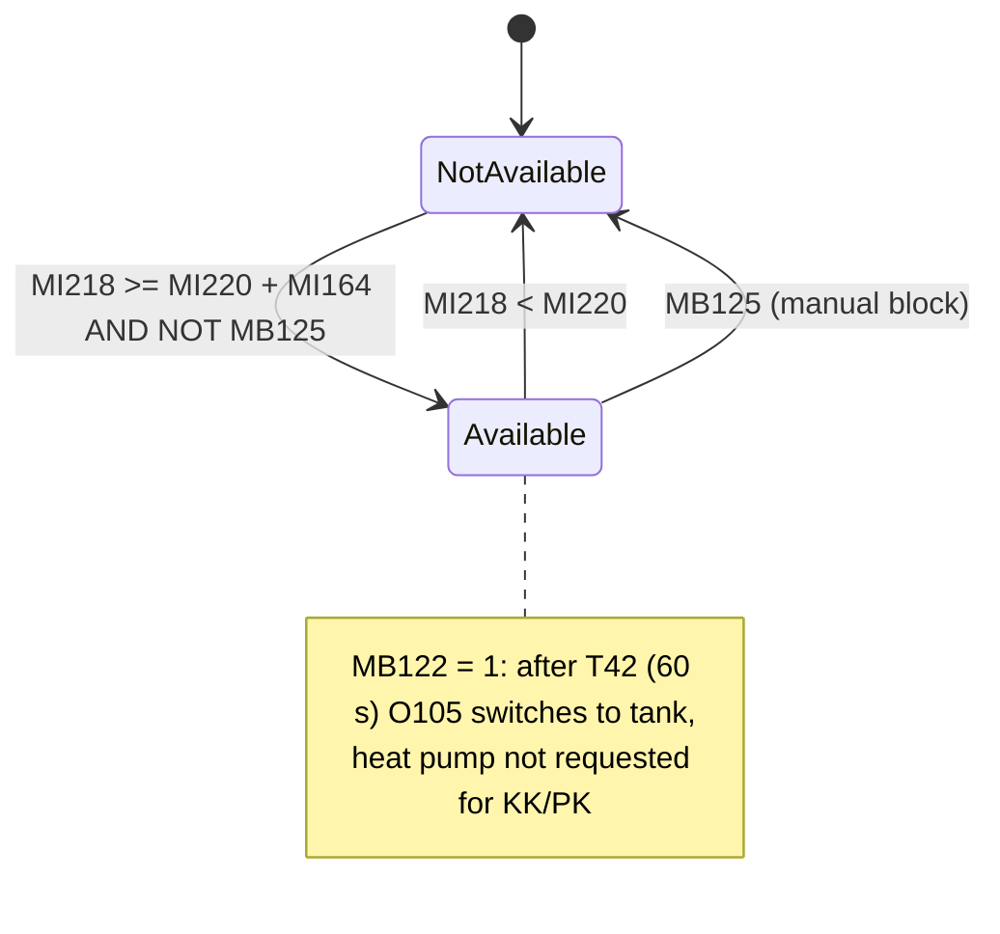
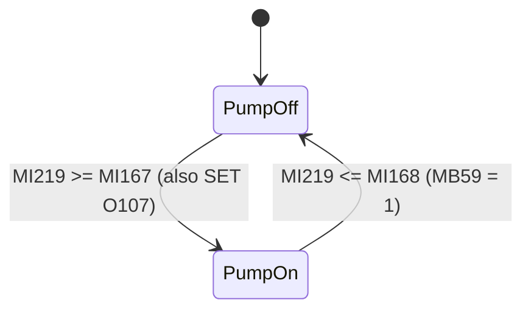
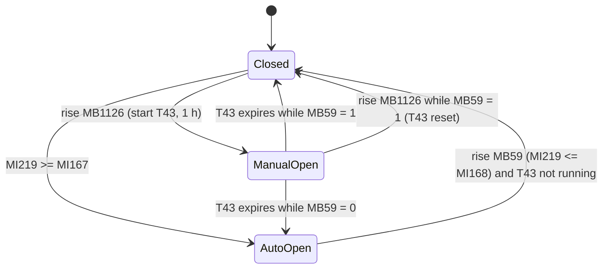

# 6. Buffer tank (MP), wood boiler and plant overview diagram

## 6.1 Purpose

This part of the program covers three things:

1. **Buffer tank as a heat source.** The PLC compares the buffer-tank temperature ("M.Paak", *mahupaak*) with what each consumer currently needs and keeps three availability flags:
   - `MB122` for radiator/floor heating (KK/PK),
   - `MB123` for domestic hot water (TV),
   - `MB124` for Legionella disinfection.

   Other chapters use these flags. When the tank is warm enough they move the heat-pump (SP) valve over to the tank and stop asking the heat pump for that load:
   - `S.P.seade/0006`–`0007` drive `O105` through `T42`.
   - `Kütte juhtimine/0012` sends the KK/PK and TV demands to the heat pump.
   - `T.V seade/0002`, `0009` and `0012` handle the DHW circulation pump `O102`, the immersion heater `O110` and the 60 °C disinfection set point.

   A manual block bit `MB125` is meant to clear all three flags.
2. **Wood boiler ("katel") with chimney (flue) sensor ("Korsten").**
   - The boiler loading pump `O104` switches on and off with hysteresis on the flue temperature.
   - The boiler air damper `O107` ("õhusiiber") opens together with the pump.
   - The damper closes when the flue has cooled, unless the operator has opened it by hand. A manual opening lasts at most 1 h (`T43`).
   - The time the pump last ran is recorded in `DW2`.
3. **Animated screens.**
   - Module F6 has three screens: F6‑1 tank and boiler diagram, F6‑2 tank settings, F6‑3 chimney/boiler settings.
   - The full-plant diagram `5.Täielik joonis` animates pumps, valves, flow arrows and the flow meter for the whole plant. Its touch areas lead to each sub-system's diagram.

## 6.2 Subroutines

| Subroutine | Nets | How invoked | Purpose |
|---|---|---|---|
| `M.P.ja Korst.seade` ("buffer tank and chimney setting") | 0001–0011, 0023 (12) | `CALL_FUNCTION` from MAIN `0-0. PEA LEHT/0008`. It sits in the second parallel branch with no condition, so it runs every scan. | All control logic in this chapter: tank availability flags, manual block, boiler pump, air damper, pump run-time stamp. |
| `6-1.MP` | 0001–0009, 0017 (10) | Display-linked: `DISPLAY "1.MP.jaKatla joonis" MODULE "F6" LADDER "6-1.MP"` | Animation for screen F6‑1: tank/boiler pipes, tee, tank picture, boiler flame, boiler pump. |
| `6-2.MP` | 0001, 0017 (2) | Display-linked: `DISPLAY "2.MP.Temp.Seaded" ... LADDER "6-2.MP"` | Copies the tank set points into 32-bit operands for the bar graphs on F6‑2. |
| `6-3.Korsten` | 0001, 0017 (2) | Display-linked: `DISPLAY "3.Korstna Temp. Seade" ... LADDER "6-3.Korsten"` | Copies the boiler pump thresholds into 32-bit operands for the bar graphs on F6‑3. |
| `Täielik joonis` ("full diagram") | 0001–0024 (24) | Display-linked: `DISPLAY "5.Täielik joonis" MODULE "! Start-Up Module" LADDER "Täielik joonis"` | Animation for the whole-plant screen. |

The display-linked subroutines run only while their screen is shown, so their bits go stale when another screen is active. Several of those bits (`MB45`, `MB46`, `MB48`, `MB317`, `MB417`, `MI5`, `MI7`, `MI610` and others) are also written by the other circuits' diagram subroutines (`2-1.KK`, `3-1.PK`, `4-1.TV`, `5-1.SP`). This does not cause conflicts, because only one screen is shown at a time.

## 6.3 Signals

### Physical inputs and measurements

| Operand | Original description | Meaning | Written by | Read here |
|---|---|---|---|---|
| `MI202` | "M.Paak temp. peale korrektsiooni" | Buffer-tank temperature after offset correction, in 0.1 °C. It equals the type K thermocouple `MI38` minus 44. | `0-0. PEA LEHT/0002` (SUB) | `M.P.ja Korst.seade/0001`; shown on F6‑1, the full diagram and F1‑2 |
| `MI203` | "Korsten temp. peale korrektsiooni" | Chimney (flue) temperature after correction, in 0.1 °C. It equals `MI39` minus 20. | `0-0. PEA LEHT/0002` | `M.P.ja Korst.seade/0006`; shown on F6‑1 and the full diagram |
| `I81` | "3T Ventii suure MP. asendis" | Limit switch: 3-way valve "in large-tank position". The logic suggests the opposite polarity (see 6.8). | hardware IO-DI16 | `6-1.MP/0003`; `Täielik joonis/0012`, `0013`, `0015`, `0016` |
| `I82` | "SP.3Tventiil KK/PK suunas avatud" | Heat-pump 3-way valve open toward KK/PK | hardware IO-DI16 | `6-1.MP/0003`; `Täielik joonis/0010`, `0015`, `0016` |
| `I89` | "MP.Elektriküte sees" | Buffer-tank electric heater is on. It is monitored only; this PLC does not drive it. | hardware IO-DI16 | `6-1.MP/0005`, `0006` |
| `MI61` / `MI62` | "K.K. 3T Ventiil (väljund O1.1)" / "P.K. 3T Ventiil (väljund O2.0)" | Analog outputs to the KK and PK mixing valves (raw 0–4095) | `Kütte juhtimine/0004` / `0008`; hardware IO-AO6X | `6-1.MP/0001`–`0002`; `Täielik joonis/0001`, `0005` |

### Physical outputs

| Operand | Original description | Meaning | Written by |
|---|---|---|---|
| `O104` | "Katla pump sees/väljas" | Wood-boiler loading pump on/off | `M.P.ja Korst.seade/0006` (SET/RESET) |
| `O107` | "Katla õhusiiber" | Boiler air damper (1 = open) | SET in `M.P.ja Korst.seade/0006` and `0009`; RESET in `0007` and `0010` |

Related output in another chapter: `O105` "SP. Ventiil (sulgeb SP.ja avaneb S.MP.suunas)", the heat-pump valve that closes the heat pump and opens toward the large tank. It is driven from `MB122` via `T42`, 60 s (`S.P.seade/0006`–`0007`).

### Key internal operands, M.P.ja Korst.seade

| Operand | Original description | Meaning | Written by | Main readers |
|---|---|---|---|---|
| `MI218` | "M.Paagi temp.teisendus täis kraadideks" | Tank temperature in whole °C (`MI202`/10) | `M.P.ja Korst.seade/0001` | `/0003`, `/0004`; `P.K.seade/0008` |
| `MI220` | "KK.võiPK.temp" | Current heating demand temperature, from KK or PK | `M.P.ja Korst.seade/0002` | `/0001`, `/0003` |
| `MI221` | "KK.võiPK.temp+lisatud kraadid (MP.SISSE)" | Heating demand + `MI164` = KK/PK switch-on threshold | `/0001` | `/0003` |
| `MI222` | "TV.temp.+lisatud kraadid(MP.SISSE)" | DHW set point + `MI164` = TV switch-on threshold | `/0001` | `/0003` |
| `MI223` | "TV.temp.+lisatud kraadid(MP.VÄLJA)" | DHW set point + `MI165` = TV switch-off threshold | `/0001` | `/0003` |
| `MI313` | "KK.korrigeeritud temp.teisendamine täis kraadideks" | KK corrected flow set point, whole °C | `Kütte juhtimine/0001` | `/0002` |
| `MI410` | "P.Kütte temp. teisendamine täis kraadideks" | PK flow set point, whole °C | `Kütte juhtimine/0005` | `/0002` |
| `MI503` | "TV.kütte temp. kellaga, ajatu või des.temp." | Active DHW set point: from the clock schedule, the untimed set point, or 60 °C during disinfection | `T.V seade/0002`, `0003` | `/0001` |
| `MB200` | "Kõrgema temp.valija KK.võiPK." | Higher-demand selector: 1 = KK demand is higher than PK | `Kütte juhtimine/0009` | `/0002` |
| `MB305` | "KK lüliti peale kliima seadet ja ooterežiimi." | KK enabled after climate and standby conditions | `K.K.seade/0021` | `/0002` |
| `MB404` | "PK lüliti kella" | PK enabled, clock condition included | `P.K.seade/0004` | `/0002` |
| `MB1370` | "Lüliti vesi PK.ja vesi/elekter PK." | Operator switch: water floor heating vs. water/electric floor heating | HMI F3‑7 | `/0002` |
| `MB122` | "F6-2 MP.sees/väljas (KK.,PK.)" | Tank available for KK/PK | SET/RESET `/0003`; RESET `/0005` | `6-1.MP/0005`–`0006`, `Kütte juhtimine/0012`, `P.K.seade/0008`, `S.P.seade/0006`, `1-2.Temp/0001`; F6‑2 lamp |
| `MB123` | "F6-2MP.sees/väljas (TV.)" | Tank available for DHW | SET/RESET `/0003`; RESET `/0005` | `6-1.MP/0003`, `Kütte juhtimine/0012`, `T.V seade/0009`, `0012`, `1-2.Temp/0001`; F6‑2 and F4‑5 lamps |
| `MB124` | "F6-2MP.sees/väljas (TV.Legionella 60C°)" | Tank hot enough for Legionella disinfection | SET/RESET `/0004`; RESET `/0005` | `T.V seade/0002`, `0009`, `0012`, `Kütte juhtimine/0012`, `1-2.Temp/0001` |
| `MB125` | "MP manuaal blokeering" | Manual tank block | **no writer anywhere** (only an HMI display link on F6‑2) | `/0003`, `/0004`, `/0005`, `1-2.Temp/0001` |
| `MI219` | "Korstna temp.teisendus täis kraadideks" | Flue temperature, whole °C (`MI203`/10) | `/0006` | `/0006` |
| `MB54` | "Katla pumba lülitamine joonisel" | Boiler pump running (internal copy, used for animations) | SET/RESET `/0006` | `/0011`, `6-1.MP/0005`, `0007`–`0009`, `Täielik joonis/0021`–`0022` |
| `MB59` | "Katla õhusiibri reset impulss" | "Damper reset pulse". In fact it is a **level**: flue ≤ off threshold. | COIL `/0006` | `/0007` (rise), `/0008`, `/0010` |
| `MB1126` | "Õhusiibri avamine lüliti" | Operator damper-open button | HMI touch, screen `4.Seadmete valikud` VAR @80,212 (shows `O107`) | `/0008`, `/0009` (rise) |
| `T43` | "Õhusiibri käsitsi avamine" | Manual damper opening timer | COIL `/0009`; RESET `/0008` | `/0007`, `/0010` |
| `DW2` | "Katla pumba viimase käivituse aeg." | Time stamp of the boiler pump's last run (UTC) | `RTC_TO_UTC` `/0011` | F6‑1 "Viimati töötas" ("last ran") |
| `MB202` | "M.Paak tähelepanu vilkumine" | "Tank attention" blink | `1-2.Temp/0001` (any of `MB122`–`MB125` AND `SB3`) | F1‑2 tank temperature VAR |

### Display-only operands (6-1.MP, 6-2.MP, 6-3.Korsten)

| Operand | Original description | Meaning | Written by |
|---|---|---|---|
| `MI5` / `MI7` | "KK.Kraani asend (0-100%)" / "PK.Kraani asend (0-100%)" | KK and PK valve position, % | `6-1.MP/0001`, `0002`; `Täielik joonis/0001`, `0005` (and other diagram subroutines) |
| `MB317` / `MB417` | "KK.3T kraan osaliselt avatud" / "PK.3T kraan osaliselt avatud" | Valve at least 5 % open | `6-1.MP/0001`, `0002` (and others) |
| `MB45` | "1.Nool ja klapp" | Arrow and flap 1: tank feeding the heating circuits | `6-1.MP/0003`, `Täielik joonis/0013`, `5-1.SP/0008` |
| `MB46` | "2.Nooled ja klapp" | Arrows and flap 2: tank feeding DHW | `6-1.MP/0003`, `Täielik joonis/0013`, `5-1.SP/0012` |
| `MB48` | "2.Nool välja (mahupaaki)" | Return arrow into the tank | `6-1.MP/0003`, `Täielik joonis/0013`, `5-1.SP/0014` |
| `MI172` | "Kolmik MP. joonisel" | Tee-piece picture index | `6-1.MP/0004` |
| `MI171` | "Mahupaak joonisel" | Tank picture index | `6-1.MP/0005`, `0006` |
| `MI170` | "Katla joonis" | Boiler (flame) picture index | `6-1.MP/0007` |
| `MI169` | "Katla pump joonisel" | Boiler pump picture index | `6-1.MP/0008` |
| `MB56` | "Nooled" | Boiler-circuit arrows | `6-1.MP/0009`, `Täielik joonis/0022` |
| `ML40`, `ML41`, `ML45`, `ML46` | "Mahupaagi sisse lülitamise lisa kraadid", "Tarbevee kütmiseks lisatavad min. kraadid", "Katla pumba sisse/välja lülitamise temp." | 32-bit copies of `MI164`, `MI165`, `MI167`, `MI168` for the bar graphs | `6-2.MP/0001`, `6-3.Korsten/0001` |

Operands used only by `Täielik joonis` are listed with that subroutine below.

## 6.4 Logic

### `M.P.ja Korst.seade` (every scan)

**Net 0001: thresholds.** Comment: "M.Paagi sisse/välja lülitamine" (tank on/off switching).
```
MI218 := MI202 / 10                 // tank °C, integer
MI221 := MI220 + MI164              // KK/PK switch-on threshold
MI223 := MI503 + MI165              // TV switch-off threshold
MI222 := MI503 + MI164              // TV switch-on threshold
```
`MI220` is written in net 0002, after this net, so `MI221` uses the previous scan's demand. This one-scan lag does no harm.

**Net 0002: heating demand to compare against (`MI220`).**
```
if not MB1370:                       // floor heating water-only
    MI220 := MB200 ? MI313 : MI410   // higher of KK / PK demand
else:                                // water/electric floor heating
    if MB305:        MI220 := MI313  // KK enabled → KK demand
    elif MB404:      MI220 := MI410  // else PK enabled → PK demand
    // neither enabled → MI220 keeps its last value
```

**Net 0003: KK/PK and TV availability, with hysteresis.** Comment: "Võrdlemine" (comparison).
```
if MI218 >= MI221 and not MB125: SET MB122     // tank ≥ demand + MI164
if MI218 <  MI220:               RESET MB122   // tank < demand
if MI218 >= MI222 and not MB125: SET MB123     // tank ≥ TV set + MI164
if MI218 <  MI223:               RESET MB123   // tank < TV set + MI165
```
- KK/PK hysteresis = `MI164`, 15–30 K. `MI165` plays no part here.
- TV hysteresis = `MI164 − MI165`. This can be 0 when both are 15.
- `MI503` rises to 60 °C during the disinfection period (`T.V seade/0003`). The TV thresholds rise with it.

**Net 0004: Legionella availability, fixed thresholds.**
```
if MI218 >= 70 and not MB125: SET MB124
if MI218 <  65:               RESET MB124
```
The description says "60C°". 60 °C is the disinfection target (`T.V seade/0003`); the tank must reach 70 °C to qualify and stays qualified down to 65 °C.

**Net 0005: manual block.** Comment: "MP 6-2 aknas oleva mahupaagi blokeerimise nupu loogika" (logic of the tank block button in window 6‑2).
```
if MB125: RESET MB122, MB123, MB124
```
Together with the `not MB125` gating in nets 0003 and 0004, the tank is fully blocked while `MB125` = 1. Nothing in the project writes `MB125`, however (see 6.8).

**Net 0006: boiler pump and automatic damper opening.** Comment: "Katla pumba sisse/välja lülimine" (boiler pump on/off).
```
MI219 := MI203 / 10
if MI219 >= MI167: SET O104, SET MB54, SET O107        // pump on, damper open
MB59 := (MI219 <= MI168)
if MB59:           RESET O104, RESET MB54              // pump off
```
- The hysteresis is between `MI167` (40–70 °C) and `MI168` (35–55 °C).
- Inside the band (`MI168 < MI219 < MI167`) the pump keeps its state.
- Both branches act every scan while their condition holds.

**Nets 0007–0010: damper closing and manual opening.** Comment: "Õhusiibri avamine/sulgemine nupust" (open/close the damper from the button). `T43` is an extended-pulse timer (TE) of 3600 s.

| Net | Logic | Effect |
|---|---|---|
| 0007 | `NOT T43 AND rise(MB59) → RESET O107` | Automatic close when the flue cools to the off threshold, unless a manual opening is running. |
| 0008 | `O107 AND rise(MB1126) AND MB59 → RESET T43` | Button pressed while the damper is open and the flue is cold: cancel the manual opening. |
| 0009 | `NOT O107 AND rise(MB1126) → COIL T43, SET O107` | Button pressed while the damper is closed: open it and start the 1 h pulse. |
| 0010 | `fall(T43) AND MB59 → RESET O107` | Manual period ended, or was cancelled in net 0008 in the same scan, and the flue is still cold: close. If the boiler has come up to temperature in the meantime (`MB59` = 0), the damper stays open under automatic control. |

The intended use is lighting the fire. The operator opens the damper with the button. If the fire takes, the flue passes `MI167` and net 0006 holds the damper open together with the pump. If it does not take within 1 h, the damper closes. A second press closes it early, but only while the flue is at or below the off threshold. The button `MB1126` is on screen `4.Seadmete valikud` (device selections). That VAR shows `O107` with button-off and button-on images.

**Net 0011: pump run time stamp.** Comment: "Pumba viimase töötamise aeg" (pump's last running time).
```
while MB54: DW2 := RTC_TO_UTC(now)
```
This refreshes on every scan while the pump runs, so after a stop `DW2` holds the **stop** time. F6‑1 labels it "Viimati töötas" ("last ran"). The operand description, "viimase käivituse aeg" (last start time), does not match.

**Net 0023:** `FUNCTION_RETURN`.

### `6-1.MP` (screen F6‑1, tank and boiler diagram)

| Net | Logic | Diagram meaning |
|---|---|---|
| 0001 | Comment "KK ahela info" (KK circuit info). `MB8 → MI5 := LINEAR(819→0 %, 4095→100 %, MI61); MB317 := MI5 ≥ 5` | KK valve position and "partly open" flag, only while the KK pump runs |
| 0002 | Comment "PK ahela info". The same for PK: `MB15`, `MI62 → MI7`, `MB417` | |
| 0003 | Comment "Trassi nooled (peale ja tagasivool)" (main-line arrows, flow and return). `MB45 := NOT I81 AND (MB317 OR MB417)`; `MB46 := NOT I82 AND MB123 AND MB22`; `MB48 := MB45 OR MB46` (previous scan's values) | Tank feeds heating (`MB45`) or DHW (`MB46`); return into the tank (`MB48`) |
| 0004 | Comment "Kolmik joonisel" (tee on diagram). `MI172 := 0` (none), `1` (`MB45` only), `2` (`MB46` only), `3` (both) | Selects one of four tee images |
| 0005 | Comment "MP Joonisel" (tank on diagram). If NOT `MB122`: if `MB54`, `MI171 := 4`; else `MI171 := I89 ? 1 : 0` | 0 = idle tank, 1 = electric heater on, 4 = boiler charging the tank |
| 0006 | If `MB122`: `MI171 := I89 ? 6 : 5` | 5 = tank in use for heating, 6 = in use with electric heater on. Boiler charging is not shown in this state. |
| 0007 | Comment "Katla pilt joonisel" (boiler picture). While `MB54`: on each rising edge of `SB7` (100 ms), `MI170++`, wrapping at 5 → 0. Otherwise `MI170 := 5`. | Flame animation, frames 0–4; frame 5 = idle boiler |
| 0008 | Comment "Pump joonisel". The same for `MI169`, frames 0–3 while running, 4 = stopped | Rotating boiler pump |
| 0009 | Comment "Katla nooled" (boiler arrows). `MB56 := MB54` | Boiler-to-tank pipe arrows |
| 0017 | `FUNCTION_RETURN` | |

Screen F6‑1 also shows:
- `MI202` (tank °C) and `MI203` (flue °C). `MI203` is a keypad-entry field (see 6.8).
- Chimney bitmaps.
- `DW2` as a UTC time under "Viimati töötas".
- `O107` as a closed or open damper image.

Navigation: Enter goes to F6‑2, Back goes to `2.Avaleht`.

### `6-2.MP` and `6-3.Korsten` (settings screens)

- `6-2.MP/0001`: `ML40 := MI164`, `ML41 := MI165`. These are the bar-graph copies; comment "MI>MLiks" (MI to ML).
- `6-3.Korsten/0001`: `ML45 := MI167`, `ML46 := MI168`.
- Each subroutine then ends with `FUNCTION_RETURN` (net 0017).

**F6‑2 "2.MP.Temp.Seaded".**
- Title: "Mahupaagi SISSE ja VÄLJA lülitamise temperatuuri seaded" (tank ON/OFF switching temperature settings).
- "SISSE" (on) row: keypad `MI164` with a 15–30 °C bar graph, explained as "degrees added to the temperature needed for heating, to switch the tank in". A lamp shows `MB122`.
- "VÄLJA" (off) row: keypad `MI165` with a 5–15 °C bar graph, explained as "minimum extra degrees needed for heating domestic water". A lamp shows `MB123`.
- An image button area shows `MB125` (block / blocked images) but has no touch operand.
- Enter goes to F6‑3.

**F6‑3 "3.Korstna Temp. Seade".**
- "Katla pumba SISSE ja VÄLJA lülitamise temperatuuri seaded" (boiler pump ON/OFF temperature settings).
- `MI167` with a 40–70 °C bar graph and `MI168` with a 35–55 °C bar graph.
- A lamp shows `O104`.
- Enter goes back to F6‑1.

### `Täielik joonis` (full-plant diagram)

The full-plant screen shows the whole plant, with labels F2‑1, F3‑1, F4‑1, F5‑1 and F6‑1.
- Touch areas: `MB1111` KK, `MB1112` PK, `MB1113` TV, `MB1114` SP, `MB1115` tank. Each opens that circuit's diagram; Back goes to `2.Avaleht`.
- The screen is reached from `2.Avaleht` via `MB1117` "Joonise nupp".
- Values shown: `MI5`, `MI7`, `MI198` (KK), `MI199` (PK), `MI201` (TV), `MI202`, `MI203` (keypad-entry), `MI204` (main-line water), and `MI611` (flow, l/min).
- Status texts show `MB305`, `MB1121`, `MB1122` and `MB1123` (circuit switches).

| Nets | Logic | Indicates |
|---|---|---|
| 0001 / 0005 | `MI5 := LINEAR(819..4095 → 0..100, MI61)`; `MI7` from `MI62` (unconditional here) | KK / PK valve % |
| 0002 / 0006 | `MB315 := MI5 ≥ 100`; `MB316 := MI5 ≤ 0`; `MB11 := MB315 OR (NOT MB315 AND NOT MB316 AND MB58)`. PK: `MB415`, `MB416`, `MB18`. | Valve image steady when fully open, off when closed, blinking at the 3 s rate when modulating |
| 0003 / 0007 | `MB12 := NOT MB11 AND MB8`; `MB13 := MB11`; `MB14 := MB12 OR MB13`. PK: `MB19`, `MB20`, `MB21` with `MB15`. | Circuit flow arrows: "corner" arrow when the pump runs with the valve closed, through-arrows when the valve is open |
| 0004 / 0008 / 0009 / 0014 / 0021 | `MB10`, `MB17`, `MB24`, `MB40`, `MB55` := pump bit (`MB8`, `MB15`, `MB22`, `MB38`, `MB54`) AND `SB3` | Pump symbols blink at 1 s while that pump runs (KK, PK, TV, SP, boiler) |
| 0010 | `MB25 := MB22 OR (I82 AND MB38)` | DHW arrows: TV pump, or heat pump heating DHW |
| 0011 | `MB26 := MB13`; `MB28 := MB26 OR MB20`; `MB29 := MB25 OR MB28` | Collector-loop arrows ("Kollektori") and the common outlet arrow |
| 0012 | `I81 AND MB28 → MB34, MB39` | Return "(2.MP)" and heating flow "(v.mahupaagist)" arrows on the SP side |
| 0013 | `MB45 := NOT I81 AND MB28`; `MB46 := MB22 AND MB25`; `MB47 := MB29`; `MB48 := MB45 OR MB46` | Tank-side arrows and flaps. The conditions differ from `6-1.MP/0003` (see 6.8). |
| 0015 | While NOT `T55` AND `MB38`: `MB50 := 1`; `MB49 := I81 AND NOT I82`; `MB43 := I82` | Heat-pump loop arrows; "corner" arrow; arrows from SP to TV. All are suppressed once the low-flow delay `T55` has elapsed. |
| 0016 | `MB41 := NOT I81`; `MB42 := I82` | Positions of the SP motor valve and the SP 3-way valve, from the actuator auxiliary contacts |
| 0017–0018 | `MB53 := MB38 AND T55` ("hüüumärgi lüliti", exclamation switch); `MB51 := rise(SB3)` (one scan per second); `T58` (0.3 s) and `T59` (0.1 s) form a free-running oscillator | Flow-meter alarm condition and animation clock |
| 0019 | While `MB38` AND NOT `MB53`: on each rise of `T58`, `MI610++`, wrapping at 4 → 0 | Flow-meter symbol rotates while the heat-pump pump runs with flow present |
| 0020 | Comment "Veemõõtja seisab" (flow meter stopped). If `MB53`: `MI610 := MB51 ? 5 : 4` | Low-flow image (4), with the exclamation frame (5) for a single scan each second |
| 0022 | `MB56 := MB54` | Boiler-circuit arrows |
| 0023 | Comment "Noolde vilkumise sagedus" (arrow blink rate). On each `SB13` (1 s edge): `MI3++`; at ≥ 3, toggle `MB58` and set `MI3 := 0` | `MB58` is a 3 s on / 3 s off blink clock for the modulating-valve symbols |
| 0024 | `FUNCTION_RETURN` | |

## 6.5 Timers

| Timer | Description | Type | Preset | Purpose | Nets |
|---|---|---|---|---|---|
| `T43` | "Õhusiibri käsitsi avamine" | TE (extended pulse), reset on power-up | 360000 → **3600 s (1 h)** | Maximum manual damper opening | `M.P.ja Korst.seade/0007`–`0010` |
| `T58` | "Veemõõtja sümboli keerutaja" | TD | 30 → 0.3 s | Flow-meter animation oscillator | `Täielik joonis/0017`, `0019` |
| `T59` | "Veemõõtja sümboli keerutaja (RES)" | TD | 10 → 0.1 s | Oscillator reset | `Täielik joonis/0017`–`0018` |
| `T55` | "vee voolu min.kiiruse viide" | TD | 18000 → 180 s | Low-flow delay. Read here; its coil is in `S.P.seade/0012`. | `Täielik joonis/0015`, `0017` |
| `T42` (related) | "MP. sees/väljas viide" | TD | 6000 → 60 s | Delay from `MB122` to heat-pump valve `O105` | `S.P.seade/0006`–`0007` |

## 6.6 State diagrams

Tank availability for KK/PK (`MB122`). `MB123` behaves the same way with `MI222`/`MI223`, and `MB124` with 70/65 °C.


Boiler pump (`O104`/`MB54`):


Air damper (`O107`):

While `ManualOpen`, a rise of the flue temperature to `MI167` also sets `O107`, which has no further effect. "AutoOpen" is an informal state: the bit is simply `O107` = 1 with `T43` idle.

## 6.7 Operator parameters

| Operand | Screen | Meaning | HMI range | Power-up default |
|---|---|---|---|---|
| `MI164` "MP.SISSE lülitamise temp.seade" | F6‑2 keypad | Degrees above demand needed to switch the tank in. Used for both KK/PK and TV, and also in `P.K.seade/0008`. | 15–30 | none (no `OprndPowerUp`; value retained) |
| `MI165` "MP.VÄLJA lülitamise temp.seade" | F6‑2 keypad | Minimum degrees above the DHW set point to keep the tank in for TV | 5–15 | none |
| `MI167` "Katla pumba SISSE lülitamise temp.seade" | F6‑3 keypad | Flue temperature to start the boiler pump and open the damper | 40–70 °C | none |
| `MI168` "Katla pumba VÄLJA lülitamise temp.seade" | F6‑3 keypad | Flue temperature to stop the pump and allow the damper to close | 35–55 °C | none |
| `MB1126` "Õhusiibri avamine lüliti" | `4.Seadmete valikud` touch | Manual damper open / cancel | — | — |
| `MB125` "MP manuaal blokeering" | F6‑2 (display only) | Manual tank block | — | none; never written |

Hard-coded values:
- Legionella availability: on at 70 °C, off below 65 °C (`M.P.ja Korst.seade/0004`).
- Valve "partly open" threshold: 5 % (`6-1.MP/0001`–`0002`).
- Valve scaling: 819 → 0 % (`6-1.MP/0001`; `Täielik joonis/0001`).
- Sensor offsets: −4.4 °C for the tank and −2.0 °C for the flue (`0-0. PEA LEHT/0002`).

## 6.8 Open questions and inconsistencies

1. **The manual tank block `MB125` cannot be operated.** No ladder element, HMI touch or web/communication entry writes it. The F6‑2 element is a binary-image VAR with `TouchOprndAddr=-1`. The comment in net 0005 says a button was intended, so the block in nets 0003–0005 has no effect unless the bit is written remotely (for example over a VisiLogic online connection).
   *Caveat (added when this document was assembled):* the plant on/off switches `MB1120`–`MB1125` on `4.Seadmete valikud` also have `TouchOprndAddr=-1` and no writer. They share this VAR's settings blob (`sha1:034177461852`). If those switches work, which they must for the plant to run, then this VAR most likely toggles `MB125` too, and the block is operable. See 7.5, item 2.
2. **`MI165` is labelled "VÄLJA" (switch-off) but only applies to DHW.** The KK/PK flag switches off at demand + 0 K (`M.P.ja Korst.seade/0003`). With `MI164` = `MI165` = 15 the TV hysteresis is zero, which can make `MB123` chatter.
3. **The boiler threshold ranges overlap.** On = 40–70 °C and off = 35–55 °C, so the operator can set off ≥ on (for example on 40, off 55). Between the two values both branches of `/0006` act every scan and the reset wins, so the pump would effectively start only above the off value.
4. **Damper behaviour inside the hysteresis band.** If the operator opens the damper while `MI168` < flue < `MI167` (`MB59` = 0), the button cannot cancel it (`/0008` needs `MB59`). When `T43` expires the damper also stays open (`/0010` needs `MB59`), and it closes only when the flue cools to `MI168` (`/0007`). This may be intended (a fire is burning), but it is not obvious.
5. **`MB59` is not a pulse.** "reset impulss" is a level (`/0006`); the edge is taken in `/0007`.
6. **`DW2` records the last running time, not the last start time.** The description says start time; the logic and the screen text ("Viimati töötas") give the last time the pump was running (`/0011`).
7. **`I81` polarity looks inverted.** The description says "valve in large-tank position". The logic treats `I81` = 0 as "tank feeding heating" (`6-1.MP/0003`, `Täielik joonis/0013`, `0016`; also `K.K.seade/0029`, where the KK pump may run with `NOT I81` without the heat pump). Either the auxiliary contact opens in that position or the label is wrong. Verify on site.
8. **The two diagrams compute `MB45`/`MB46` differently.**
   - `6-1.MP/0003` needs a valve ≥ 5 % open for `MB45`, and `MB123` plus NOT `I82` for `MB46`.
   - `Täielik joonis/0013` uses `MB28` for `MB45`, and `MB22` AND `MB25` for `MB46`, without the tank-availability check.
   - The same tank flows can therefore look different on the two screens.
9. **The tank picture hides boiler charging when the tank is in use.** With `MB122` = 1 it shows 5 or 6 even while the boiler pump is charging the tank (`6-1.MP/0005`–`0006`). Images 2, 3 and 7–9 of the 10-image list are never selected.
10. **`MI220` can be stale.** With `MB1370` = 1 and neither KK (`MB305`) nor PK (`MB404`) enabled, `MI220` keeps its old value, so `MB122` can still be set from a stale demand (`/0002`).
11. **The flue temperature `MI203` has keypad entry** on F6‑1 and on the full diagram, with limits −32768..32767. Any value typed in is overwritten on the next scan by `0-0. PEA LEHT/0002`. This is probably a configuration slip.
12. **The flow-meter alarm frame is barely visible.** Index 5 is shown for one scan per second only (`MB51` = rise of `SB3`, `Täielik joonis/0017`, `0020`).
13. **The Legionella description says 60 °C, the thresholds are 70/65 °C.** `MB124` uses 70/65 °C; 60 °C is the disinfection DHW set point (`T.V seade/0003`), not this threshold.
14. **The F6 screens show stale values when not displayed.** `MB317`/`MB417`/`MI5`/`MI7` in `6-1.MP` are evaluated only while the KK or PK pump runs, and only while F6‑1 is shown.

Not verified: how the panel handles the `MB1126` touch (momentary or toggle; a toggle would make the rising edge fire only on every second press), and the power-up state of `O104`/`O107`.
