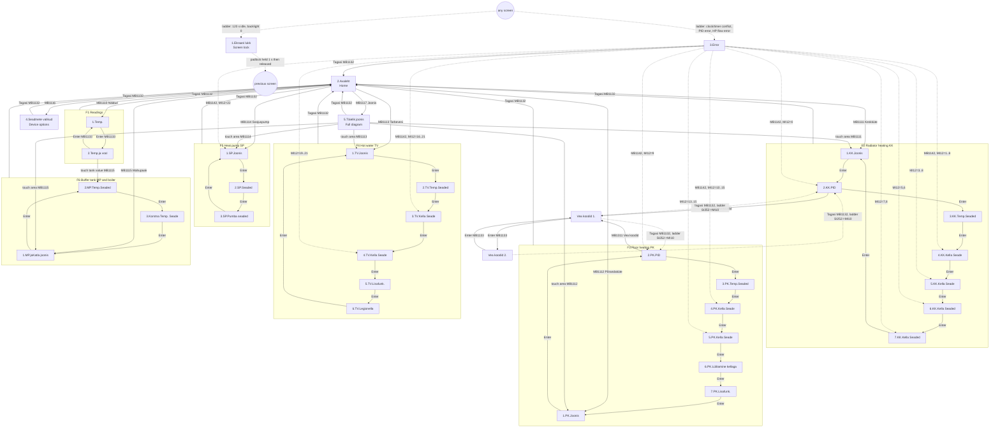

# 7. Operator interface (HMI)

## 7.1 Overview

**Panel.** The program runs on a Unitronics **V-570**. That is a colour touch panel, and its element coordinates span 320 x 240 px (`data/HW_Elements/HW_Elements.txt`). `project.txt` says `HMI_DisplayWidth = 128 / HMI_DisplayHeight = 64`. That value is stale, left over from an older panel; every display uses coordinates up to 320 x 240. The panel has no keypad screens of its own. All operator interaction goes through touch:
- `CBUTTON`s,
- touchable `VAR`s (`touch=`),
- touch rectangles,
- the built-in VisiLogic keypad that opens for keypad-entry VARs (`VarKeyPadEntry=-1`).

**Display modules.** There are 35 displays in 7 modules:

| Module | Displays | Purpose |
|---|---|---|
| `! Start-Up Module` | `1.Ekraani lukk`, `2.Avaleht`, `3.Error`, `4.Seadmete valikud`, `5.Täielik joonis`, `Vea koodid 1`, `Vea koodid 2` | Screen lock, home menu, error pop-up, plant-wide on/off switches, full plant overview, PID status-code help pages |
| `F1` | `1.Temp`, `2.Temp.ja vool` | Readings: all temperatures with min/max memories, electricity meter, water flow |
| `F2` | `1.KK.Joonis` … `7.KK.Kella Seaded` (7) | KK = keskküte, radiator heating: diagram, PID, temperature settings, 6+2 weekly clocks |
| `F3` | `1.PK.Joonis` … `7.PK.Lisafunk` (7) | PK = põrandaküte, floor heating: diagram, PID, settings, clocks and timers, clock switching, electric floor heating |
| `F4` | `1.TV.Joonis` … `6.TV.Legionella` (6) | TV = tarbevesi, domestic hot water: diagram, temperatures, clocks and timers, extra functions, Legionella disinfection |
| `F5` | `1.SP.Joonis`, `2.SP.Seaded`, `3.SP.Pumba seaded` | SP = soojuspump, heat pump: diagram, status/flow settings, circulation-pump speeds |
| `F6` | `1.MP.jaKatla joonis`, `2.MP.Temp.Seaded`, `3.Korstna Temp. Seade` | MP = mahupaak (buffer tank) and the wood boiler: diagram, tank on/off offsets, boiler-pump on/off by chimney temperature |

**"Is-displayed" flags.** Every display sets a flag while it is shown, `MB1001` … `MB1063` (`IsDisplayedOpAddress`):
- Start-up module: `MB1001`–`MB1007`
- F1: `MB1011`/`MB1012`
- F2: `MB1021`–`MB1027`
- F3: `MB1031`–`MB1037`
- F4: `MB1041`–`MB1046`
- F5: `MB1051`–`MB1053`
- F6: `MB1061`–`MB1063`

The ladder uses some of them, for example `MB1034 "F3-4.PK.Kella seade"` in `ladder/! Main Module/3-4.PK/0005.txt`.

**Common screen furniture.**
- **Standard header** (y = 0..19). Most screens have:
  - a date VAR (`VarType=5`, keypad entry, no link, so it sets the RTC date) at @2,3
  - the day of the week `SI34 "Current day - according to RTC (1-7)"` (text list) at @54,2
  - a time VAR (`VarType=5`, keypad entry, so it sets the RTC time) at @237,3
  - a battery icon `SB8 "Battery low (1=low)"` (images `0093_patarei täis` = battery full / `0052_patarei tühi` = battery empty) at @283,1
  - a screen tag TEXT such as `"F2-1"`.
- **Standard footer.**
  - `CBUTTON "Tagasi"` ("Back") → `MB1132 "Tagasi nupp"` at @8,212
  - an Enter image button (`0109_enter valge.bmp`) → `MB1133 "Enter nupp"` at @256,212
- **Clock screens** (F2-4…F2-7, F3-4, F3-5, F4-3, F4-4, F4-6) have no header. They show `SI34` and a read-only time VAR at the bottom instead.

**Screen lock and backlight** (`ladder/! Main Module/0-0. PEA LEHT/0005–0007.txt`, `0.1.Lukk`):
- Any touch (`SB16`) beeps (`SB310`) and re-triggers `T1 "Heledus taimer"`. T1 is an extended-pulse timer, 120 s (OprndPowerUp=12000).
- While T1 runs, the backlight `SI9 = 100`.
- When T1 expires, `SI9` drops by 2 every 100 ms (`SB7`), about 5 s to dark. At `SI9 = 0`, `MB1103 "tagasi luku aknasse"` (back to lock screen) jumps to `1.Ekraani lukk`.
- `MB1 "Ekraani luku välja lülitamine"` (screen lock disable, toggled on `4.Seadmete valikud`) keeps T1 running, so the panel never dims or locks.

## 7.2 Navigation

### Display jumps (from `JUMP … when= to=PAGE`)

- **Home** `hmi/! Start-Up Module/2.Avaleht`: `MB1110`→`1.Temp.`, `MB1111`→`1.KK.Joonis`, `MB1112`→`1.PK.Joonis`, `MB1113`→`1.TV.Joonis`, `MB1114`→`1.SP.Joonis`, `MB1115`→`1.MP.jaKatla joonis`, `MB1116`→`4.Seadmete valikud`, `MB1117`→`5.Täielik joonis`. All are set by CBUTTONs on the same screen.
- **Overview** `hmi/! Start-Up Module/5.Täielik joonis`: has the same jumps for `MB1111`–`MB1115`, set by five invisible touch `RECTANGLE`s laid over the diagram quadrants. Coordinates and bits:
  - KK @4,4 144x72 → `MB1111`
  - PK @4,82 → `MB1112`
  - TV @4,163 → `MB1113`
  - SP @171,5 → `MB1114`
  - MP/boiler @171,132 → `MB1115`

  `MB1132` → `2.Avaleht`.
- **Module screens** form an Enter (`MB1133`) ring. Every one of them jumps to `2.Avaleht` on `Tagasi` (`MB1132`).
  - F1: `1.Temp.` ⇄ `2.Temp.ja vool`. In `hmi/F1/2.Temp.ja vool`, touching the buffer-tank temperature value (VAR `MI202` with `touch=MB1115`) jumps to `2.MP.Temp.Seaded`.
  - F2: `1.KK.Joonis`→`2.KK.PID`→`3.KK.Temp.Seaded`→`4.KK.Kella Seade`→`5.KK.Kella Seade`→`6.KK.Kella Seaded`→`7.KK.Kella Seaded`→`1.KK.Joonis`. On `2.KK.PID`, `MB1211` (button "Vea koodid" = error codes) jumps to `Vea koodid 1.`.
  - F3: `1.PK.Joonis`→`2.PK.PID`→`3.PK.Temp.Seaded`→`4.PK.Kella Seade`→`5.PK.Kella Seade`→`6.PK.Lülitamine kellaga`→`7.PK.Lisafunk.`→`1.PK.Joonis`. On `2.PK.PID`, `MB1311` jumps to `Vea koodid 1.`.
  - F4: `1.TV.Joonis`→`2.TV.Temp.Seaded`→`3.TV.Kella Seade`→`4.TV.Kella Seade`→`5.TV.Lisafunk.`→`6.TV.Legionella`→`1.TV.Joonis`.
  - F5: `1.SP.Joonis`→`2.SP.Seaded`→`3.SP.Pumba seaded`→`1.SP.Joonis`.
  - F6: `1.MP.jaKatla joonis`→`2.MP.Temp.Seaded`→`3.Korstna Temp. Seade`→`1.MP.jaKatla joonis`.
- `3.Error` and `4.Seadmete valikud`: `MB1132` → `2.Avaleht`.
- `Vea koodid 1.` ⇄ `Vea koodid 2.` via `MB1133`. Their `Tagasi` buttons (`MB1132`) have **no display jump**. Instead, `ladder/! Main Module/0-1.Vead/0001.txt` restores the PID page: on a rising edge of `MB1132` while `SI252 "Current HMI Display Number"` = 103 or 105, it writes `SI252 := MI10 "PID akna aadres"` (PID window address). `MI10` was saved when the operator pressed "Vea koodid" (`2-2.KK/0004.txt`, `3-2.PK/0004.txt`).

### Ladder `JUMP_TO_HMI_PAGE`

| Target | Condition (net) |
|---|---|
| `1.Ekraani lukk` | `RISE MB1103` and `SI9 = 0` (backlight faded out) – `0-0. PEA LEHT/0007.txt` |
| previous page (`LOAD_LAST_HMI_PAGE`) | padlock held ≥ 1 s (`MB1101` → `T0` 1 s → `SET MB1100`), then finger lifted (`SI40 = -1`) → `MB1102` – `0.1.Lukk/0001–0004.txt` |
| `3.Error` | KK clock conflicts `MI12` = 1..8 (`2-4.KK/0006`, `2-5.KK/0006`, `2-6.KK/0006`, `2-7.KK/0006`); PK clock/timer conflicts 10..15 (`3-4.PK/0008-0009`, `3-5.PK/0008-0009`); TV clock/timer conflicts 16..21 (`4-3.TV/0008-0009`, `4-4.TV/0008-0009`); KK PID error `MI12`=0 (`K.K.seade/0028`); PK PID error 9 (`P.K.seade/0014`); heat-pump compressor emergency stop / water-flow-meter error 22 (`S.P.seade/0016`) |
| `2.KK.PID` / `2.PK.PID` | on `3.Error` (`SI252 = 100`): `RISE MB1142` with `MI12` = 0 / 9 (`0-1.Vead/0002`, `0003`) |
| `4.KK.Kella Seade`, `5.KK.Kella Seade`, `6.KK.Kella Seaded`, `7.KK.Kella Seaded` | `MI12` 1–2 / 3–4 / 5–6 / 7–8 → `MB65`/`MB66`/`MB2290`/`MB2291` (`0-1.Vead/0004-0006`) |
| `4.PK.Kella Seade`, `5.PK.Kella Seade` | `MI12` 10–12 / 13–15 → `MB67`/`MB68` (`0-1.Vead/0007-0009`) |
| `3.TV.Kella Seade`, `4.TV.Kella Seade` | `MI12` 16–18 / 19–21 → `MB69`/`MB70` (`0-1.Vead/0010-0012`) |
| `1.SP.Joonis` | `MI12` = 22 → `MB71` (`0-1.Vead/0013-0014`) |

### Navigation diagram

Solid edges are display `JUMP`s; dashed edges are ladder actions. The `3.Error` → clock-page edges are simplified, so use the table above for the exact `MI12` grouping.

**Start-up.** The start-up display is not stored as text in the dump. `1.Ekraani lukk` is display "1." of the `! Start-Up Module`, so it is presumably the power-up screen (inferred). With the padlock latched off at power-up (`MB1100` = 0), the operator must unlock first.

## 7.3 Screen catalogue

### `! Start-Up Module`

#### Screen lock ("1.Ekraani lukk") – `hmi/! Start-Up Module/1.Ekraani lukk`
- **Ladder:** `0.1.Lukk`.
  - Holding the padlock sets `MB1101 "taba vajutus"` (padlock press), which runs `T0 "Ekraani luku viide"` (screen-lock delay, 1 s).
  - When T0 elapses, `MB1100 "taba asend"` (padlock position) is set and `REFRESH_HMI_VARS` runs.
  - On release (`SI40 = -1`, no touch), `MB1102` fires `LOAD_LAST_HMI_PAGE` and `MB1100` is reset.
- **Shows:** a background image `0118_Winter-HD-Wallpaper1.bmp`; a padlock VAR @129,187 linked to `MB1100` (images `0095_stock_lock2` closed / `0096_stock_lock open2` open).
- **Operator:** touch and hold the padlock (`MB1101`).

#### Home ("2.Avaleht") – `hmi/! Start-Up Module/2.Avaleht`
- **Ladder:** none.
- **Shows:** the standard header only.
- **Buttons** (all navigation):

  | Label | English | Bit |
  |---|---|---|
  | "Näidud" | Readings | `MB1110 "Temperatuurid nupp"` |
  | "Keskküte" | Radiator heating | `MB1111` |
  | "Põrandaküte" | Floor heating | `MB1112` |
  | "Tarbevesi" | Hot water | `MB1113` |
  | "Soojuspump" | Heat pump | `MB1114` |
  | "Mahupaak" | Buffer tank | `MB1115` |
  | "Joonis" | Diagram | `MB1117` |
  | "Seadmete valikud" | Device options | `MB1116` |

- **Operator:** can set the RTC date and time from the header.

#### Error ("3.Error") – `hmi/! Start-Up Module/3.Error`
- **Ladder:** `0-1.Vead`. It is also called every scan from `0-0. PEA LEHT/0008.txt`.
- **Shows:**
  - a blinking alarm bell, VAR `SB3` with images `0094_Uni_alarm_1_off` / `0051_Uni_alarm_1_on`
  - the error text `MI11 "Errori tekstid"` (error texts, list): 1 = clock/timer conflict, 2 = heat-pump compressor emergency stop / water-meter error, 3 = PID error. These meanings are inferred from the writers; the texts themselves are in a blob.
  - the detail `MI12 "Täpsustav error"` (detail error, list): the codes in 7.2.
- **Buttons:**
  - "Veemõõtja vea nullimine" (water-meter fault reset) → `MB1140 "SP.kompressori hädaseisu nullimine"` (HP compressor emergency-stop reset). It is visible only when `MI11 = 2`: its hide bit `MB1141 "peidab nullimise nupu"` (hides the reset button) is reset when `MI11 = 2` and set otherwise (`S.P.seade/0017.txt`). It resets `T55`, `MB617` and `MB638` (`S.P.seade/0014.txt`) and clears `MI11` (`S.P.seade/0016.txt`).
  - "Tagasi vigasesse aknasse" (back to the faulty screen) → `MB1142`. Its hide bit is `MB1143 "Nupu peitmine"`. The ladder jumps listed in 7.2 follow, and the auxiliary-display error group flags `MB338`/`MB438`/`MB538`/`MB638` are reset.
  - "Tagasi" → `MB1132`.
- **Related:** `0-1.Vead/0015–0033` also blink the error group code on an auxiliary display through `O108 "Lisaekraani valgustus"` (auxiliary display backlight). Input `I92` resets these flags.

#### Device options ("4.Seadmete valikud") – `hmi/! Start-Up Module/4.Seadmete valikud`
- **Ladder:** none.
- **Shows:** a 3x2 grid of large switch images (`0124_Uni_R_off` / `0140_Uni_G_on`). Each switch toggles its own bit (inferred, see Open questions):

  | Switch | Bit |
  |---|---|
  | "Keskküte" (radiator heating) | `MB1120 "KK lüliti"` |
  | "Põrandaküte" (floor heating) | `MB1121 "PK.Lüliti"` |
  | "Tarbeveeküte" (DHW heating) | `MB1122 "TV.Lüliti"` |
  | "Soojuspump +" (heat pump) | `MB1123 "SP.Lüliti"` |
  | "ECO" | `MB1124 "ECO lüliti"` |
  | "Leg.kuumutus" (Legionella heating) | `MB1125 "Legionellatõrje reziimi lüliti"` |

- **Bottom row:**
  - a boiler air-damper button: VAR linked to `O107 "Katla õhusiiber"` with `touch=MB1126 "Õhusiibri avamine lüliti"` (damper opening switch), images `0683_nupp_valjas` / `0682_nupp_sees`. In `M.P.ja Korst.seade/0008-0009.txt`, a press opens the damper (`SET O107`) and starts `T43` (manual opening, 1 h extended pulse). A press while it is open resets `T43` when `MB59` is present.
  - a screen-lock disable toggle `MB1` (images `0626_Nupp ekraanilukk väljas` / `0607_Nuppekraanilukk sees`).
  - "Tagasi".

#### Full diagram ("5.Täielik joonis") – `hmi/! Start-Up Module/5.Täielik joonis`
- **Ladder:** `Täielik joonis`. It animates pipe arrows and pumps; `MB58` provides a 3 s blink rhythm (net 0023).
- **Shows:** a mini schematic of all circuits, each with a tag text (F2-1, F3-1, F4-1, F5-1, F6-1):
  - **KK:** valve position `MI5 "KK.Kraani asend (0-100%)"`, flow temperature `MI198 "K.kütte temp. peale korrektsiooni"` (after correction), pump `MB10`, 3-way valve `MB11`, arrows `MB12`–`MB14`, and state text `MB305 "KK lüliti peale kliima seadet ja ooterežiimi."` (KK switch after climate device and standby).
  - **PK:** `MI7`, `MI199`, pump `MB17`, valve `MB18`, arrows `MB19`–`MB21`, and switch text `MB1121`.
  - **TV:** `MI201 "T.V.Küte temp. 0-100,0°C"`, pump `MB24`, arrows `MB25`, and switch text `MB1122`.
  - **SP:** pump `MB40`, motor valve `MB41`, 3-way valve `MB42`, arrows `MB43`/`MB49`/`MB50`, flow meter animation `MI610` (images `Vee tsirk.andur 2.x`), flow `MI611 "Veemõõtja näit L/Min"`, district/transfer-loop water temperature ("trassivesi") `MI204`, and switch text `MB1123`.
  - **MP/boiler:** `MI202 "M.Paak temp. peale korrektsiooni"`, chimney `MI203`, boiler pump `MB55`, arrows `MB56`, collector arrows `MB26`–`MB29`/`MB45`–`MB48`, and heat exchanger image `0193_Soojusvaheti punane`.
- **Operator:**
  - The five touch rectangles listed in 7.2.
  - "Tagasi" (@168,212).
  - The `MI203` VAR @271,136 (chimney temperature) is keypad-enabled with limits −32768..32767; see Open questions.
- **Images:** many `MonochromaticImage`, `pump off/on 0.värviline`, `3T` valve images.

#### Error codes 1 / 2 ("Vea koodid 1." / "Vea koodid 2.") – `hmi/! Start-Up Module/Vea koodid 1`, `hmi/! Start-Up Module/Vea koodid 2`
- **Ladder:** none (the `Tagasi` handling is in `0-1.Vead/0001.txt`).
- **Shows:** static help text for the PID "Status" value shown on `2.KK.PID` / `2.PK.PID`:

  | Code | Meaning |
  |---|---|
  | 0 | PID state OK |
  | 1, 2, 3 | Auto-tune running |
  | 4 | PID running |
  | 5, 6 | Set point being changed |
  | 7 | Integral increasing |
  | 8 | Integral decreasing |
  | 9 | Pause |
  | 10, 11 | Output exceeds proportional value |
  | 12, 13 | Auto-tune parameter mismatch |
  | −1 | Proportional value zero |
  | −2 | Input range wrong |
  | −3 | Output range wrong |
  | −4 | Integral reached maximum (100 000) |
  | −5 | Auto-tune error (32 addr.) |
  | −6 | SP below/above input limits |
  | −7…−10 | Auto-tune failed to compute PID parameters |
  | −11 | Noise > 5 % of input range |

- **Buttons:** "Tagasi" (`MB1132`, top-left on page 1); Enter (`MB1133`) flips between the two pages.

### Module F1 – readings

#### Temperatures ("1.Temp.") – `hmi/F1/1.Temp`
- **Ladder:** `1-1.Temp.`
  - Room set-point state arrow `MI75` (0 = room warmer than SP+0.5, 1 = in band, 2 = colder; images `väviline nool-`, `nool+-`, `nool+`).
  - Blinking clock symbols `MB92` / `MB95` / `MB98` show that a KK / PK / TV clock is active.
  - `REFRESH_HMI_VARS` runs on their falling edge.
- **Shows** current value / min / max for each row:

  | Row | Current | Min (touch) | Max (touch) | Extra |
  |---|---|---|---|---|
  | Outdoor ("Õue") | `MI196` | `MI1150` (`MB1150`) | `MI1151` (`MB1151`) | – |
  | Room ("Toa") | `MI197` | `MI1152` (`MB1152`) | `MI1153` (`MB1153`) | – |
  | Room set point ("Toa seade") | `MI362 "Toa Seade 15,0-30,0°C"` | – | – | arrow `MI75` |
  | Radiator circuit ("K.Küte") | `MI198` | `MI1156` (`MB1156`) | `MI1157` (`MB1157`) | small value `MI310 "KK.korrigeeritud temp.(10,0-65,0°C)"` (corrected set point), clock icon `MB92` |
  | Floor circuit ("P.Küte") | `MI199` | `MI1158` (`MB1158`) | `MI1159` (`MB1159`) | `MI401 "PK. graafiku korrektsioon kellaga"` (PK curve correction by clock), clock `MB95` |
  | DHW ("T.V.Küte") | `MI201` | `MI1160` (`MB1160`) | `MI1161` (`MB1161`) | `MI503 "TV.kütte temp. kellaga, ajatu või des.temp."` (DHW temperature: by clock, timeless or disinfection), clock `MB98` |
  | Heat pump ("S.Pump") | `MI205` | `MI1168` (`MB1168`) | `MI1169` (`MB1169`) | `MI59 "SP.-le saadetava temperatuuri näit"` (temperature sent to the HP) |

- **Operator:** touching a min or max value pulses its bit. `0-0. PEA LEHT/0009–0017.txt` then **resets** that memory to the current value. The memories otherwise track the extremes every scan.

#### Temperatures and flow ("2.Temp.ja vool") – `hmi/F1/2.Temp.ja vool`
- **Ladder:** `1-2.Temp.`. `MB202 "M.Paak tähelepanu vilkumine"` (buffer-tank attention blink) blinks while any buffer-tank mode `MB122`–`MB125` is active.
- **Shows** current / min / max:

  | Row | Current | Min (touch) | Max (touch) |
  |---|---|---|---|
  | Small buffer tank ("V.M.Paak") | `MI206` | `MI1170` (`MB1170`) | `MI1171` (`MB1171`) |
  | Buffer tank ("M.Paak") | `MI202` | `MI1162` (`MB1162`) | `MI1163` (`MB1163`) |
  | Chimney ("Korsten") | `MI203` | `MI1164` (`MB1164`) | `MI1165` (`MB1165`) |
  | District/transfer-loop water ("Trassi Vesi") | `MI204` | `MI1166` (`MB1166`) | `MI1167` (`MB1167`) |

  The `MI202` value is highlighted by `MB202` (`HighlightOpAddr`) and touchable (`MB1115` jumps to `2.MP.Temp.Seaded`).

  Further rows:
  - unlabelled spare `MI207 "vaba 0-100,0°C"`
  - electricity "EL.": meter pulse indicator `MB1176 "Voolumõõtja impulss"`, instantaneous watts `MI25 "Vatid ekraanile"`, last-hour kWh `MI21 "Hetke näit Kw/h"`, min/max `MI1174`/`MI1175` (touch `MB1174`/`MB1175`)
  - water flow `MI611` L/min
  - minimum flow `MI616 "Veevoolu min. kiiruse astmed"`
- **Operator:** min/max resets as on F1-1 (`0-0. PEA LEHT/0014–0016, 0018, 0019`).

### Module F2 – radiator heating (KK)

#### KK diagram ("1.KK.Joonis") – `hmi/F2/1.KK.Joonis`
- **Ladder:** `2-1.KK`. It derives the diagram states from valve output `MI61` and pump bit `MB8`. `MB306 "Kliima tekst KK.joonistel"` (climate text) blinks when `MB1120` is on and `T3` (60 s KK block delay, climate) has elapsed.
- **Shows:**
  - valve position `MI5` (%), flow temperature `MI198`
  - pump animation `MI369` (images `pump 1.-1`…`pump 1.-2`), 3-way valve `MI368`, tees `MI365`/`MI366`/`MI367`
  - pipes `MB12`–`MB14`, `MB27`, `MB28`; radiators image `MB14` (`0055_Radikad 1` / `0056_Radikad 2`)
  - texts `MB306` (climate), `MB307 "Küte ooterežiimil"` (heating in standby), `MB305` (effective KK on/off).
- **Operator:** navigation only.

#### KK PID ("2.KK.PID") – `hmi/F2/2.KK.PID`
- **Ladder:** `2-2.KK`.
- **Shows:** hourglass `MI360 "Liivakell F2-2"` (images `Uni_hourglass_1_1…13`, `0238_graafik` = done); `MI324 "PID: PID Status"`; SP `MI310`; PV `MI198`.
- **Buttons:**
  - "Start AUTO-TUNE" → `MB1210`, which resets `MB311` and sets `MB312 "AUTO TUNE töötab"` (auto-tune running).
  - "Vea koodid" → `MB1211`, which saves `SI252` into `MI10` and jumps to `Vea koodid 1.`.

#### KK temperature settings ("3.KK.Temp.Seaded") – `hmi/F2/3.KK.Temp.Seaded`
- **Ladder:** `2-3.KK`; the manual offset logic is in `K.K.seade/0001.txt`.
- **Heading:** "Kellaga valitavate toa temperatuuride muutmine -/+3°C" (change the clock-selected room temperatures by ±3 °C).
- **Selections:**
  - **Selection 1:** `MI302 "1.Temp.muutmine +/-3,0°C"`, bar graph `ML0` (−30..30), active-clock lamp `MB90`. "MIINUS" `MB1220` / "PLUSS" `MB1222` change it by 5 (0.5 °C) within −30..+30. The hide bits `MB1221`/`MB1223` are set at the limits.
  - **Selection 2:** `MI304`, `ML1`, lamp `MB91`. Buttons `MB1224`/`MB1226`, hide bits `MB1225`/`MB1227`.
  - **Manual water temperature** ("Keskkütte vee temperatuuri käsitsi muutmine -15/+10°C võrra", manual change of KK water temperature by −15/+10 °C): `MI313` (whole degrees), bar `ML2` (data 100/−150). `MB1228`/`MB1230` change `MI300 "K.K.S.+/-"` by 10 within −150..+100. The ladder room correctors `MB300`/`MB301` and minimum-water-temperature limiters `MB347`–`MB349` also change it. Hide bits `MB1229`/`MB1231`.
- **Images:** lamps `0102_avatud kont.roh` / `0101_suletud kont.pun`.

#### KK clock settings (four screens) – `hmi/F2/4.KK.Kella Seade`, `hmi/F2/5.KK.Kella Seade`, `hmi/F2/6.KK.Kella Seaded`, `hmi/F2/7.KK.Kella Seaded`

These are "1. Temp. 1./2. aja seade" (temperature 1, time settings 1–2) and "2. Temp. 1.–6. aja seade" (temperature 2, time settings 1–6). Each screen has two clocks. Each clock has:
- an ON ("SISSE") weekday set and ON time
- an OFF ("VÄLJA") weekday set and OFF time

All of these are `VarType=6` time-function keypad VARs. Each clock also has a SET/RES status VAR, whose touch bit toggles the clock output manually.

| Display (ladder) | Clock | ON days / time | OFF days / time | Output (touch) |
|---|---|---|---|---|
| F2-4 (`2-4.KK`) | T1 C1 | `MI77`/`MI78` | `MI80`/`MI81` | `MB75` (`MB1234`) |
| | T1 C2 | `MI83`/`MI84` | `MI86`/`MI87` | `MB76` (`MB1235`) |
| F2-5 (`2-5.KK`) | T2 C1 | `MI89`/`MI90` | `MI92`/`MI93` | `MB77` (`MB1240`) |
| | T2 C2 | `MI95`/`MI96` | `MI98`/`MI99` | `MB78` (`MB1241`) |
| F2-6 (`2-6.KK`) | T2 C3 | `MI2270`/`MI2271` | `MI2273`/`MI2274` | `MB2270` (`MB1242`) |
| | T2 C4 | `MI2276`/`MI2277` | `MI2279`/`MI2280` | `MB2271` (`MB1243`) |
| F2-7 (`2-7.KK`) | T2 C5 | `MI2282`/`MI2283` | `MI2285`/`MI2286` | `MB2272` (`MB1244`) |
| | T2 C6 | `MI2288`/`MI2289` | `MI2291`/`MI2292` | `MB2273` (`MB1245`) |

- **Ladder:** `IN_DIR_DAY_OF_THE_WEEK` plus `IN_DIR_TIME(t, t+1)` gives a set pulse at the ON time and a reset pulse at the OFF time.
- **Interlock:** a temperature-1 clock cannot switch on while any temperature-2 clock is on (`MB91`), and vice versa (`MB90`). The attempt raises `3.Error` with `MI12` = 1..8.
- **Images:** status images `0634_avatud kont.roh.tekstiga` / `0638_suletud kont.pun.tekstiga`.

### Module F3 – floor heating (PK)

#### PK diagram ("1.PK.Joonis") – `hmi/F3/1.PK.Joonis`
- **Ladder:** `3-1.PK`.
- **Shows:**
  - valve position `MI7`, flow temperature `MI199`
  - pump `MI469`, 3-way valve `MI468`, tees `MI465`–`MI467`
  - pipes `MB19`–`MB21`, `MB26`, `MB28`
  - floor image `MB16 "PK.Põranda lülitamine joonisel"` (`0571_2.Põrandaküte` / `0577_3.Põrandaküte`), collector images `MB21`
  - texts `MB406 "Elektrilise PK.tekst"` (electric floor heating text, blinks when `MB1370` is on) and `MB407 "Kellaga lülitamise tekst"` (clock switching text, blinks when `MB1360` is on); `MB1121` on/off text.
- **Operator:** navigation only.

#### PK PID ("2.PK.PID") – `hmi/F3/2.PK.PID`
- **Ladder:** `3-2.PK`.
- **Shows:** hourglass `MI460`, `MI424 "PID: PID Status"`, SP `MI401`, PV `MI199`.
- **Buttons:** "Start AUTO-TUNE" `MB1310` (sets `MB412`); "Vea koodid" `MB1311` (saves `MI10`).

#### PK temperature settings ("3.PK.Temp.Seaded") – `hmi/F3/3.PK.Temp.Seaded`
- **Ladder:** `3-3.PK`.
- **Selections:**
  - **Selection 1:** `MI157 "PK.1.Temp.seade+,-"`, bar `ML10` (−15..15), lamp `MB93`. Buttons `MB1320`/`MB1322` (hide bits `MB1321`/`MB1323`).
  - **Selection 2:** `MI158`, `ML11`, lamp `MB94`. Buttons `MB1324`/`MB1326` (hide bits `MB1325`/`MB1327`).
  - **Manual correction** ("Korrektsioon"): `MI156 "PK. korrektsioon temp.+,-"`, `ML13`. Buttons `MB1328`/`MB1330` (hide bits `MB1329`/`MB1331`).
- All steps are ±1 within −10..+10. The tenths shadows are `MI407`/`MI408`/`MI406` (±10).
- **Auto-repeat:** holding a button 1 s (`T70`–`T75`) repeats the step every 100 ms.
- **Footer:** curve temperature "Graafiku temp." `MI192` (= `MI191`/10).

#### PK clock settings ("4.PK.Kella Seade", "5.PK.Kella Seade") – `hmi/F3/4.PK.Kella Seade`, `hmi/F3/5.PK.Kella Seade`

The layout is the same as the KK clock screens:

| Display (ladder) | Clock | ON days / time | OFF days / time | Output (touch) |
|---|---|---|---|---|
| F3-4 (`3-4.PK`) | T1 C1 | `MI102`/`MI103` | `MI105`/`MI106` | `MB80` (`MB1340`) |
| | T1 C2 | `MI108`/`MI109` | `MI111`/`MI112` | `MB81` (`MB1341`) |
| F3-5 (`3-5.PK`) | T2 C1 | `MI114`/`MI115` | `MI117`/`MI118` | `MB82` (`MB1350`) |
| | T2 C2 | `MI120`/`MI121` | `MI123`/`MI124` | `MB83` (`MB1351`) |

- Each screen also has a timer VAR ("1.Temp.taimer" / "2.Temp.taimer", temperature timer) with keypad entry: `T76` / `T77` (extended pulse).
- After a keypad entry completes on that screen (`SI42 = 10`, `SB94`), the timer starts and keeps temperature selection 1 / 2 active (`MB181` / `MB183`).
- When the timer is idle, the preset is cleared to 0 (`3-4.PK/0005-0006`, `3-5.PK/0005-0006`).
- Conflicts raise `3.Error` with `MI12` = 10–15.

#### PK switching by clock ("6.PK.Lülitamine kellaga") – `hmi/F3/6.PK.Lülitamine kellaga`
- **Ladder:** `3-6.PK`.
- **Shows:** switch `MB1360 "Lüliti PK.kellaga juhtimiseks"` (switch for clock control of PK, toggle); clock output `MB84` (touch `MB1361` SET/RES); ON days/time `MI480`/`MI481`; OFF days/time `MI483`/`MI484`.
- **Effect:** when `MB1360` is on, floor heating runs only while `MB84` is on (`3-1.PK/0004`, `P.K.seade/0004`).

#### PK extra functions ("7.PK.Lisafunk.") – `hmi/F3/7.PK.Lisafunk`
- **Ladder:** `3-7.PK` (empty).
- **Shows:** switch "VESI / VESI/ELEKTER" (water / water+electric) `MB1370 "Lüliti vesi PK.ja vesi/elekter PK."` (toggle).
- **Keypad values:**
  - `MI490 "EL.põrandaküte SEES"` (electric floor heating ON), range 3–6: the electric heating switches ON when the PK temperature is 3–6 °C above the KK temperature.
  - `MI492 "EL.põrandaküte VÄLJAS"` (electric floor heating OFF), range 0–2: it switches OFF at 0–2 °C above.

### Module F4 – domestic hot water (TV)

#### TV diagram ("1.TV.Joonis") – `hmi/F4/1.TV.Joonis`
- **Ladder:** `4-1.TV`.
- **Shows:**
  - DHW temperature `MI201`, district/transfer-loop water `MI204`
  - boiler image `MI525` (8 states `Boiler 12…19`: above/below 35 °C, flow, immersion heater `I87`, manual mode `I88` blinking)
  - pump `MI519`, tees `MI521`–`MI523`
  - pipes `MB25`, `MB28`–`MB32`
  - "Viimati töötas" (last ran) `DW1 "TV. pumba viimase käivituse aeg."` (UTC time of the last DHW pump start)
  - `MB1122` on/off text.

#### TV temperature settings ("2.TV.Temp.Seaded") – `hmi/F4/2.TV.Temp.Seaded`
- **Ladder:** `4-2.TV`.
- **Selections** (step 1 within 40–60 °C, auto-repeat after 1 s via `T80`–`T85`):
  - **Selection 1:** `MI161 "TV.1.Temp.seade"`, bar `ML20`, lamp `MB96`. Buttons `MB1410`/`MB1412` (hide bits `MB1411`/`MB1413`).
  - **Selection 2:** `MI162`, `ML21`, lamp `MB97`. Buttons `MB1414`/`MB1416` (hide bits `MB1415`/`MB1417`).
  - **Timeless/manual** ("Valik"): `MI160 "TV.Ajatu temp.seade"`, `ML23`. Buttons `MB1418`/`MB1420` (hide bits `MB1419`/`MB1421`).
- **Footer** "valitud temp.-dif.kraadid=lülitus temp." (selected temperature − differential = switching temperature):
  - `MI500` (active DHW target)
  - keypad `MI175 "TV. diferentsiaali muutmine (5-20°C)"` (DHW differential), range 5–20
  - result `MI501`.

#### TV clock settings ("3.TV.Kella Seade", "4.TV.Kella Seade") – `hmi/F4/3.TV.Kella Seade`, `hmi/F4/4.TV.Kella Seade`

| Display (ladder) | Clock | ON days / time | OFF days / time | Output (touch) |
|---|---|---|---|---|
| F4-3 (`4-3.TV`) | T1 C1 | `MI127`/`MI128` | `MI130`/`MI131` | `MB85` (`MB1430`) |
| | T1 C2 | `MI133`/`MI134` | `MI136`/`MI137` | `MB86` (`MB1431`) |
| F4-4 (`4-4.TV`) | T2 C1 | `MI139`/`MI140` | `MI142`/`MI143` | `MB87` (`MB1440`) |
| | T2 C2 | `MI145`/`MI146` | `MI148`/`MI149` | `MB88` (`MB1441`) |

- Timer VARs `T86` / `T87` work the same way as on the PK clock screens.
- Conflicts raise `3.Error` with `MI12` = 16–21.

#### TV extra functions ("5.TV.Lisafunk.") – `hmi/F4/5.TV.Lisafunk`
- **Ladder:** `4-5.TV`. It times heat-pump use for DHW: after `MI177` minutes it sets `MB208`, then pauses for `MI178` minutes.
- **Shows:**
  - switches "TV.Kütmise abi (SP.puhul)" (DHW heating assist with HP) `MB1450` and "TV.Küte ilma SP-ta, Elekter/mahupaak" (DHW without HP: electric/buffer tank) `MB1451` (toggles)
  - buffer-tank DHW status `MB123` (VarType 31)
- **Keypad values** ("SP.Kasutamise ajaline piiramine", time limit on heat-pump use):
  - `MI177 "TV.Lubatud kütmise aeg (SP-ga)"` (allowed heating time with HP), 30–120 min
  - `MI178 "TV.kütmise piirangu aeg (SP-ga)"` (pause), 30–120 min.

#### Legionella ("6.TV.Legionella") – `hmi/F4/6.TV.Legionella`
- **Ladder:** `4-6.TV`.
- **Shows:**
  - "Kuumutamise aja valimine" (heating time selection): weekdays `MI151`, start time `MI152` (time-function keypad); week/clock hit lamp `MB190`. `MB190` auto-resets after 12 h (`ML250` ≥ 43200 s) if no disinfection happened.
  - "Desinfitseerimise vahe nädalates" (disinfection interval in weeks): keypad `MI154`, range 1–4; elapsed counter `MI251`.
  - disinfection-active VAR `MB192` with `touch=MB1460` (manual start). A start requires `MB1125`, no manual mode `I88`, `T47`, and no `MB210`.
  - switch "Legionellareziimi lõpu paus" (pause after the Legionella mode) `MB1453` (toggle): 2 min `T25` + 20 min `T26` HP pause; blinking text `MB527`.

### Module F5 – heat pump (SP)

#### SP diagram ("1.SP.Joonis") – `hmi/F5/1.SP.Joonis`
- **Ladder:** `5-1.SP`.
- **Shows:**
  - sun image `0073_Päike`
  - flow `MI611`, minimum flow `MI616`, flow-meter animation `MI610`
  - HP temperature `MI205`, small buffer tank `MI206` and its image `MI626`
  - pump `MI619`, valves `MI617`/`MI618`, tees `MI622`/`MI629`
  - booster heater `MI625`, heat-pump image `MI623`
  - mode text `MI58 "Tööreziimi näit (F5-1)"` (operating mode display: 0 off / 1 on / 2 Legionella pause)
  - pipes `MB28`, `MB34`, `MB35`, `MB39`, `MB43`–`MB50`, `MB60`.
- **Operator:** hand-valve symbols are touchable. `MI630` with `touch=MB1511` toggles `MB61 "F5-1 käsikraanid (1 ja 2 lahti/kinni)"` (hand valves 1 and 2 open/closed). `MI632` with `touch=MB1512` toggles `MB62` (hand valves 3–5) (`5-1.SP/0013`). These only change the diagram.

#### SP settings ("2.SP.Seaded") – `hmi/F5/2.SP.Seaded`
- **Ladder:** `5-2.SP`.
- **Heat-pump mode** ("Soojuspumba töö reziim"):
  - `MI50` (list: 0 idle, 1 KK/PK, 2 TV, 3 Legionella pause)
  - `MI51 "SP.analoog sisendi temp."` (HP analog input temperature, 10–60 °C)
  - `MI56` (Legionella pause minutes left)
- **Defrost booster** ("Sulatuse lisaküte"): text `MI52` (list); remaining minutes `MI53`; hourglasses linked to `MI55`.
- **Minimum water flow** ("Vee voolu min. kiiruse valimine"):
  - `MI611` L/min, `MI612` Hz
  - blinking warning text `MB615`
  - keypad `MI616`, range 50–200
  - flow-meter block toggle `MB1510 "F5-1Veevoolumõõtja blokeerimine"` (images `0614_nupp ok` / `0616_blokk nupp`).

#### SP pump settings ("3.SP.Pumba seaded") – `hmi/F5/3.SP.Pumba seaded`
- **Ladder:** `5-3.SP`.
- **Circulation-pump speed** (10–100 %, step 10):
  - in KK/PK position: `MI671`, bar `ML30`, lamp `MB118`. Buttons `MB1520`/`MB1522` (hide bits `MB1521`/`MB1523`).
  - in TV position: `MI672`, `ML31`, lamp `MB119`. Buttons `MB1524`/`MB1526` (hide bits `MB1525`/`MB1527`).
- **Extra degrees for the HP input** ("SP.lisakraadid"): `MI676`, 0–5, step 1, `ML33`. Buttons `MB1530`/`MB1532` (hide bits `MB1531`/`MB1533`).
- **Also shows:** flow `MI611`.

### Module F6 – buffer tank (MP) and boiler

#### MP and boiler diagram ("1.MP.jaKatla joonis") – `hmi/F6/1.MP.jaKatla joonis`
- **Ladder:** `6-1.MP`.
- **Shows:**
  - tank `MI171` (10 images `10.mahupaak…17.mahupaak`: electric heater `I89`, boiler pump, `MB122`) and tank temperature `MI202`
  - boiler `MI170` (`Katel 3.-0…Katel 2`), boiler pump `MI169`, chimney images `korsten1-3`, chimney temperature `MI203` (keypad-enabled, see Open questions)
  - air damper `O107` (`õhu siiber suletud/avatud`, closed/open)
  - "Viimati töötas" (last ran) `DW2 "Katla pumba viimase käivituse aeg."` (boiler pump last start time)
  - tee `MI172`, arrows `MB45`/`MB46`/`MB48`/`MB56`.

#### MP temperature settings ("2.MP.Temp.Seaded") – `hmi/F6/2.MP.Temp.Seaded`
- **Ladder:** `6-2.MP`. It copies `MI164`/`MI165` into the bars `ML40`/`ML41`.
- **Heading:** "Mahupaagi SISSE ja VÄLJA lülitamise temperatuuri seaded" (buffer-tank switch-in/out temperature settings).
- **Keypad values:**
  - "SISSE" (in): `MI164 "MP.SISSE lülitamise temp.seade"` (MP switch-in set point), 15–30. These are degrees added to the temperature required for heating before the tank is switched in. Lamp `MB122`.
  - "VÄLJA" (out): `MI165 "MP.VÄLJA lülitamise temp.seade"` (MP switch-out set point), 5–15. These are the minimum extra degrees for DHW heating. Lamp `MB123`.
- **Bottom toggle:** `MB125 "MP manuaal blokeering"` (MP manual block; images `0789_mp_blokeering` / `0724_mp_blokeeritud`).

#### Chimney temperature setting ("3.Korstna Temp. Seade") – `hmi/F6/3.Korstna Temp. Seade`
- **Ladder:** `6-3.Korsten`. It copies the set points into `ML45`/`ML46`.
- **Heading:** "Katla pumba SISSE ja VÄLJA lülitamise temperatuuri seaded" (boiler-pump switch-on/off temperature settings).
- **Keypad values:** `MI167` ON, 40–70 °C; `MI168` OFF, 35–55 °C.
- **Shows:** boiler-pump output lamp `O104 "Katla pump sees/väljas"`.

## 7.4 Operator parameter table

Power-up column: "retained" means the operand has no `OprndEnablePowerUp` in `operands.txt`, so it keeps its last value. Only `MI300` is forced at start-up (to 0). Ranges come from VAR `data=` limits or from the ladder clamps.

### Keypad-entry values

| Operand | Screen | Meaning | Range / unit | Power-up |
|---|---|---|---|---|
| RTC date / time (`VarType=5`, no operand) | header of all screens with header | set PLC clock | date / hh:mm | RTC |
| `MI77`,`MI78`,`MI80`,`MI81`,`MI83`,`MI84`,`MI86`,`MI87` | `hmi/F2/4.KK.Kella Seade` | KK temperature-1 clocks 1–2: ON/OFF weekdays and times | weekday set / time | retained |
| `MI89`,`MI90`,`MI92`,`MI93`,`MI95`,`MI96`,`MI98`,`MI99` | `hmi/F2/5.KK.Kella Seade` | KK temperature-2 clocks 1–2 | " | retained |
| `MI2270`,`MI2271`,`MI2273`,`MI2274`,`MI2276`,`MI2277`,`MI2279`,`MI2280` | `hmi/F2/6.KK.Kella Seaded` | KK temperature-2 clocks 3–4 | " | retained |
| `MI2282`,`MI2283`,`MI2285`,`MI2286`,`MI2288`,`MI2289`,`MI2291`,`MI2292` | `hmi/F2/7.KK.Kella Seaded` | KK temperature-2 clocks 5–6 | " | retained |
| `MI102`,`MI103`,`MI105`,`MI106`,`MI108`,`MI109`,`MI111`,`MI112` | `hmi/F3/4.PK.Kella Seade` | PK temperature-1 clocks | " | retained |
| `MI114`,`MI115`,`MI117`,`MI118`,`MI120`,`MI121`,`MI123`,`MI124` | `hmi/F3/5.PK.Kella Seade` | PK temperature-2 clocks | " | retained |
| `MI480`,`MI481`,`MI483`,`MI484` | `hmi/F3/6.PK.Lülitamine kellaga` | PK on/off by clock | " | retained |
| `MI127`,`MI128`,`MI130`,`MI131`,`MI133`,`MI134`,`MI136`,`MI137` | `hmi/F4/3.TV.Kella Seade` | TV temperature-1 clocks | " | retained |
| `MI139`,`MI140`,`MI142`,`MI143`,`MI145`,`MI146`,`MI148`,`MI149` | `hmi/F4/4.TV.Kella Seade` | TV temperature-2 clocks | " | retained |
| `MI151`, `MI152` | `hmi/F4/6.TV.Legionella` | Legionella weekdays / start time | " | retained |
| `T76` / `T77` | `hmi/F3/4.PK.Kella Seade` / `hmi/F3/5.PK.Kella Seade` | PK temperature-1 / -2 run timer (TE) | time | preset 0, ladder-cleared when idle |
| `T86` / `T87` | `hmi/F4/3.TV.Kella Seade` / `hmi/F4/4.TV.Kella Seade` | TV temperature-1 / -2 run timer (TE) | time | " |
| `MI490` | `hmi/F3/7.PK.Lisafunk` | electric floor heating ON: PK − KK difference | 3–6 °C | retained |
| `MI492` | `hmi/F3/7.PK.Lisafunk` | electric floor heating OFF difference | 0–2 °C | retained |
| `MI175` | `hmi/F4/2.TV.Temp.Seaded` | DHW switching differential | 5–20 °C | retained |
| `MI177` | `hmi/F4/5.TV.Lisafunk` | allowed DHW heating time with HP | 30–120 min | retained |
| `MI178` | `hmi/F4/5.TV.Lisafunk` | HP pause after DHW heating | 30–120 min | retained |
| `MI154` | `hmi/F4/6.TV.Legionella` | disinfection interval | 1–4 weeks | retained |
| `MI616` | `hmi/F5/2.SP.Seaded` | minimum water flow (HP flow alarm threshold) | 50–200 (unit unclear) | retained |
| `MI164` | `hmi/F6/2.MP.Temp.Seaded` | MP switch-in extra degrees | 15–30 °C | retained |
| `MI165` | `hmi/F6/2.MP.Temp.Seaded` | MP min extra degrees for DHW | 5–15 °C | retained |
| `MI167` | `hmi/F6/3.Korstna Temp. Seade` | boiler pump ON (chimney temperature) | 40–70 °C | retained |
| `MI168` | `hmi/F6/3.Korstna Temp. Seade` | boiler pump OFF (chimney temperature) | 35–55 °C | retained |
| `MI203` | `hmi/F6/1.MP.jaKatla joonis`, `hmi/! Start-Up Module/5.Täielik joonis` | chimney temperature after correction (keypad enabled, probably by mistake) | −32768..32767 | overwritten every scan |

### Values changed with MIINUS / PLUSS buttons

| Operand | Buttons (− / +) | Screen | Meaning | Range / step | Power-up |
|---|---|---|---|---|---|
| `MI302` (→`ML0`) | `MB1220` / `MB1222` | `hmi/F2/3.KK.Temp.Seaded` | KK room temperature selection 1 offset | −30..+30 (0.1 °C), step 5 | retained |
| `MI304` (→`ML1`) | `MB1224` / `MB1226` | " | KK selection 2 offset | −30..+30, step 5 | retained |
| `MI300` (→`ML2`) | `MB1228` / `MB1230` | " | KK water temperature manual offset | −150..+100 (0.1 °C), step 10 | **0** (`OprndEnablePowerUp=-1`) |
| `MI157` (→`ML10`) | `MB1320` / `MB1322` | `hmi/F3/3.PK.Temp.Seaded` | PK selection 1 offset | −10..+10 °C, step 1, auto-repeat | retained |
| `MI158` (→`ML11`) | `MB1324` / `MB1326` | " | PK selection 2 offset | " | retained |
| `MI156` (→`ML13`) | `MB1328` / `MB1330` | " | PK manual correction | " | retained |
| `MI161` (→`ML20`) | `MB1410` / `MB1412` | `hmi/F4/2.TV.Temp.Seaded` | DHW temperature selection 1 | 40–60 °C, step 1, auto-repeat | retained |
| `MI162` (→`ML21`) | `MB1414` / `MB1416` | " | DHW selection 2 | " | retained |
| `MI160` (→`ML23`) | `MB1418` / `MB1420` | " | DHW timeless (manual) temperature | " | retained |
| `MI671` (→`ML30`) | `MB1520` / `MB1522` | `hmi/F5/3.SP.Pumba seaded` | HP circulation pump speed, KK/PK | 10–100 %, step 10 | retained |
| `MI672` (→`ML31`) | `MB1524` / `MB1526` | " | HP circulation pump speed, TV | 10–100 %, step 10 | retained |
| `MI676` (→`ML33`) | `MB1530` / `MB1532` | " | extra degrees on HP input | 0–5, step 1 | retained |

### Toggle switches (binary-image VARs, self-toggling – inferred)

| Operand | Screen | Meaning | Power-up |
|---|---|---|---|
| `MB1120` | `hmi/! Start-Up Module/4.Seadmete valikud` | radiator heating enable | retained |
| `MB1121` | " | floor heating enable | retained |
| `MB1122` | " | DHW heating enable | retained |
| `MB1123` | " | heat pump enable | retained |
| `MB1124` | " | ECO mode | retained |
| `MB1125` | " | Legionella mode enable | retained |
| `MB1` | " | disable screen lock / backlight dimming | retained |
| `MB1360` | `hmi/F3/6.PK.Lülitamine kellaga` | PK controlled by clock | retained |
| `MB1370` | `hmi/F3/7.PK.Lisafunk` | PK water vs water+electric | retained |
| `MB1450` | `hmi/F4/5.TV.Lisafunk` | DHW heating assist (with HP) | retained |
| `MB1451` | " | DHW heating without HP (electric/tank) | retained |
| `MB1453` | `hmi/F4/6.TV.Legionella` | HP pause after Legionella mode | retained |
| `MB1510` | `hmi/F5/2.SP.Seaded` | block water-flow meter supervision | retained |
| `MB125` | `hmi/F6/2.MP.Temp.Seaded` | buffer tank manual block | retained |

### Momentary touch commands

| Bit | Screen | Effect |
|---|---|---|
| `MB1110`–`MB1117`, `MB1132`, `MB1133`, `MB1211`, `MB1311` | various | navigation (7.2) |
| `MB1101` | `hmi/! Start-Up Module/1.Ekraani lukk` | unlock (hold 1 s) |
| `MB1126` | `hmi/! Start-Up Module/4.Seadmete valikud` | open boiler air damper `O107` for up to 1 h (`T43`) |
| `MB1140` | `hmi/! Start-Up Module/3.Error` | reset HP compressor emergency stop / flow-meter error |
| `MB1142` | `hmi/! Start-Up Module/3.Error` | go back to the screen that caused the error |
| `MB1150`–`MB1153`, `MB1156`–`MB1161`, `MB1168`, `MB1169` | `hmi/F1/1.Temp` | reset min/max memory to the current value |
| `MB1162`–`MB1167`, `MB1170`, `MB1171`, `MB1174`, `MB1175` | `hmi/F1/2.Temp.ja vool` | " |
| `MB1210` / `MB1310` | `hmi/F2/2.KK.PID` / `hmi/F3/2.PK.PID` | start PID auto-tune |
| `MB1234`, `MB1235`, `MB1240`–`MB1245` | F2-4…F2-7 | manual SET/RES of a KK clock output |
| `MB1340`, `MB1341`, `MB1350`, `MB1351`, `MB1361` | F3-4, F3-5, F3-6 | manual SET/RES of PK clock outputs |
| `MB1430`, `MB1431`, `MB1440`, `MB1441` | F4-3, F4-4 | manual SET/RES of TV clock outputs |
| `MB1460` | `hmi/F4/6.TV.Legionella` | start tank disinfection manually |
| `MB1511`, `MB1512` | `hmi/F5/1.SP.Joonis` | toggle hand-valve symbols `MB61`/`MB62` (diagram only) |

## 7.5 Open questions

1. **Opaque texts.** The list/range texts are in `Binary` blobs and are not decoded:
   - `SI34` day names, `MI11` error texts, `MI12` detail texts (`hmi/! Start-Up Module/3.Error`)
   - `MI50`, `MI52` (`hmi/F5/2.SP.Seaded`), `MI58` (`hmi/F5/1.SP.Joonis`)
   - all binary-text VARs (`MB305`, `MB306`, `MB307`, `MB406`, `MB407`, `MB527`, `MB615`, `MB1121`/`MB1122`/`MB1123` on the diagrams)
   - the `VarType=31` VARs `MB1176` (`hmi/F1/2.Temp.ja vool`) and `MB123` (`hmi/F4/5.TV.Lisafunk`).

   The meanings given above come from operand descriptions and the ladder writers.
2. **Toggle switches.** The 14 switch VARs in 7.4 have no `touch=` operand and no ladder writer. They all share settings blob `sha1:034177461852`, which differs from the indicator VARs (`4886799741a8`). It is inferred that this blob configures "touch toggles the linked bit". This needs confirming in VisiLogic.
3. **Display numbers and `SI252`.** The error-return logic tests `SI252` = 100 (`3.Error`) and 103 / 105 (`Vea koodid 1.` / `2.`). Display numbers are not in the dump. Also, `SI252` is described as "Standard Vision only" while the PLC is a V-570 (Enhanced). If `SI252` is not maintained on this panel:
   - the `3.Error` "Tagasi vigasesse aknasse" button does nothing;
   - the `Vea koodid` "Tagasi" buttons, which have no display `JUMP`, cannot leave those pages. The lock-screen timeout's `LOAD_LAST_HMI_PAGE` would return there too.
4. **Wrong hide bit (probable bug).** `ladder/! Main Module/3-3.PK/0002.txt` drives `MB1221` (the F2-3 hide bit) instead of `MB1321`. `MB1321` has no writer, so the PK selection-1 MIINUS button on `hmi/F3/3.PK.Temp.Seaded` never hides.
5. **Hide bit never set.** `MB1143 "Nupu peitmine"` (`hmi/! Start-Up Module/3.Error`) is never written, so "Tagasi vigasesse aknasse" is always visible, even when `MI12` is stale.
6. **Wrong hourglass operand (probable bug).** On `hmi/F5/2.SP.Seaded`, both hourglasses link `MI55` (defrost booster). The Legionella-pause hourglass `MI57`, animated by `5-2.SP/0003-0004`, is never displayed.
7. **Keypad on a measured value.** `MI203` (chimney temperature) is keypad-enabled with no limits on `hmi/F6/1.MP.jaKatla joonis` and `hmi/! Start-Up Module/5.Täielik joonis`. `0-0. PEA LEHT/0002.txt` overwrites it every scan, so this is probably an editing leftover.
8. **Start-up screen.** The start-up display is not explicit in the dump. After unlocking at power-up, the `LOAD_LAST_HMI_PAGE` target is undefined.
9. **`MI616` unit and limits.** The limits are given as `data=D#200 data=D#50` (reversed order), and the unit ("astmed" = steps vs L/min on F1-2) is unclear. The other reversed `data=` pairs (`MI165`, `MI167`, `MI168`, bars `ML2`, `ML13`, `ML23`, `ML40`, `ML41`, `ML45`, `ML46`) are assumed to be min/max in either order.
10. **Inferred field meanings.** `op5=` is read as the visibility/hide operand (`VisibleOpAddr`). This is consistent with the "peitmine" (hiding) descriptions and the ladder setting the bit at the limits. `op6=` is `HighlightOpAddr` (`MB202` on `hmi/F1/2.Temp.ja vool`).
11. **Clock subroutines run twice per scan while shown.** `2-4.KK`…`2-7.KK`, `3-4.PK`…`3-6.PK`, `4-3.TV`…`4-6.TV` and `0-1.Vead` are linked to their displays and are also called every scan from `0-0. PEA LEHT/0008.txt`. So they run regardless of the screen, and twice while it is shown. Edge contacts should make the second pass harmless, but this is unverified.
12. **Minor display leftovers.**
    - `hmi/F1/2.Temp.ja vool` shows `MI207 "vaba"` (spare) without a label.
    - `hmi/! Start-Up Module/5.Täielik joonis` has a duplicated `TEXT "F2-1"` at the same position.
    - `project.txt` panel size (128x64) does not match the V-570 layout (320x240).

Not verified: the images, and the ladder behind the device switches (ECO, Legionella, KK/PK/TV/SP enables) beyond what these screens show. The biggest risk: if `SI252` does nothing on the V-570, the "back to faulty screen" logic and the error-code pages' Back buttons do not work.
